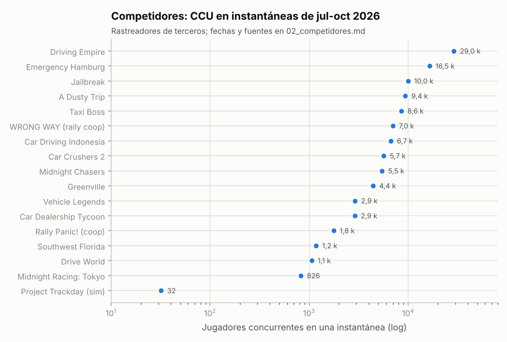

# Informe 1.2 y 1.3 — Competidores y críticas de los jugadores

> **Fecha de referencia:** 22-10-2026. Fuentes consultadas el 22-10-2026.
> **Etiquetas:** [OBS] observado · [EST] estimación propia · [HIP] hipótesis.
> **Advertencia importante:** las APIs de Roblox, Rolimons y Reddit están bloqueadas por la red de este entorno. Las cifras proceden de rastreadores de terceros (Rolimons, RoWatcher, Rotrends, Earnaldo, profitable.app) **leídos a través de extractos de buscador**. Son **instantáneas** de fechas distintas, no medias. **Nunca** hemos convertido visitas acumuladas en jugadores activos. Tampoco hemos construido series históricas: no tenemos datos para ello.

---

## Resumen ejecutivo

- Analizamos **19 títulos** (17 con cifras): 8 de los solicitados y 11 más que aparecieron durante la investigación.
- El líder indiscutible es **Driving Empire (Voldex)**: ~25 k CCU de media a 30 días, récord de **89.566** el 15-08-2026 y 3.368 M de visitas. Sus armas son el catálogo enorme, las licencias (Porsche, NASCAR…) y las actualizaciones semanales.
- Los **juegos centrados en carreras** tienen las **mejores valoraciones** del género (Midnight Chasers, **97,5 %**), pero una concurrencia modesta (4-7 k).
- Los **veteranos sin actualizaciones caen**: Vehicle Legends, Drive World y Car Dealership Tycoon están muy por debajo de sus picos.
- **Novedad de octubre de 2026:** dos juegos de *rally* cooperativo (WRONG WAY y Rally Panic!) demuestran que la conducción con amigos y con roles puede viralizarse en días.
- **Las 5 quejas de mayor impacto** que debemos resolver: conducir sin rumbo, carreras que se abandonan a medias, progresión lenta o abusiva, sensación de *pay-to-win* y controles o rendimiento deficientes en móvil.

---

## 1. Metodología

1. **Selección:** los 8 títulos solicitados más los que aparecen de forma recurrente en listados de juegos de conducción en Roblox en 2026, incluidos los adyacentes con persecuciones (Jailbreak, Emergency Hamburg).
2. **Métricas:** CCU en instantánea, visitas, favoritos, pico histórico, valoración, tiempo medio de juego, actualizaciones recientes, monetización observable y quejas documentadas.
3. **DAU estimado [EST]:** DAU ≈ CCU medio × 1.440 / minutos diarios por jugador.
   - Como la instantánea no es la media diaria y los minutos diarios no son públicos, damos un **rango**: DAU ≈ CCU × **45-90**. El rango equivale a 16-32 minutos diarios por jugador; la mediana de GameAnalytics es de 22,4.
   - Es una estimación de **orden de magnitud**.
4. **Retención:** ningún competidor publica D1/D7. Usamos **indicadores indirectos** (no causales):
   - favoritos por cada 1.000 visitas;
   - tiempo medio de juego;
   - años de vida;
   - estabilidad del CCU frente a su pico.
5. **Fiabilidad de las fuentes:** Rolimons y RoWatcher son rastreadores automáticos y suelen ser más fiables. Earnaldo, profitable.app y las webs de códigos tienen fiabilidad baja o media. Rotrends anunció su cierre el 31-08-2026, así que sus datos pueden estar congelados.

---

## 2. Tabla comparativa

| # | Juego (estudio) | Subgénero | CCU instantánea [OBS] | Fecha y fuente | Pico histórico | Visitas | Favoritos | Valoración | DAU estimado [EST] |
|---|---|---|---|---|---|---|---|---|---|
| 1 | **Driving Empire** (Voldex) | Rol de conducción en mundo abierto | 29.001 (media de 30 días ≈ 25 k) | Rolimons ≈ 18-10-2026; RoWatcher | **89.566** (15-08-2026) | 3.368 M | n. d. | n. d. | 1,1-2,3 M |
| 2 | **Emergency Hamburg** | Rol policial y de emergencias | 16.460 | RoWatcher, sin fecha | 84,1 k | 1.220-1.400 M | n. d. | n. d. | 0,7-1,5 M |
| 3 | **Jailbreak** (Badimo) | Policías y ladrones con vehículos | ≈ 9-11 k | RoWatcher / AllThingsHow, jul-ago 2026 | 173 k (sin confirmar) | ≈ 7.989 M | ≈ 19 M | n. d. | 0,4-1,0 M |
| 4 | **A Dusty Trip** (Jandel's Road Trip) | Viaje cooperativo de supervivencia | ≈ 9,4-16 k | Rotrends / otros, jul-ago 2026 | 58 k (RoWatcher) frente a 435,5 k (Rotrends): **en conflicto** | ≈ 2.500 M | ≈ 2,2 M | n. d. | 0,4-1,4 M |
| 5 | **Taxi Boss** | Tycoon de conducción | 8.555 | Rolimons, sin fecha | 20,7 k | 842 M | 1,41 M | 93,7 % | 0,4-0,8 M |
| 6 | **WRONG WAY** (Fried Brain Studios) | Rally cooperativo para 2 | 7.000 | RoWatcher, oct-2026 | **14 k (12-10-2026)** | 4,1 M | n. d. | n. d. | 0,3-0,6 M |
| 7 | **Car Driving Indonesia** (CDID) | Rol de conducción (Indonesia) | 6,7-13 k | Earnaldo, jul-sep 2026 | n. d. | 426-433 M | 370 k | n. d. | 0,3-1,2 M |
| 8 | **Car Crushers 2** | Física y destrucción | 5.679 | Rotrends, sin fecha | 22,9 k | 1.400 M | n. d. | n. d. | 0,25-0,5 M |
| 9 | **Midnight Chasers: Highway Racing** | Carreras de autopista | 5.455 (media de 14 días ≈ 4 k) | Rotrends, sep-2026 | 16,8 k | 308,8 M | 6,5 M | **97,5 %** | 0,2-0,5 M |
| 10 | **Greenville** | Rol de conducción realista | 4.442 (pico de 24 h: 9 k) | Rolimons, sin fecha | 34.133 (dic-2025) / 74,7 k (Rotrends) | 1.411 M | 2,6 M | 87,8 % | 0,2-0,4 M |
| 11 | **Vehicle Legends** (QuadraTech) | Mundo abierto + carreras | 2.910 | Rolimons; rastreador del 7-7-2026 (≈ 3 k) | 29,7 k | 1.900 M | 2,7 M | 94,4 % | 0,13-0,26 M |
| 12 | **Car Dealership Tycoon** | Tycoon de concesionario | 2.891 | Rolimons, sin fecha | 66.726 (16-09-2023) | 2.510 M | n. d. | n. d. | 0,13-0,26 M |
| 13 | **Rally Panic!** | Rally cooperativo para 2 | 1.773 | Earnaldo, 12-10-2026 | n. d. | 1,7 M | n. d. | n. d. | 0,08-0,16 M |
| 14 | **Southwest Florida** (Strigid) | Rol realista | ≈ 1.180 (media de 14 días ≈ 1,2 k) | Rotrends, ≤ ago-2026 | 29,5 k | 779 M | n. d. | 90,2 % | 0,05-0,1 M |
| 15 | **Drive World** (Twin Atlas; antes *Driving Simulator*) | Tuning, derrapes, carreras | 1.063 | Rotrends, ≤ ago-2026 | 24,6 k | 499 M | 6,8 M | 93,7 % | 0,05-0,1 M |
| 16 | **Midnight Racing: Tokyo** | Carreras callejeras (Tokio) | 826 | RoWatcher, 2026 | 3 k (abr-2026) | n. d. | n. d. | ≈ 90 % | 0,04-0,07 M |
| 17 | **Project Trackday** (devGem) | Simulación de circuito | 32 | RoWatcher, 2026 | 408 (abr-2026) | 45,2 M | n. d. | n. d. | < 3 k |
| 18 | **Ultimate Driving** (TwentyTwoPilots; antes *Westover Islands*) | Rol de conducción veterano | **n. d.** (no hallamos cifra actual) | — | n. d. | > 100 M (dato de 2021) | n. d. | n. d. | n. d. |
| 19 | **DRIVE X**, **Pacifico 2** y otros | Mundo abierto y carreras | n. d. | — | — | — | — | — | — |

*Gráfico: instantáneas de CCU (escala logarítmica). Fechas y fuentes en la tabla anterior.*

### 2.1 Indicador indirecto de compromiso: favoritos por cada 1.000 visitas [EST]

| Juego | Favoritos / 1.000 visitas |
|---|---|
| Midnight Chasers | **21,0** |
| Drive World | **13,6** |
| Vehicle Legends | 1,4 |
| Greenville | 1,8 |
| Taxi Boss | 1,7 |
| Jailbreak | 2,4 |
| A Dusty Trip | 0,9 |
| Car Driving Indonesia | 0,9 |

**Lectura con cautela:** los dos juegos **centrados en conducir rápido y en el tuning** (Midnight Chasers y Drive World) tienen una proporción de favoritos por visita **un orden de magnitud mayor** que los juegos de rol. Esto **no prueba causalidad**:

- la proporción depende de la época (los juegos más recientes acumulan visitas en una plataforma con otros hábitos de «favorito»);
- depende del público;
- depende de los incentivos («dale a favorito por un código»).

Aun así, es coherente con la tesis de que el público de las carreras se vincula intensamente con el juego que le gusta.

---

## 3. Perfiles de los competidores

### 3.1 Driving Empire (Voldex) — el líder

| Métrica | Información |
|---|---|
| Antigüedad | En el catálogo desde hace años (fecha exacta no verificada); adquirido por Voldex |
| Popularidad | 3.368 M de visitas ([Rolimons](https://www.rolimons.com/game/3351674303)) |
| Actividad | 29.001 CCU (≈ 18-10-2026). Media de 7 días: 24 k; de 30 días: 25 k; −31 % en 30 días frente a −9 % de la plataforma ([RoWatcher](https://rowatcher.com/games/1202096104/driving-empire-ram-debut/dying)). Récord: 89.566 el 15-08-2026 |
| DAU estimado | 1,1-2,3 M [EST] |
| Comunidad | n. d. (Discord y grupo no accesibles desde este entorno) |
| Retención | Sin datos públicos. Recupera picos con cada actualización de marca [EST] |
| Monetización | Pases con coche + multiplicador de dinero (p. ej., «[PORSCHE UPD]» a 500 R$: +50 % de dinero al conducir + Apollo IE ([Rolimons](https://www.rolimons.com/gamepass/9614957))). Históricamente, un trabajo de policía bloqueado tras pase ([Sportskeeda](https://sportskeeda.com/roblox-news/what-jobs-can-players-take-roblox-driving-empire)). En 2023, una **caja *premium* de 649 R$** con 13 coches exclusivos provocó rechazo y se retiró ([wiki](https://roblox.fandom.com/wiki/Driving_Empire_by_Voldex/Driving_Empire)) |
| Jugabilidad | Mundo abierto, 300+ coches y barcos, tuning, rol, trabajos (seguridad y forajidos desde abril de 2026), carreras en 5 sedes (arrancadas, autopista, *sprint*, óvalo) |
| Diferenciación | Catálogo, **licencias** (Porsche, Pagani, NASCAR desde feb-2026, RAM, Rivian…) ([wiki de licencias](https://drivingempire.fandom.com/wiki/Category:Licensed_Vehicles); [NASCAR](https://www.nascar.com/?p=500255)) y cadencia semanal |
| Debilidades | Carreras «desactivadas por errores» según la wiki (nota de dic-2025; no verificado si persiste). Modelo de dinero orientado a multiplicadores. Una plataforma tan amplia tiene un bucle de carrera menos pulido [EST] |
| Actualizaciones | Muy frecuentes: 9-10-2026 (RAM), 16-10-2026 (servidores personalizados en beta, remolques) ([Zing](https://zing.co.uk/industry-resources/roblox/experience/1202096104-driving-empire/); Rolimons) |
| Valoración | n. d. |

**Implicación:** no competir con Driving Empire en catálogo ni en marcas. Sí competir en **calidad del bucle de carrera**, **justicia** y **social**.

### 3.2 Car Dealership Tycoon

| Métrica | Información |
|---|---|
| Popularidad | ≈ 2.510 M de visitas ([Rolimons](https://www.rolimons.com/game/1554960397)) |
| Actividad | 2.891 CCU (instantánea sin fecha); pico de 66.726 (16-09-2023). **Muy por debajo del pico** |
| DAU estimado | 0,13-0,26 M [EST] |
| Retención | Tiempo medio de juego de 15,7 min (Rolimons) |
| Monetización | **Pase de temporada a 399 R$**, Elite a 599 R$ (salta 10 niveles), paquete de temporada actual y futuras a 1.599 R$ (temporada 14, nov-2024) ([Sportskeeda](https://sportskeeda.com/roblox-news/car-dealership-tycoon-season-14-pass-all-rewards-price)); pase de colores especiales a 80 R$ ([Rolimons](https://www.rolimons.com/gamepass/6553376)) |
| Jugabilidad | Tycoon: construir concesionario, comprar y vender coches, conducir, carreras, temporadas («Classic Car Season 26») ([registro de actualizaciones](https://car-dealership-tycoon.fandom.com/wiki/Updates_Log)) |
| Diferenciación | Fantasía de negocio; colaboraciones (Monster Jam, [Feld Entertainment](https://www.feldentertainment.com/monster-jam-roars-into-roblox-with-car-dealership-tycoon/)) |
| Debilidades | Declive fuerte desde 2023 [OBS]; el bucle tycoon se agota [HIP] |
| Actualizaciones | Actualización de Halloween el 17-10-2026 ([YouTube](https://www.youtube.com/watch?v=jAxCRjGrx_I)) |

### 3.3 Vehicle Legends (QuadraTech)

| Métrica | Información |
|---|---|
| Popularidad | 1.900 M de visitas; 2,7 M de favoritos; 94 % de valoración ([profitable.app](https://profitable.app/roblox/games/vehicle-legends-cars)) |
| Actividad | ≈ 3 k CCU (7-7-2026), bajando de ~4 k a ~2,7 k entre el 24-6 y el 6-7; pico histórico de 29,7 k ([Rotrends](https://rotrends.com/game/1480782352)) |
| Retención | Tiempo medio de juego de 13,06 min (Rolimons) |
| Monetización | No verificada en esta sesión |
| Jugabilidad | Mundo abierto con carreras y zonas variadas; licencia de Porsche anunciada hace años ([X](https://x.com/VehicleLegends)) |
| Debilidades | Última actualización el 5-6-2026 a fecha del rastreador: **cadencia lenta** [OBS]; descenso continuado |

### 3.4 Drive World (Twin Atlas; antes Driving Simulator)

| Métrica | Información |
|---|---|
| Popularidad | ≈ 499 M de visitas; **6,8 M de favoritos**; 93,7 % ([Rotrends](https://rotrends.com/game/3876150506)) |
| Actividad | ≈ 1.063 CCU (≤ ago-2026); pico de 24,6 k. Otra fuente: ≈ 2.700 |
| Jugabilidad | Tuning, **física de derrape**, carreras de habilidad. Mapas Golden Valley y Morikawa City. **Sin licencias**: diseños «inspirados» ([Earnaldo, 10-6-2026](https://earnaldo.com/blog/drive-world-vs-driving-empire)) |
| Diferenciación | Profundidad de conducción y tuning |
| Debilidades | Concurrencia muy por debajo del pico. Un comentario informal de jugadores (wiki, sin fecha) cita «coches caros y sin derrape» en la etapa de Driving Simulator ([foro de la wiki](https://vehicle-simulator-roblox.fandom.com/f/p/4400000000000037556/r/4400000000000350115)) |

**Relevancia:** demuestra que **la calidad de conducción genera afecto** (favoritos) pero **no basta** para sostener concurrencia sin un bucle social y de contenido.

### 3.5 Midnight Racing: Tokyo

| Métrica | Información |
|---|---|
| Actividad | 826 CCU; pico de 3 k en abril de 2026; RoWatcher lo marca como «activo y creciendo» ([RoWatcher](https://rowatcher.com/games/1198533421/update-midnight-racing-tokyo)) |
| Jugabilidad | Carreras callejeras en un Tokio estilizado de noche; mundo abierto |
| Valoración | ≈ 90 % (directorio de terceros) |
| Lectura | La **fantasía «Tokio nocturno + carreras callejeras»** tiene público, pero a escala pequeña |

### 3.6 Ultimate Driving (antes Westover Islands)

- Serie veterana de TwentyTwoPilots. Los mapas se unificaron en un solo juego en 2022 ([wiki](https://roblox.fandom.com/wiki/Community:TwentyTwoPilots/Ultimate_Driving)).
- La página del juego anuncia más de 400 coches, carreras cara a cara y rol de camión, autobús y emergencias ([Roblox](https://roblox.com/games/54865335)).
- Según la wiki, Gamefam dejó de estar vinculado al juego en 2023.
- **No encontramos cifras actuales**, lo que sugiere poca relevancia en 2026 [EST].

### 3.7 Southwest Florida (Strigid)

| Métrica | Información |
|---|---|
| Popularidad | 779 M de visitas ([Rotrends](https://rotrends.com/game/1769712451)); otra fuente afirma más de 4.000 M (sin verificar) |
| Actividad | ≈ 1,2 k (media de 14 días); pico de 29,5 k |
| Jugabilidad | Rol en una recreación de Bonita Springs: civiles, policía, criminales, trabajos (de bombero a empleado de *fintech*) y superdeportivos ([GamerJournalist](https://gamerjournalist.com/roblox-southwest-florida-codes/)) |
| Monetización | Pase de «doble velocidad de ascenso» a 299 R$ (fuente de baja calidad, sin verificar) |
| Valoración | 90,2 % |

### 3.8 Greenville

| Métrica | Información |
|---|---|
| Popularidad | 1.411 M de visitas; 2,6 M de favoritos ([Rolimons](https://www.rolimons.com/game/891852901)) |
| Actividad | 4.442 CCU (pico de 24 h: 9 k); récord de 34.133 (dic-2025) según Rolimons frente a 74,7 k según Rotrends |
| Monetización | RoWatcher estima unos **34.000 $ al mes** con ~6,3 k CCU (fiabilidad «moderada» según la propia fuente) ([RoWatcher](https://rowatcher.com/games/371263894)). Si fuera correcto, serían ≈ 5,4 $ por CCU y mes, coherente con nuestro rango «baja-media» [EST] |
| Jugabilidad | Rol realista en una ciudad de Wisconsin. **Licencia de Ford** (tráiler el 9-7-2026, actualización el 25-7, Lincoln el 22-8). Al licenciar una marca, retira y reembolsa sus versiones ficticias ([wiki](https://greenville-wisconsin.fandom.com/wiki/Licensed_Vehicles)) |
| Efecto de la licencia | **+307 % de CCU** (de ~8 k a 34 k) tras los Ford, según [RoWatcher](https://rowatcher.com/news/greenville-s-307-surge-leads-a-wild-week-on-roblox). Es una correlación temporal: la novedad y la promoción también influyen |
| Debilidades | Personalización limitada (sobre todo colores y llantas), GPS confuso, «limitado al rol» ([Sportskeeda](https://www.sportskeeda.com/roblox-news/top-3-reasons-greenville-bad-roblox)) |
| Valoración | 87,8 % (Rotrends) |

### 3.9 Midnight Chasers: Highway Racing

| Métrica | Información |
|---|---|
| Popularidad | 308,8 M de visitas; **6,5 M de favoritos** ([Rotrends](https://rotrends.com/game/4793836769/JDM-UPDATEMidnight-Chasers-Highway-Racing)) |
| Actividad | ≈ 5.455 CCU; media de 14 días ≈ 4 k; pico de 16,8 k |
| Jugabilidad | Superdeportivos, hiperdeportivos y motos de noche en autopista. **El dinero se gana pasivamente manteniendo velocidad alta entre el tráfico sin chocar**; carreras como «Interstate 80 Sprint»; quedadas para lucir coches ([AllThingsHow](https://allthings.how/midnight-chasers-best-money-farming-method-for-fast-cash/); [Insider Gaming](https://insider-gaming.com/roblox-midnight-chasers-codes/)) |
| Monetización | No verificada. Códigos generosos ligados a hitos (p. ej., 75.000 de dinero) [OBS] |
| Diferenciación | El bucle de **velocidad entre el tráfico** es inmediato y satisfactorio [EST] |
| Valoración | **97,5 %**, la mejor del género |

**Relevancia:** el competidor más cercano en **fantasía**. Su fortaleza es la inmediatez; su techo, la falta de capas sociales y competitivas (hipótesis a validar jugándolo).

### 3.10 Taxi Boss

| Métrica | Información |
|---|---|
| Popularidad | 842 M de visitas; 1,41 M de favoritos; 93,7 % ([Rolimons](https://www.rolimons.com/group/11987919)) |
| Actividad | 8.555 CCU; pico de 20,7 k; tiempo medio de juego de 13,6 min |
| Jugabilidad | Transportar pasajeros rápido para ganar dinero; valoración del coche que limita a los clientes; **16 niveles de oficina** con empleados a los que asignar coches ([Sportskeeda](https://www.sportskeeda.com/roblox-news/beginner-s-guide-roblox-taxi-boss)) |
| Lectura | Un **objetivo claro en cada trayecto** (llevar al pasajero) elimina la conducción sin rumbo [EST] |

### 3.11 Car Driving Indonesia (CDID)

| Métrica | Información |
|---|---|
| Popularidad | ≈ 426-433 M de visitas; 370 k favoritos |
| Actividad | 6,7-13 k CCU (jul-sep 2026); 16 k en ene-2026 según una fuente de baja fiabilidad |
| Jugabilidad | Mapas de Indonesia (Yakarta, Java Occidental con el circuito de Sentul, Java Central), circuito de Mandalika, compraventa de coches limitados, trabajos (camión, taxi) y **misión de mensajería de efectivo con el banco BCA** (ago-2026) ([BCA](https://www.bca.co.id/en/informasi/news-and-features/2026/08/13/14/34/seru-bca-berkolaborasi-dengan-gim-car-driving-indonesia-cdid-di-roblox); [Sportskeeda](https://sportskeeda.com/roblox-news/how-play-roblox-car-driving-indonesia)) |
| Lectura | **La localización cultural funciona.** Un mercado nacional bien servido sostiene más de 10 k CCU [EST] |

### 3.12 Car Crushers 2

- 1.400 M de visitas y ≈ 5,7 k CCU; pico de 22,9 k ([Rotrends](https://rotrends.com/game/274816972/Car-Crushers-2-Physics-Simulation)).
- Fantasía de destrucción física.
- **Lectura:** la destrucción es un nicho estable; parte de su atractivo (choques espectaculares) puede incorporarse como momentos compartibles.

### 3.13 A Dusty Trip

| Métrica | Información |
|---|---|
| Antigüedad | Febrero de 2024 ([RoWatcher](https://rowatcher.com/games/5650396773/a-dusty-trip-car)) |
| Popularidad | ≈ 2.500 M de visitas; 2,2 M de favoritos |
| Actividad | ≈ 9,4-16 k (jul-ago 2026). El pico histórico es **contradictorio** (58 k frente a 435,5 k); no lo usamos |
| Monetización | Pases de 75-600 R$ (p. ej., «Flame Truck» a 600 R$) según una wiki que advierte de posibles imprecisiones ([wiki](https://adusty-trip.fandom.com/wiki/Gamepasses)). Ingresos acumulados estimados por terceros: 19,5 M$ (modelo, no dato) |
| Jugabilidad | Viaje por carretera **cooperativo** con supervivencia, varias variantes (coche, moto, búnker) |
| Lectura | El mayor éxito de «conducción» reciente **no es de carreras**: es **una aventura con amigos dentro de un coche** [EST] |

### 3.14 Emergency Hamburg

- 1.220-1.400 M de visitas; 16,5-17,4 k CCU en instantáneas; pico de 84,1 k ([RoWatcher](https://rowatcher.com/games/2992873140); [Rotrends](https://rotrends.com/game/2992873140)).
- Rol de emergencias con vehículos.
- **Lectura:** las **persecuciones y la policía** son un motor de juego probado.

### 3.15 Jailbreak (Badimo)

- ≈ 8.000 M de visitas y ≈ 19 M de favoritos ([RoWatcher](https://rowatcher.com/games/245662005/jailbreak); [AllThingsHow](https://allthings.how/jailbreak-events-schedule/)).
- 9-11 k CCU en jul-ago 2026.
- Una ficha menciona la «temporada 33, nuestra última temporada planificada».
- **Lectura:** la fantasía de **escapar de la policía en coche** tiene una década de demanda en Roblox. Su ciclo de vida demuestra también que hasta los gigantes acaban decayendo.

### 3.16 WRONG WAY (Fried Brain Studios) y Rally Panic!

| Métrica | WRONG WAY | Rally Panic! |
|---|---|---|
| Formato | Rally a 2: uno conduce y el otro **lee las notas**, avisa de peligros y tira del freno de mano. Copiloto robot si juegas solo | Rally a 2: piloto y navegante |
| Actividad | 7 k CCU; **pico de 14 k el 12-10-2026**; 4,1 M de visitas ([RoWatcher](https://rowatcher.com/games/10768866246/4-player-rally-wrong-way)) | 1.773 jugadores y 1,7 M de visitas el 12-10-2026; **creado el 2-10-2026**; mediana +138 % en 15 mediciones ([Earnaldo](https://earnaldo.com/blog/rally-panic-codes)) |
| Contenido | Campeonatos, tramos diarios y semanales, eliminación, clima, cosméticos; progresión sin necesidad de Robux ([Destructoid](https://www.destructoid.com/wrong-way-codes/)) | Códigos por hitos |
| Lectura | **Roles complementarios entre amigos** + formato de tramo corto = viral. Su aparición casi simultánea indica que **el formato se copia en días** [EST] | Imitador o lanzamiento paralelo |

### 3.17 Project Trackday (devGem)

- Simulación de circuito con embrague manual; publicado en abril de 2020.
- 45,2 M de visitas; **32 CCU**; pico de 408 ([RoWatcher](https://rowatcher.com/games/1655411599/hypercar-project-trackday)).
- **Lectura:** el realismo puro no escala en Roblox (un solo caso: evidencia débil, pero coherente con el resto del mercado).

---

## 4. Monetización observada en el género (resumen)

| Mecanismo | Quién lo usa (evidencia) | Precio observado | Riesgo de percepción |
|---|---|---|---|
| Pase con coche exclusivo + multiplicador de dinero | Driving Empire | 500 R$ | Medio: acelera la progresión |
| Caja *premium* aleatoria con coches exclusivos | Driving Empire (2023, retirada) | 649 R$ | **Muy alto**: rechazo y retirada |
| Pase de temporada (normal / Elite / paquete) | Car Dealership Tycoon | 399 / 599 / 1.599 R$ | Bajo-medio |
| Pase cosmético barato | Car Dealership Tycoon (colores especiales) | 80 R$ | Bajo |
| Pases de vehículo o capacidad | A Dusty Trip | 75-600 R$ (sin verificar) | Medio |
| Pases de progresión acelerada | Southwest Florida | 299 R$ (sin verificar) | Medio |
| Licencias de marca como contenido | Driving Empire, Greenville, CDID | — | — (impulso de CCU) |
| Códigos de dinero por hitos de likes y visitas | Midnight Chasers, CDT, CDID… | — | Inflación de la economía |

**Limitación:** no pudimos abrir las tiendas de los juegos (la red bloquea roblox.com). El inventario completo de pases y productos de cada competidor **debe auditarse manualmente** en la Fase 0 (tarea en [10_roadmap_desarrollo.md](10_roadmap_desarrollo.md)).

---

## 5. Informe 1.3 — Lo que valoran y lo que critican los jugadores

### 5.1 Lo que valoran (patrones)

1. **Velocidad inmediata y fluida**: el bucle de Midnight Chasers, la valoración más alta del género.
2. **Coches que se sienten distintos y personalizables**: el éxito en favoritos de Drive World; las licencias impulsan picos.
3. **Jugar con amigos**: A Dusty Trip, WRONG WAY.
4. **Novedad frecuente**: los picos de Driving Empire y Greenville coinciden con actualizaciones de marca.
5. **Objetivos claros por trayecto**: Taxi Boss.
6. **Identidad cultural y local**: CDID.

### 5.2 Los 20+ problemas más relevantes, ordenados por impacto

**Puntuación** = impacto potencial sobre retención, descubrimiento o ingresos (1-5) × solidez de la evidencia (1-3). El orden es nuestra estimación [EST]; la evidencia se etiqueta en cada fila.

| Rango | Problema | Evidencia | Impacto (1-5) | Evidencia (1-3) | Puntuación | Cómo lo resolvemos (ver GDD) |
|---|---|---|---|---|---|---|
| 1 | **Conducir sin rumbo / sin objetivo inmediato** | «Nadie quiere conducir sin rumbo» ([DevForum](https://devforum.roblox.com/t/would-people-play-my-unique-car-game/2909758)); solo 1/4 de los nuevos sigue a los 5 min ([Block Car Racing](https://devforum.roblox.com/t/25-of-new-users-are-still-playing-after-5-minutes/4244172)) [OBS] | 5 | 3 | 15 | Evento a menos de 30 s, siempre |
| 2 | **Carreras abandonadas a medias** (largas, difíciles, frustrantes) | El 56 % abandona antes de terminar (Block Car Racing) [OBS] | 5 | 3 | 15 | Eventos de 60-180 s, reaparición en pista, asistencias, poder unirse a carreras en curso |
| 3 | **Sobrecarga de información en la primera sesión** | En hilos del DevForum sobre retención temprana, un desarrollador cuenta que solo ~50 % completa su tutorial y otro describe a los jugadores «abrumados por información al entrar» (p. ej., [este hilo](https://devforum.roblox.com/t/new-players-are-quickly-leaving-and-not-returning/3965637); atribución exacta por hilo no verificada) [OBS] | 5 | 2 | 10 | Tutorial jugando: carrera en el segundo 10 |
| 4 | **Monetización agresiva / *pay-to-win*** (cajas aleatorias, coches exclusivos de pago) | Rechazo a la caja de 649 R$ en Driving Empire ([wiki](https://roblox.fandom.com/wiki/Driving_Empire_by_Voldex/Driving_Empire)) [OBS] | 4 | 3 | 12 | Sin cajas de pago; rendimiento por clase; pagos cosméticos y de comodidad |
| 5 | **Progresión lenta / *grind*** | Opiniones informales: «grind duro» en Ultimate Driving, «coches caros» en Driving Simulator ([foro de la wiki](https://vehicle-simulator-roblox.fandom.com/f/p/4400000000000037556/r/4400000000000350115)) [OBS, débil] | 4 | 2 | 8 | Primer coche de clase C en ~1,6 h; recompensas diarias claras |
| 6 | **Controles móviles deficientes / dirección con retraso** | Hilos sobre dirección con retraso cuando el servidor gira las ruedas ([DevForum](https://devforum.roblox.com/t/vehicle-steering-lag/431156)); 80 % del uso en móvil [OBS] | 5 | 2 | 10 | Física en el cliente, controles táctiles con asistencias, pruebas en dispositivo de gama baja |
| 7 | **Rendimiento y cierres en móviles de gama baja** (mapas grandes) | Roblox advierte de cierres por falta de memoria en dispositivos de gama baja ([docs](https://create.roblox.com/docs/performance-optimization/design)) [OBS] | 5 | 2 | 10 | Mapa compacto, *streaming* y presupuestos de memoria |
| 8 | **Contenido repetitivo / pocas actualizaciones** | Caída de Vehicle Legends sin actualizaciones desde junio; los veteranos lejos de sus picos [OBS correlacional] | 4 | 2 | 8 | Temporadas de 6-8 semanas; eventos rotativos semanales |
| 9 | **Coches de otros jugadores con *jitter* o desincronización** | Hilos sobre coches que tiemblan a alta velocidad para los demás ([DevForum](https://devforum.roblox.com/t/cars-jittering-when-driving-at-high-speed/4068444)) [OBS] | 4 | 2 | 8 | Ver arquitectura: propiedad de red, Server Authority, interpolación |
| 10 | **Carreras injustas** (choques, paredes, *rubber-banding*) | «Los jugadores chocan o van pegados al muro y se van» ([DevForum](https://devforum.roblox.com/t/25-of-new-users-are-still-playing-after-5-minutes/4244172)) [OBS] | 4 | 2 | 8 | Fantasma al salir y al reaparecer; sin *rubber-banding* en clasificatorias; rebufo como mecanismo natural de remontada |
| 11 | **Falta de interacción social significativa** (solo rol) | Greenville «limitado al rol» (Sportskeeda) [OBS] | 4 | 2 | 8 | Crews, eventos de crew, quedadas |
| 12 | **Errores que rompen modos clave** | Carreras de Driving Empire «desactivadas por errores» (wiki, dic-2025) [OBS] | 4 | 2 | 8 | Pruebas automáticas del módulo de carreras, tests de aceptación por evento |
| 13 | **Personalización limitada** | Greenville: sobre todo colores y llantas (Sportskeeda) [OBS] | 3 | 2 | 6 | Kits, alerones, neón, tintado, *liveries*, sonidos |
| 14 | **Vehículos desequilibrados** (los de pago dominan) | Inferido de los pases con coche + dinero [EST] | 4 | 1 | 4 | Índice de rendimiento por clase; coches de pago solo cosméticos |
| 15 | **Navegación confusa (GPS)** | Greenville (Sportskeeda) [OBS] | 3 | 2 | 6 | Ruta pintada en el suelo, balizas, teletransporte a eventos |
| 16 | **Falta de objetivos a largo plazo / final de juego vacío** | Análogo fuera de Roblox: el final de partida de Car Dealer Simulator se vuelve monótono ([VaporLens](https://vaporlens.app/app/2404880/car_dealer_simulator)) [OBS análogo] | 4 | 1 | 4 | Maestría de coche, reputación de crew, clasificaciones y temporadas |
| 17 | **Abusos y embestidas en el mundo abierto** | Comentarios informales (wiki) [OBS débil] | 3 | 1 | 3 | Modo pasivo fuera de eventos; colisiones solo dentro de eventos |
| 18 | **Coordinación que depende del chat** (restringido por edad desde 2026) | Política de Roblox ([Newsroom](https://about.roblox.com/newsroom/2026/01/roblox-age-checks-required-to-chat)) [OBS] | 3 | 2 | 6 | Pings, chat rápido, emotes |
| 19 | **Economías infladas por códigos y regalos** | Códigos de 30.000-75.000 de dinero por hitos (Midnight Chasers) [OBS] | 2 | 2 | 4 | Códigos cosméticos o de cantidad pequeña |
| 20 | **FOMO agresivo** (coches limitados que nunca vuelven) | Análogo: quejas en GTA Online por coches limitados ([Gfinity](https://www.gfinityesports.com/article/gta-online-update-lacklustre-player-verdict)) [OBS análogo] | 3 | 1 | 3 | Rotación con retorno: los exclusivos vuelven tras 2-3 temporadas |
| 21 | **Sonido y sensación de velocidad pobres** | [HIP] (no hallamos evidencia directa) | 3 | 1 | 3 | Sonido por capas, campo de visión dinámico, partículas de velocidad |
| 22 | **Esperas largas para empezar una carrera** (lobbies vacíos) | «El problema es la espera» (DevForum) [OBS] | 4 | 2 | 8 | Bots para completar parrillas; inicio en 10 s |

**Las 5 prioridades absolutas para el diseño:** 1, 2, 3, 6 y 7. Todas afectan a los **primeros minutos**, es decir, al rebote, que hoy es una señal directa de RFY.

---

## 6. Conclusiones

1. Driving Empire es imbatible en **amplitud**, pero el género tiene **huecos de calidad** en el bucle de carrera, la justicia, la sociabilidad y la experiencia móvil.
2. Los títulos centrados en **velocidad y tuning** generan más afecto por visita. Los **sociales y cooperativos** generan picos.
3. **Ningún competidor combina** carreras inmediatas + crews + persecuciones + justicia por clases + personalización profunda.
4. La caída de los veteranos sin actualizaciones advierte de que **la cadencia de LiveOps es parte del producto**, no un extra.

## 7. Recomendaciones accionables

1. **Fase 0:** jugar 2 horas cada uno a Driving Empire, Midnight Chasers, WRONG WAY, Drive World y Taxi Boss, con una plantilla de evaluación (sensación, primer minuto, bucle, monetización), y auditar sus tiendas.
2. Montar un **panel de seguimiento manual** semanal (CCU, actualizaciones, novedades) de 10 competidores. Herramientas: Rolimons y RoWatcher desde un navegador normal.
3. Usar las 22 quejas como **lista de comprobación de aceptación** del MVP: cada una debe tener una respuesta de diseño probada.

## 8. Incertidumbres y limitaciones

- Las instantáneas de CCU pueden variar ±50 % según la hora; algunas no tienen fecha.
- Hay picos contradictorios entre rastreadores (A Dusty Trip, Greenville).
- **DAU estimado** con un factor de 45-90 DAU por CCU: es orden de magnitud, no un dato.
- **Sin acceso a Reddit, Discord ni TikTok** desde este entorno: la muestra de opiniones está sesgada hacia DevForum, wikis y prensa.
- Las valoraciones (porcentaje de «me gusta») se tomaron de rastreadores y pueden estar desfasadas.
- No hemos verificado fechas de lanzamiento cuando la fuente no las daba; no las inventamos.
