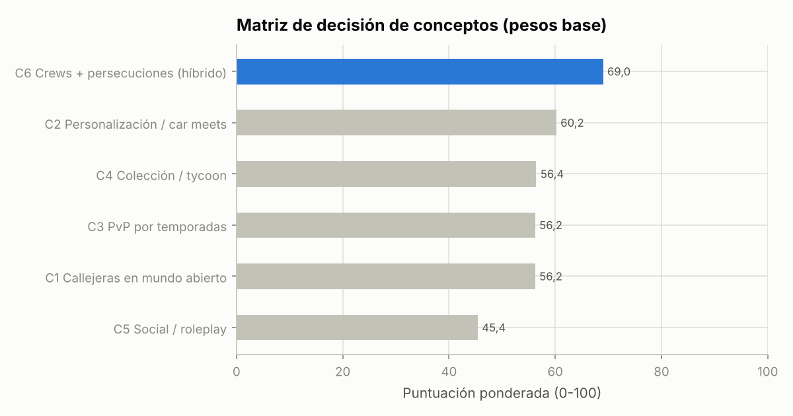

# Informe 2 — Conceptos de juego y selección

> **Fecha de referencia:** 22-10-2026.
> **Etiquetas:** [OBS] observado · [EST] estimación · [HIP] hipótesis. Las puntuaciones de la matriz son **juicio experto** [HIP]: hacen explícitos los supuestos, no son mediciones.
> **Cálculos:** `matriz_decision()` en [modelos/modelo.py](modelos/modelo.py); resultados en [modelos/salidas/matriz_conceptos.csv](modelos/salidas/matriz_conceptos.csv) y [modelos/salidas/matriz_montecarlo.csv](modelos/salidas/matriz_montecarlo.csv). La matriz es editable en la hoja `Matriz_conceptos` de [modelo_financiero.xlsx](modelo_financiero.xlsx).

---

## Resumen ejecutivo

- Evaluamos **6 conceptos**: los 5 sugeridos y un **híbrido construido a partir de la investigación** (C6).
- **Ganador: C6 «Street racing por crews + persecuciones»**, con 69,0/100 frente a 60,2 del segundo (C2, personalización y *car meets*).
- **Gana con las cinco ponderaciones probadas** (rentabilidad, velocidad de lanzamiento, retención, bajo riesgo).
- En una simulación Monte Carlo de 20.000 combinaciones de pesos aleatorios con ruido de ±1 punto en cada nota, **gana el 96,9 % de las veces**.
- **Advertencia honesta:** C6 se diseñó *después* de ver los datos, combinando lo mejor de los demás (sesgo de construcción).
- La prueba de estrés: si su capa cooperativa no funcionara como esperamos (−2 en retención, viralidad y originalidad; −1 en técnica y tiempo), C6 cae a **60,8** y **empata técnicamente con C2**.
- **Conclusión:** la elección es robusta frente a los pesos, pero **depende de validar la hipótesis social y cooperativa** en la Fase 0-1. Si falla, el plan B es C2 + C1 (personalización + carreras de autopista) con la misma tecnología.

---

## 1. Metodología

1. **Generación:** los 5 conceptos del encargo más uno nuevo, justificado por tres hallazgos:
   - el auge de la conducción cooperativa (WRONG WAY, A Dusty Trip);
   - las señales de RFY que premian el co-juego intencional y la retención a 28 días;
   - el hueco de carreras callejeras de calidad.
2. **Criterios:** los 14 aspectos pedidos, agrupados en **11 criterios puntuables**. Público, fantasía y mecánicas son descriptivos.
3. **Escala 0-10.** 10 = máximo atractivo; en los criterios «inversos» (complejidad, contenido, tiempo, riesgo, competencia), 10 = **mejor** para nosotros (más simple, menos contenido, menos tiempo…).
4. **Puntuación ponderada** = Σ(peso × nota) / Σ(pesos) × 10 → escala 0-100.
5. **Sensibilidad:**
   - 5 juegos de pesos;
   - Monte Carlo (20.000 sorteos: pesos de una Dirichlet centrada en los pesos base con concentración 40, más ruido entero de −1/0/+1 en cada nota);
   - prueba de estrés específica del ganador.

### 1.1 Pesos y justificación

| Criterio | Peso | Por qué |
|---|---|---|
| Potencial de retención (D1-D28) | **16** | Es la señal central del algoritmo de RFY desde junio de 2026 ([DevForum](https://devforum.roblox.com/t/recommended-for-you-algorithm-improvements-that-better-value-long-term-retention/4684575)). En nuestro modelo, la retención D7-D30 es de las variables que más mueven el CCU ([05](05_retencion_y_ccu.md)) |
| Potencial de monetización | **12** | Sin ingresos no hay proyecto. Pesa menos que la retención porque la monetización por hora de la plataforma está bajando ([carta T2 2026](https://s27.q4cdn.com/984876518/files/doc_financials/2026/q2/Roblox-Q2-2026-Earnings-Shareholder-Letter.pdf)) y porque sobremonetizar daña la retención |
| Facilidad de captación (CTR/PTR) | **10** | Hace falta que hagan clic. Pesa menos que la retención porque la prueba se puede comprar barata (coste por partida de 0,01-0,03 $) |
| Viabilidad técnica | **10** | Requisito explícito del encargo: dos desarrolladores |
| Contenido necesario | **8** | El contenido (coches, mapa) es el coste dominante para dos personas |
| Tiempo de desarrollo | **8** | El coste de oportunidad y el riesgo de abandono crecen con el tiempo |
| Viralidad y co-juego | **8** | La adquisición orgánica y la señal de co-juego intencional |
| Originalidad / diferenciación | **8** | Mercado concentrado: sin diferenciación no hay clic ni recuerdo |
| Competencia directa | **8** | La fuerza de los incumbentes en ese subnicho concreto |
| Riesgo de ejecución | **6** | Probabilidad de que el diseño no funcione aunque se construya bien |
| Potencial de crecimiento | **6** | Capacidad de escalar con temporadas y expansiones |
| **Total** | **100** | ~32 % de los pesos va a viabilidad de ejecución (técnica, contenido, tiempo, riesgo), coherente con el encargo |

---

## 2. Los seis conceptos

### C1 — Carreras callejeras en mundo abierto con reputación

- **Público objetivo:** 11-17 años, aficionados a los coches; algo de público adulto.
- **Fantasía:** «Soy el piloto callejero más temido de la ciudad.»
- **Mecánicas centrales:** mundo abierto grande, eventos repartidos por el mapa, reputación por niveles, tuning, policía.
- **Originalidad (5):** es el formato NFS clásico; Midnight Chasers, Vehicle Legends y Driving Empire cubren partes.
- **Captación (8):** fantasía muy clicable (noche, neón, policía).
- **Retención (6):** buena progresión, pero riesgo de conducción sin rumbo en un mundo grande.
- **Monetización (7):** coches, cosméticos, garaje.
- **Viralidad (6):** persecuciones y llegadas ajustadas.
- **Complejidad técnica (4):** mundo grande + *streaming* + tráfico + policía + carreras.
- **Contenido (4):** mapa grande y muchos coches.
- **Tiempo (4):** largo.
- **Riesgo (5):** medio.
- **Competencia directa (4):** fuerte (Driving Empire, Midnight Chasers).
- **Crecimiento (8):** alto con distritos y temporadas.

### C2 — Arcade de conducción y personalización (*car meets*)

- **Público:** 12-25 años, cultura del tuning y del «lucir».
- **Fantasía:** «Mi coche es mi obra; todo el mundo lo admira.»
- **Mecánicas:** editor visual profundo, quedadas, concursos de diseño, fotos, conducción ligera.
- **Originalidad (6):** nadie en Roblox lo hace con profundidad.
- **Captación (6):** atractivo visual pero nicho.
- **Retención (5):** depende de la masa crítica en las quedadas; bucle de juego débil.
- **Monetización (8):** lo cosmético es lo que mejor se monetiza sin dañar la justicia.
- **Viralidad (7):** diseños llamativos compartibles.
- **Técnica (6):** el editor de vinilos es complejo; lo demás, moderado.
- **Contenido (5):** muchas piezas.
- **Tiempo (6).**
- **Riesgo (5).**
- **Competencia (6):** media.
- **Crecimiento (6).**

### C3 — PvP clasificatorio con temporadas

- **Público:** 13-25 años, competitivos.
- **Fantasía:** «Soy el número 1 de la clasificación.»
- **Mecánicas:** salas, emparejamiento, ELO, pistas cerradas, temporadas.
- **Originalidad (6).**
- **Captación (5):** competir no atrae al jugador casual de Roblox.
- **Retención (6):** la maestría retiene a pocos.
- **Monetización (4):** la justicia limita las ventas.
- **Viralidad (6).**
- **Técnica (5):** el *netcode* justo es difícil, aunque Server Authority ayuda y no hay mundo abierto.
- **Contenido (7):** pocas pistas.
- **Tiempo (7).**
- **Riesgo (4):** **sin CCU alto, el emparejamiento muere** (problema de arranque en frío).
- **Competencia (7):** poca competencia buena.
- **Crecimiento (5).**

### C4 — De coche barato a hiperdeportivo (colección / tycoon)

- **Público:** 8-14 años.
- **Fantasía:** «Empecé con una chatarra y ahora tengo un garaje de superdeportivos.»
- **Mecánicas:** bucle de dinero → coche, ingresos pasivos, concesionario.
- **Originalidad (3):** Car Dealership Tycoon, Driving Empire y Taxi Boss ya lo cubren.
- **Captación (7):** formato probado.
- **Retención (7):** los bucles de progresión retienen.
- **Monetización (8):** multiplicadores y paquetes de dinero.
- **Viralidad (4).**
- **Técnica (6).**
- **Contenido (4):** necesita muchos coches.
- **Tiempo (6).**
- **Riesgo (5).**
- **Competencia (3):** saturado.
- **Crecimiento (6).**

### C5 — Mundo abierto social (rol, actividades, exploración)

- **Público:** 9-15 años.
- **Fantasía:** «Vivo en esta ciudad con mis amigos.»
- **Mecánicas:** trabajos, casas, rol, eventos.
- **Originalidad (2):** Greenville, Southwest Florida, Brookhaven…
- **Captación (7):** el rol es enorme en Roblox.
- **Retención (6).**
- **Monetización (6).**
- **Viralidad (5).**
- **Técnica (3):** mapa grande y muchos sistemas.
- **Contenido (3).**
- **Tiempo (3).**
- **Riesgo (4).**
- **Competencia (2).**
- **Crecimiento (7).**

### C6 — Street racing por crews + persecuciones (híbrido propuesto)

- **Público:** núcleo de 12-17 años; capa de 18+ aficionada al motor; accesible desde los 10.
- **Fantasía:** «Mi crew y yo dominamos la ciudad de noche: ganamos carreras, escapamos de la policía y nuestros coches son leyenda.»
- **Mecánicas centrales:**
  - *hub* compacto con eventos inmediatos (*sprint*, circuito, autopista entre el tráfico, derrape, huida);
  - **crews** de 2-4 en sesión con puntuación conjunta, rebufo entre compañeros y recompensas compartidas;
  - persecuciones con «Heat»;
  - clases de rendimiento justas;
  - personalización profunda;
  - temporadas.
- **Originalidad (8):** ningún competidor combina carreras inmediatas, crews cooperativas, policía y justicia por clases.
- **Captación (7):** la fantasía NFS más el gancho de «con tus amigos».
- **Retención (8):** días de co-juego, eventos diarios rotativos y reputación de crew.
- **Monetización (7):** cosméticos, garaje, pase de temporada y servidores privados de crew; menos dependiente de vender ventaja.
- **Viralidad (8):** persecuciones, llegadas en equipo y clips compartibles.
- **Técnica (5):** multijugador de carreras y persecuciones con IA, compensado por un mapa compacto.
- **Contenido (6):** los eventos dan rejugabilidad con 12-15 coches.
- **Tiempo (6).**
- **Riesgo (5):** necesita amigos, así que debe funcionar en solitario (bots, crews emparejadas).
- **Competencia (7):** hueco poco cubierto.
- **Crecimiento (8):** distritos, policía jugadora, campeonatos de crews.

**Nota de diseño:** C6 es, en la práctica, **«C1 compacto + capa social de C6 + personalización de C2»**. Su capa cooperativa es **modular**: si no funciona, se retira sin rehacer el juego.

---

## 3. Matriz de decisión

### 3.1 Puntuaciones (0-10) por criterio

| Criterio (peso) | C1 | C2 | C3 | C4 | C5 | C6 |
|---|---|---|---|---|---|---|
| Captación (10) | 8 | 6 | 5 | 7 | 7 | 7 |
| Retención (16) | 6 | 5 | 6 | 7 | 6 | **8** |
| Monetización (12) | 7 | **8** | 4 | **8** | 6 | 7 |
| Viralidad (8) | 6 | 7 | 6 | 4 | 5 | **8** |
| Originalidad (8) | 5 | 6 | 6 | 3 | 2 | **8** |
| Viabilidad técnica (10) | 4 | **6** | 5 | **6** | 3 | 5 |
| Contenido necesario (8) | 4 | 5 | **7** | 4 | 3 | 6 |
| Tiempo de desarrollo (8) | 4 | 6 | **7** | 6 | 3 | 6 |
| Riesgo de ejecución (6) | 5 | 5 | 4 | 5 | 4 | 5 |
| Competencia directa (8) | 4 | 6 | **7** | 3 | 2 | **7** |
| Crecimiento (6) | **8** | 6 | 5 | 6 | 7 | **8** |

### 3.2 Resultado ponderado (0-100)

| Concepto | Base | Prioridad rentabilidad | Prioridad velocidad de lanzamiento | Prioridad retención | Prioridad bajo riesgo |
|---|---|---|---|---|---|
| C1 Callejeras en mundo abierto | 56,2 | 58,8 | 52,7 | 56,8 | 54,5 |
| C2 Personalización / *car meets* | 60,2 | 63,1 | 59,5 | 59,2 | 59,4 |
| C3 PvP por temporadas | 56,2 | 53,6 | 58,0 | 56,8 | 55,2 |
| C4 Colección / tycoon | 56,4 | 60,2 | 55,9 | 57,7 | 55,2 |
| C5 Social / rol | 45,4 | 48,2 | 42,0 | 47,5 | 43,5 |
| **C6 Crews + persecuciones** | **69,0** | **69,2** | **66,4** | **70,8** | **66,8** |

**Variantes de pesos (multiplicadores sobre los pesos base, renormalizados):**

- *Rentabilidad:* monetización ×2,5; captación ×1,3.
- *Velocidad:* tiempo ×2,5; contenido ×2; técnica ×1,8.
- *Retención:* retención ×2; viralidad ×1,5.
- *Bajo riesgo:* riesgo ×2,5; competencia ×1,5; técnica ×1,5.

### 3.3 Análisis de sensibilidad

| Pregunta | Respuesta |
|---|---|
| ¿Cambia el ganador al priorizar la **rentabilidad**? | No. C6 obtiene 69,2; **C2 (63,1) y C4 (60,2) se acercan**, porque monetizan mejor sin la carga de la justicia competitiva |
| ¿Y al priorizar la **velocidad de lanzamiento**? | No. C6 obtiene 66,4; **C3 sube a 58,0** (pocas pistas, sin mundo), pero su riesgo de arranque en frío lo descarta |
| ¿Y al priorizar la **retención**? | No; la ventaja de C6 aumenta (70,8 frente a 59,2) |
| ¿Y con **pesos aleatorios** (Monte Carlo)? | C6 gana el **96,9 %** de 20.000 sorteos; C2, el 2,2 %; C4, el 0,5 %; C3, el 0,2 %; C1, el 0,1 %; C5, el 0 % |
| **Prueba de estrés:** ¿y si la capa cooperativa de C6 no aporta? (retención −2, viralidad −2, originalidad −2, técnica −1, tiempo −1) | C6 cae a **60,8**: **empate técnico con C2 (60,2)** |

**Interpretación:**

- La victoria de C6 **no depende de los pesos**. Depende de **una hipótesis de producto**: que las crews y la cooperación aumenten de verdad la retención y la difusión.
- Esa hipótesis es **comprobable pronto y barata** (Fase 0-1): comparar la duración de sesión y el retorno de quienes juegan en crew frente a quienes juegan solos, y medir la tasa de eventos de crew completados.

---

## 4. Abogado del diablo: argumentos contra C6

1. **«El jugador de Roblox juega solo más de lo que creemos.»** Si la mayoría entra sin amigos, las crews se quedan vacías.
   - *Mitigación:* crews emparejadas automáticamente y bots de relleno; todo evento es jugable en solitario.
   - *Señal de alerta:* menos del 20 % de las sesiones con algún compañero de crew tras 4 semanas.
2. **«La policía IA es cara y frágil.»** Las persecuciones mal hechas frustran.
   - *Mitigación:* versión mínima en el MVP (Heat 1-3, máximo 3 coches patrulla, escapes claros); policía jugadora solo en la Fase 5.
3. **«El formato cooperativo ya está tomado.»** WRONG WAY y Rally Panic! ocupan el rally a dos.
   - *Respuesta:* no copiamos el rally con copiloto. Nuestra cooperación es **por equipos en carreras callejeras**, y el copiloto es un experimento opcional.
4. **«C4 monetiza mejor y es más simple.»** Cierto en la fase de dinero, pero está saturado (competencia 3/10) y no se diferencia.
   - *Respuesta:* incorporamos su mejor parte (la colección D→S) a C6.
5. **«Es demasiado para dos personas.»** C6 suma sistemas.
   - *Respuesta:* el MVP recorta (ver [10](10_roadmap_desarrollo.md)): 5 tipos de evento, 12 coches, 1 mapa compacto, crews de sesión y policía mínima. La amplitud viene después, con ingresos.

**¿Qué evidencia nos haría cambiar de concepto?**

- Si en la prueba con usuarios de la Fase 1 la **duración de sesión no mejora** al jugar en crew, y la personalización genera más interés que las carreras (medido por tiempo en el garaje frente a tiempo en eventos), pivotar hacia **C2 + C1** (personalización + autopista), reutilizando el chasis, el mapa y la economía.

---

## 5. Decisión

**Concepto seleccionado: C6 — «Street racing por crews + persecuciones»** (nombre provisional: **Nitro Crews**; ver [08](08_popularidad_y_marketing.md)).

**Qué se queda:**

- eventos de carrera inmediatos (60-180 s);
- crews de sesión con puntuación conjunta;
- policía IA con Heat;
- clases de rendimiento justas;
- personalización profunda progresiva;
- colección D→S;
- temporadas.

**Qué se descarta o se aplaza:**

- mundo grande (C1/C5);
- trabajos y rol (C5);
- emparejamiento global clasificatorio (C3), hasta tener CCU;
- concesionario y tycoon (C4);
- editor de vinilos completo (C2), en una fase posterior;
- licencias de marcas reales (hasta superar ~5.000 CCU).

**Condición de continuidad:** validar la hipótesis social (sección 3.3) con los umbrales de [12_recomendacion_final.md](12_recomendacion_final.md).

## 6. Conclusiones

- C6 es la mejor combinación de demanda, diferenciación y viabilidad para dos personas, **bajo nuestros supuestos explícitos**.
- La ventaja de C6 es robusta frente a los pesos, pero **frágil frente al supuesto social**, que debe validarse primero.
- El diseño modular permite **retroceder a C1 + C2** sin perder el trabajo técnico.

## 7. Recomendaciones accionables

1. Los dos socios rellenan la matriz **por separado** (hoja `Matriz_conceptos`) antes de leer nuestras notas y comparan resultados: reduce el sesgo de anclaje.
2. Definir y medir desde el prototipo: el porcentaje de sesiones en crew, el retorno D1 de jugadores en crew frente a solitarios, y la tasa de finalización de eventos.
3. Reservar la decisión «C6 frente a C2 + C1» para el hito de validación de la semana 8-10 (Informe 10).

## 8. Incertidumbres y limitaciones

- Las notas son **juicio experto**, no datos. El Monte Carlo explora la incertidumbre de los pesos y de ±1 punto, no errores mayores de criterio.
- **Sesgo de construcción:** C6 se creó a la vista de los resultados. Lo hemos compensado con la prueba de estrés y el plan B explícito.
- La evidencia sobre la cooperación procede de juegos de *rally* y viaje (WRONG WAY, A Dusty Trip), no de carreras callejeras por equipos. La transferencia es una **hipótesis**.
