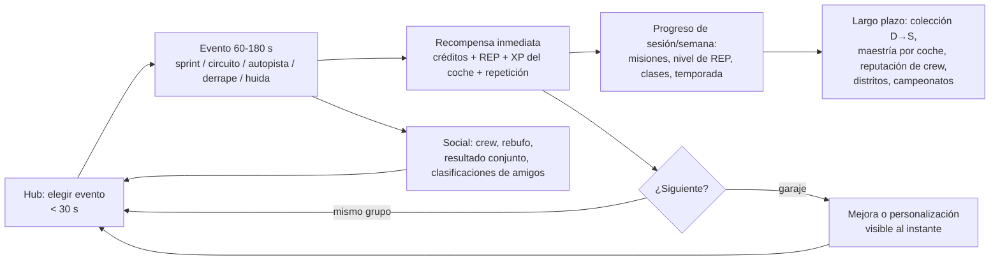

# Informe 3 — Game Design Document: **Nitro Crews** (nombre provisional)

> **Versión:** 0.1 (preproducción) · **Fecha:** 22-10-2026.
> **Etiquetas de alcance:** **[MVP]** imprescindible para el primer lanzamiento público · **[BETA]** se prueba durante la beta · **[T1]**, **[T2]**… temporadas posteriores al lanzamiento · **[F5]** fase de escalado (Informe 10) · **[NO]** descartado de forma explícita.
> Todo lo que no lleva fuente es **diseño propuesto [HIP]** y debe validarse con pruebas de juego y telemetría.

---

## Resumen ejecutivo

**Nitro Crews** es un juego de **carreras callejeras arcade por crews** en una ciudad nocturna compacta.

- **Qué haces:** formas una *crew* de 2-4 amigos (o te emparejan con otros jugadores o con bots), corres eventos de 1-3 minutos que empiezan al instante, escapas de la policía, ganas reputación y construyes una colección de coches personalizados, de la clase D a la S.
- **Tres diferencias frente al resto de Roblox:**
  1. **siempre hay una carrera a menos de 30 segundos**;
  2. **el juego es mejor con tu crew** (eventos de equipo, rebufo entre compañeros, recompensas compartidas);
  3. **la competición es justa** (clases de rendimiento; el dinero real compra estilo y comodidad, no victorias).
- **MVP:** 12 coches, 5 tipos de evento (~20 rutas), 1 mapa de 4 distritos, policía IA básica, tráfico en autopista, crews de sesión, garaje y personalización inicial.

---

## 3.1 Visión general

| Campo | Definición |
|---|---|
| **Nombre provisional** | *Nitro Crews* (alternativas y comprobaciones de marca en [08](08_popularidad_y_marketing.md)) |
| **Género / subgénero** | Carreras arcade · subgénero: carreras callejeras por equipos con persecuciones y mundo compacto |
| **Propuesta única de valor** | «Carreras callejeras rápidas y justas con tu crew: un evento cada 30 segundos, persecuciones policiales y un coche que es tuyo de verdad» |
| **Público objetivo** | **Primario:** 12-17 años, aficionados a los coches y a los juegos con amigos. **Secundario:** 18-30 años de cultura del motor (más gasto por usuario y tasa DevEx 18+ en EE. UU.). **Accesible:** desde 10 años (controles asistidos y sin violencia) |
| **Plataformas** | **Móvil primero** (≈ 80 % de los DAU en 2024 [OBS]), PC y consola (mando). Un mismo diseño con tres esquemas de control |
| **Dirección artística** | Realismo estilizado nocturno: asfalto mojado con reflejos, neones cian y magenta, farolas de sodio, siluetas de coche limpias y edificios de bajo detalle con ventanas emisivas. **Legible en móvil antes que fotorrealista** |
| **Ambientación** | *Bahía Vista*, ciudad costera ficticia, siempre entre el crepúsculo y la noche (sin ciclo día/noche en el MVP: menos coste de iluminación, más ambiente) |
| **Experiencia emocional** | Adrenalina (velocidad, llegadas ajustadas), pertenencia (crew), orgullo (mi coche), maestría (trazadas, derrapes), alivio y euforia (escapar de la policía) |
| **Referencias de fantasía** | Carreras callejeras nocturnas de la tradición arcade (era *Underground*/*Midnight Club*), persecuciones de la era *Hot Pursuit*, el *hub* festivo y las clases por índice de rendimiento de *Forza Horizon*, la accesibilidad de *Mario Kart*, la monetización cosmética y las sesiones cortas de *Rocket League*. En Roblox: Midnight Chasers (velocidad entre el tráfico), WRONG WAY (cooperación por roles), Jailbreak (escapar de la policía) |
| **Calificación de contenido** | Mínima o leve: sin armas, sin sangre; la policía «detiene» con una barra de captura, nunca con violencia. Permite consola y público amplio |
| **Avatar** | **R15 obligatorio** (elegibilidad para la tasa DevEx 18+ de EE. UU. [OBS]: no permitir R6 en ningún momento) |

### Pilares de diseño

1. **Velocidad que se siente.** Si un cambio no hace el juego más rápido de sentir o de entender, no entra.
2. **Siempre una carrera a 30 segundos.** Nada de conducir sin rumbo.
3. **Mejor con tu crew, posible en solitario.** Todo evento es jugable con bots, y todo evento de crew da más con amigos.
4. **Tu coche, tu identidad.** Profundidad visual; rendimiento acotado por clases.
5. **Justo y transparente.** Sin cajas de pago, sin ventajas compradas en lo competitivo, precios claros.

### Lo que el juego **no** es (antiobjetivos)

- **No es un juego de rol de ciudad:** no tiene trabajos, casas ni rol.
- **No es una simulación:** no hay embrague obligatorio ni daño mecánico.
- **No es un tycoon:** no tiene ingresos pasivos ni concesionario gestionable.
- **No es un catálogo de 300 coches:** son pocos coches, muy bien hechos.

### Diferencias frente a Need for Speed y frente a la competencia en Roblox

| Aspecto | Need for Speed (referencia) | Driving Empire / rol de conducción | Midnight Chasers | **Nitro Crews** |
|---|---|---|---|---|
| Mundo | Grande, con historia | Muy grande, de rol | Autopista | **Compacto**, centrado en eventos |
| Coches | Cientos y con licencia | 300+, varios con licencia | Supercoches | **12 en el MVP**, ficticios, personalización profunda |
| Sesión | Larga, con historia | Libre | Inmediata | **Inmediata (1-3 min por evento)** |
| Social | En línea opcional | Rol con extraños | Quedadas | **Crews como unidad de juego** |
| Policía | Central en algunas entregas | Trabajo de rol | No consta | **Heat y huidas (IA en el MVP)** |
| Justicia | Por clases o rendimiento | Coches de pago y multiplicadores | n. d. | **Índice de rendimiento por clase; dinero real = cosmética y comodidad** |
| Marca | IP de EA | Licencias | n. d. | **Propia**, sin elementos de terceros |

---

## 3.2 Bucle principal

### 3.2.1 Análisis del bucle inicial propuesto

> «Conducir → competir → ganar dinero y reputación → mejorar el coche → desbloquear carreras → competir en eventos superiores.»

| Fortaleza | Debilidad | Mejora |
|---|---|---|
| Progresión clara, fantasía NFS | El paso «conducir» invita a la conducción sin rumbo (queja n.º 1) | **Evento primero:** apareces dentro de una carrera; el mundo es el camino entre eventos |
| Recompensa económica tangible | «Mejorar el coche» deriva en *grind* si los precios suben más rápido que los ingresos | Curva de precios calibrada (C en ~1,6 h; ver economía) y mejora visible tras cada evento |
| Escalado natural por clases | No tiene motor social: se puede jugar entero sin interactuar | **Capa de crew:** +10 % de recompensa por correr con compañeros, eventos de equipo, rebufo |
| — | Sin riesgo ni decisión: siempre «corre y cobra» | **Heat:** cuanto más tiempo mantengas a la policía detrás, mayor el multiplicador, pero si te atrapan pierdes el bonus |
| — | La recompensa es solo numérica | **Repetición de los mejores momentos** como recompensa emocional y compartible |

**Alternativas consideradas:**

- **Bucle de colección** (al estilo tycoon): descartado como núcleo por saturación; se integra como meta a largo plazo.
- **Bucle clasificatorio** (ELO): inviable sin CCU alto; se aplaza.
- **Bucle de exploración**: complementario (coleccionables), nunca núcleo.

### 3.2.2 Bucle final (cuatro capas)

| Capa | Duración | Qué satisface | Elementos |
|---|---|---|---|
| **Inmediata** | 1-3 min | Adrenalina y competencia | Evento con salida en 10 s, nitro, *near-miss*, final ajustado, repetición |
| **Media** | Sesión / semana | Progreso | Créditos → mejora visible; REP → nuevos eventos y distritos; misiones diarias (3) y semanales (5); tabla semanal de contrarreloj |
| **Larga** | Meses | Aspiración e identidad | Colección D→S (primer S en ~50 h); maestría por coche; temporadas de 6-8 semanas; reputación de crew; nuevos distritos |
| **Social y competitiva** | Continua | Pertenencia y estatus | Crews, eventos de crew, fantasmas de amigos, quedadas, toma de distritos [T2], policía jugadora [F5] |

---

## 3.3 Sistemas de conducción

### 3.3.1 Decisión: **arcade híbrido** («arcade con peso»)

- **Evidencia:** la simulación pura no escala en Roblox (Project Trackday: 32 CCU [OBS]); los líderes usan conducción accesible.
- **Objetivo:** que cualquier jugador gire bien en 30 segundos y que un jugador experto encuentre trazadas y derrapes que marquen la diferencia.

### 3.3.2 Modelo físico propuesto (sin simulación compleja)

| Componente | Implementación propuesta | Por qué |
|---|---|---|
| Carrocería | Un único cuerpo rígido (chasis) con propiedades de masa ajustadas; la carrocería visual es solo malla | Estable y barato en red |
| Suspensión | **4 rayos** (*raycast*) con muelle-amortiguador que aplican fuerzas en los puntos de las ruedas | Control total y estable en terreno irregular; patrón estándar en juegos arcade |
| Neumáticos | Curva de **agarre lateral en función del ángulo de deslizamiento** (pico y caída suave), agarre longitudinal con control de tracción | Permite derrapes controlables sin un modelo de neumático completo |
| Tracción | Delantera, trasera o total como «carácter» del coche: más o menos tendencia al derrape y mejor o peor salida | Variedad sin complejidad |
| Derrape | Se inicia con el freno de mano o con un contravolante brusco. La **asistencia de derrape** mantiene el ángulo objetivo y la **asistencia de contravolante** se puede graduar. Al salir de un derrape se carga el nitro | Lo espectacular es fácil de lograr; lo excelente sigue siendo difícil |
| Frenado | Fuerte y arcade, con ABS siempre activo. **Asistencia de frenada** opcional (frena antes de curvas cerradas en modo principiante) | Accesibilidad |
| Aceleración | Curva de par por clase; caja automática (manual opcional en PC y consola, sin embrague) | Accesible |
| Nitro | Barra que se llena con derrape, *near-miss*, rebufo y saltos. Pulsación = impulso. **Nitro perfecto** al activarlo justo al salir de un derrape. **Nitro de crew** [T1]: si dos compañeros lo activan a la vez, ambos ganan +10 % | Recompensa la habilidad y la cooperación |
| Rebufo | Detrás de otro coche: menos resistencia y nitro de carga. Entre compañeros de crew, efecto doble | Remontada natural, sin *rubber-banding* |
| Colisiones | Coche contra coche **solo dentro de eventos**. Fuera, «modo pasivo» (fantasmas para no compañeros). Contra muros: se pierde un porcentaje de velocidad proporcional al ángulo de impacto; roces que no paran el coche | Contra el abuso y la frustración |
| Anti muro | Penalización de agarre contra muros para que pegarse a ellos no sea óptimo | Responde a la queja de ir «pegado al muro» |
| Reaparición | Botón para volver a la pista en el último punto de control válido (1,5 s de fantasma) | Evita el abandono tras un choque |
| Daño | **Solo visual:** chispas, humo y marcas por calcomanía. Sin deformación ni reparaciones de pago | Coste bajo y sin frustración |

### 3.3.3 Objetivos de comportamiento por clase (valores de diseño iniciales)

| Clase | Índice de rendimiento | 0-100 km/h mostrado | Velocidad punta mostrada | Carácter |
|---|---|---|---|---|
| D | 100-399 | 6,5-8,0 s | 190-210 km/h | Ligero y perdonador |
| C | 400-549 | 5,0-6,0 s | 220-240 km/h | Primer «coche de verdad» |
| B | 550-699 | 4,0-4,8 s | 250-280 km/h | Exige frenar bien |
| A | 700-849 | 3,2-3,8 s | 290-320 km/h | Agarre alto; derrape exigente |
| S | 850-999 | 2,6-3,0 s | 330-360 km/h | Aspiracional |

*La velocidad mostrada se calibra con un factor de escala respecto a la velocidad física (studs/s), para que un mapa compacto se sienta rápido. Es un ajuste de sensación habitual en juegos arcade.*

### 3.3.4 Sensación de velocidad (por coste)

| Técnica | Coste | Impacto |
|---|---|---|
| Campo de visión dinámico (70° en parado → 92° a velocidad punta; +6° con nitro) | Bajo | Muy alto |
| Partículas de líneas de velocidad y viento con la velocidad | Bajo | Alto |
| Vibración sutil de cámara en función de velocidad y superficie | Bajo | Medio |
| Objetos cercanos a la vía (farolas, vallas, señales) colocados con ritmo | Medio (mapa) | **Muy alto** |
| Sonido de motor por capas (ralentí, medio, alto, limitador), viento y neumáticos | Medio | Muy alto |
| Desenfoque ligero solo con nitro (con opción de desactivarlo) | Bajo | Medio |
| Carreteras estrechas y cámara baja en la cámara de parachoques | Bajo | Medio |
| Indicador de *near-miss* con contador de combo | Bajo | Alto |

### 3.3.5 Cámaras

- Persecución cercana o lejana (por defecto, la lejana en móvil).
- Parachoques.
- **Cámara de repetición cinematográfica** para los mejores momentos.
- Cámara de llegada (*foto-finish* a cámara lenta).

### 3.3.6 Asistencias para principiantes (activadas por defecto en los primeros eventos y desactivables)

1. **Asistencia de dirección:** corrige ligeramente hacia la trazada en curvas.
2. **Asistencia de frenada** antes de curvas cerradas.
3. **Aceleración automática** (por defecto en móvil).
4. **Flechas de trazada** en el suelo (las primeras 2 horas o a elección).
5. **Asistencia de derrape** (graduada).
6. Reaparición inmediata.

Las asistencias **no** se penalizan en eventos casuales. En las clasificaciones semanales, el icono de asistencias es visible (transparencia), pero no hay tablas separadas en el MVP porque la población es baja.

### 3.3.7 Controles

| Acción | Móvil (disposición A, por defecto) | Móvil (disposición B) | Mando | PC |
|---|---|---|---|---|
| Dirección | Botones ◀ ▶ a la izquierda | Volante virtual por arrastre / inclinación opcional | Stick izquierdo | A/D o ←/→ |
| Acelerar | Automático (o botón) | Botón | Gatillo derecho (analógico) | W / ↑ |
| Frenar / marcha atrás | Botón derecho | Botón | Gatillo izquierdo | S / ↓ |
| Freno de mano / derrape | Botón derecho grande | Botón | B / Círculo | Espacio |
| Nitro | Botón derecho grande | Botón | A / Cruz | Mayús |
| Reaparecer | Icono pequeño arriba | Ídem | Y / Triángulo (mantener) | R |
| Cámara | Icono | Ídem | Stick derecho / RB | C |
| Ping a la crew | Rueda rápida | Ídem | Cruceta | Q |

Requisitos de móvil: botones de al menos 64 px (escalado de la UI), **retroalimentación háptica** en impactos y nitro, posiciones ajustables y modo zurdo.

---

## 3.4 Mundo abierto

### 3.4.1 Mapa mínimo viable: *Bahía Vista* [MVP]

| Zona | Función | Elementos | Tamaño aproximado |
|---|---|---|---|
| **La Plaza** (*hub*) | Punto de encuentro, garaje, tienda de tuning, tablón de eventos, plataforma de exhibición | Aparición, balizas de evento, zona de fotos | 250 × 250 m |
| **Centro** | Calles en cuadrícula con neón | *Sprints* urbanos, circuitos improvisados, rutas de huida | 1 × 1 km |
| **Puerto** | Industrial: contenedores, grúas | **Zona de derrape**, saltos, escondites para huidas | 0,7 × 0,6 km |
| **El Anillo** | **Autopista** circular con tráfico | Evento de autopista (*near-miss*), *sprints* largos, radares de velocidad | 5-6 km de recorrido |
| **Paso de la Cresta** | Carretera de montaña con curvas enlazadas | Duelos de montaña [T1], *sprints* técnicos | 2-3 km |

- **Huella total:** ~2,5 × 2,5 km. Cruzar el mapa a velocidad punta lleva ~60-90 s. Es suficiente para crear variedad sin coste de contenido desmesurado.
- **Reparto de vías:** 40 % calle urbana · 30 % autopista · 20 % montaña y secundarias · 10 % zonas especiales.
- **Regla de densidad:** desde cualquier punto, **un evento a ≤ 400 m o ≤ 15 s** de conducción; si no, teletransporte desde el tablón.
- **Navegación:** ruta pintada en el asfalto hacia el evento elegido; minimapa simplificado; sin GPS confuso (queja n.º 15).

### 3.4.2 Elementos del mundo

| Elemento | Alcance | Notas |
|---|---|---|
| Talleres (tuning y pintura) | [MVP] en La Plaza; [T1] uno por distrito | Interfaz de garaje accesible desde cualquier punto en el MVP |
| Concesionario | [MVP] escaparate en La Plaza (compra desde la UI) | No es un tycoon |
| Garajes | [MVP] interfaz con 10 plazas | Garaje 3D visitable por la crew en [T2] |
| Puntos de encuentro | [MVP] La Plaza; [T1] mirador de La Cresta | Quedadas programadas [T1] |
| Zonas de derrape | [MVP] Puerto | Puntuación por ángulo, velocidad y proximidad a muros |
| Carreras clandestinas | [MVP] eventos «Subterráneo» con inscripción en créditos (el ganador se lleva más) | Sin azar: el riesgo es la propia carrera |
| Circuitos improvisados | [MVP] 6-8 rutas sobre calles existentes con barreras | Reutiliza carreteras y abarata contenido |
| Eventos dinámicos | [MVP] «Carrera relámpago» (anuncio en el servidor, 60 s para unirse); [T1] «Convoy policial», «Coche leyenda» visible en el mapa | Crean picos de actividad social |
| Tráfico | [MVP] autopista y 2 avenidas | Ligero, en el cliente, determinista por semilla (ver arquitectura) |
| Policía | [MVP] Heat 1-3 con IA | Aparece al superar radares o por exceso de velocidad junto a patrullas |
| Coleccionables | [BETA] 30 «carteles de crew» que se pueden romper; 10 radares con tabla de velocidad; 8 saltos con distancia | Exploración con objetivo |

### 3.4.3 Plan de ampliación

| Temporada | Distrito o cambio | Nuevos eventos |
|---|---|---|
| T1 | Mirador de La Cresta + duelos de montaña | Duelo (líder y perseguidor), Convoy |
| T2 | **Costa** (autopista costera y paseo marítimo) | Eliminación, Relevo de crew |
| T3 | Lluvia como evento meteorológico | Carreras con lluvia (agarre menor) |
| T4 | **Aeródromo** (arrancadas y saltos) | Arrancada con cambio perfecto |
| T6 | Distrito Norte industrial | Golpes de crew (huida en equipo) |

---

## 3.5 Sistema de coches

### 3.5.1 Clases, estadísticas y prestigio

- **Clases D, C, B, A y S** por índice de rendimiento (100-999).
- **Estadísticas visibles (1-10):** Aceleración, Velocidad punta, Manejo, Frenada, Nitro y «carácter» (agarre ↔ derrape).
- **Sin rareza aleatoria.** En su lugar, **etiquetas de prestigio** (Calle, Deportivo, Exótico, Leyenda) que indican aspiración, no probabilidad.
- **No hay cajas de botín.**

### 3.5.2 Mejoras mecánicas [MVP]

| Mejora | Niveles | Efecto principal |
|---|---|---|
| Motor | 0-4 | Aceleración y velocidad punta |
| Turbo | 0-3 | Aceleración a media velocidad |
| Transmisión | 0-3 | Respuesta y velocidad punta |
| Neumáticos | 0-3 | Agarre lateral |
| Suspensión | 0-3 | Estabilidad y manejo |
| Frenos | 0-3 | Frenada |
| Nitro | 0-3 | Capacidad y potencia del nitro |
| Peso | 0-2 | Todo un poco |

- Cada mejora **sube el índice de rendimiento dentro de su clase hasta el tope de la clase**.
- **Conversión de clase** (para llevar un coche de C a B): [T2], con un coste alto en créditos.

### 3.5.3 Ajustes de conducción [MVP]

Dos controles deslizantes por coche:

1. **Agarre ↔ Derrape:** reparte agarre lateral y facilidad de derrape.
2. **Aceleración ↔ Velocidad punta:** desarrollo de cambios.

[T2]: dureza de suspensión y reparto de frenada.

### 3.5.4 Personalización estética

| Elemento | MVP | Más adelante |
|---|---|---|
| Colores | 24 colores base gratis; acabados metalizado, mate y perlado por créditos | Cromados y camaleón (temporada) |
| Llantas | 12 diseños | +4 por temporada |
| Carrocerías | Original + 2 kits por coche | Kits de temporada |
| Alerones | 6 universales | — |
| Neones | 8 colores (pase Neón: animados) | Patrones por temporada |
| Tintado | 5 niveles | — |
| Vinilos / *liveries* | 6 diseños + calcomanías en ranuras fijas | **Editor por capas** [T3] |
| Matrícula | Texto propio (**filtrado obligatorio** con `TextService`) | Marcos |
| Sonidos | 3 escapes gratis + pase de sonidos | — |
| Humo de neumáticos / llama del nitro | 4 colores | Más por temporada |
| Claxon | 4 | — |

### 3.5.5 Garajes y colecciones

- **Garaje:** 10 plazas gratis; +5 por hitos de reputación; +15 con el pase «Garaje Ampliado».
- **Libro de colección:** silueta de todos los coches y cuáles faltan. Recompensas cosméticas por completar series (p. ej., «Los 4 de clase D»).
- **Maestría por coche** (0-10): sube usando el coche y desbloquea cosméticos exclusivos de ese modelo. **Objetivo a largo plazo sin pagar.**

### 3.5.6 Coches del MVP (12, marcas ficticias)

| Clase | Coche (provisional) | Inspiración de época y estilo (genérica) | Tracción |
|---|---|---|---|
| D | Kaizen Hatch 90 | Compacto japonés de los 90 | Delantera |
| D | Ronin Coupé | Cupé ligero de los 90 | Trasera |
| D | Vega Classic | *Muscle* estadounidense de los 70 | Trasera |
| D | Lumen GTi | Compacto deportivo europeo | Delantera |
| C | Kaizen RS | Compacto turbo | Total |
| C | Brutus V8 | *Muscle* moderno | Trasera |
| C | Sakura Turbo | Deportivo japonés de los 2000 | Trasera |
| C | Falco GT | GT europeo de los 80 | Trasera |
| B | Orca R | Deportivo de inspiración rally | Total |
| B | Vortex S8 | Gran turismo europeo | Total |
| A | Ardent 9 | Superdeportivo de motor central | Trasera |
| A | Strata ZR | Superdeportivo americano | Trasera |
| S | *Nova* (coche protagonista de T1) | Hiperdeportivo | Total |

### 3.5.7 Análisis legal de vehículos reales

| Riesgo | Qué protege | Política propuesta |
|---|---|---|
| **Marcas registradas** (nombres, logotipos, emblemas) | Identidad comercial de los fabricantes | **No usar** nombres, logotipos ni emblemas reales. Marcas ficticias propias |
| **Imagen comercial y diseño industrial** (formas icónicas) | Diseños distintivos (parrillas, siluetas) | Inspiración de **época y categoría**, no réplicas 1:1. Evitar rasgos distintivos (parrillas «de riñón», silueta exacta de un modelo icónico) |
| **Derechos de autor de modelos 3D** | Modelos de terceros | **Prohibido** usar modelos extraídos de otros juegos o webs. Solo modelos propios, encargados o con licencia comercial verificada |
| **Música y sonido** | Grabaciones y composiciones | Biblioteca con licencia de Roblox o encargos. Nunca audio extraído de otros juegos |
| **IP de Need for Speed y otros juegos de EA** | Marcas, logos, interfaz, personajes | Ningún nombre, logo, tipografía ni elemento de UI reconocible de NFS. Evitar palabras clave de sus títulos («Most Wanted», «Underground», «Heat», «Hot Pursuit», «Unbound», «Payback», «Carbon») |

- **Contexto jurídico:** en EE. UU., *AM General v. Activision* (S.D.N.Y., 2020) amparó la representación realista de Humvees en *Call of Duty* bajo la prueba *Rogers* ([Finnegan](https://www.finnegan.com/en/insights/blogs/incontestable/in-legal-warfare-over-humvee-trademarks-the-first-amendment-goes-beyond-the-call-of-duty-in-dismissing-am-generals-claims.html)). Pero:
  1. es un precedente estadounidense de primera instancia;
  2. un litigio es inasumible para dos personas;
  3. **Roblox retira contenido con un aviso DMCA conforme** y deja una advertencia en la cuenta ([directrices DMCA](https://create.roblox.com/docs/production/publishing/dmca-guidelines)).

  Precedente práctico: el juego indie *Old School Rally* (Steam) tuvo que sustituir coches tras un aviso DMCA en 2025 ([GamingOnLinux](https://gamingonlinux.com/2025/07/valve-restores-the-steam-page-for-old-school-rally-after-it-got-hit-with-a-dmca)).
- **Licencias reales:** los incumbentes las usan como palanca de CCU (Driving Empire, Greenville). Para nosotros, **a partir de ~5.000 CCU sostenidos**, cuando un fabricante o un agente de licencias pueda interesarse.
- **Esto no es asesoramiento legal.** Antes de lanzar, consultar a un abogado de propiedad intelectual sobre el nombre y los diseños de los coches.

---

## 3.6 Sistemas sociales

| Sistema | Fase | Impacto esperado en retención [HIP] | Por qué |
|---|---|---|---|
| **Grupo / crew de sesión** (2-4; unirse a amigos) | [MVP] | **Muy alto** | Señal de co-juego intencional en RFY; jugar con amigos retiene |
| **Eventos de crew** (puntuación conjunta) | [MVP] | Muy alto | Da sentido al grupo |
| **Bonificación de crew** (+10 % de recompensa) y **rebufo doble** | [MVP] | Alto | Incentivo inmediato y mecánico |
| **Pings, chat rápido y emotes** | [MVP] | Alto (por necesidad) | El chat está limitado por edad desde 2026 |
| **Servidores privados** (de pago o el gratuito de Roblox Plus) | [MVP] | Medio | Quedadas de crew; ingreso extra con Roblox Plus |
| **Clasificaciones semanales** (amigos y global) por evento | [MVP] | Medio | Motiva sobre todo a los mejores; la tabla de amigos motiva a todos |
| **Desafíos fantasma** («bate mi tiempo» con enlace para compartir) | [BETA] | **Alto** | Enlaces para compartir: viralidad y *Audience Expansion* (Creator Rewards) |
| **Crews permanentes** (clanes de hasta 20, emblema, reputación) | [T1] | Alto | Pertenencia a largo plazo |
| **Quedadas programadas y concursos de diseño** | [T1] | Medio | Estatus y monetización cosmética |
| **Compartir diseños** (códigos de *livery*) | [T2] | Medio | Contenido generado por jugadores |
| **Copiloto** (pasajero con radar, aviso de atajos y nitro compartido) | Experimento [BETA] | Por validar | Inspirado en el éxito de los roles cooperativos (WRONG WAY); se mantiene solo si mejora el co-juego |
| **Toma de distritos por crews** (semanal) | [T2] | Alto (crews activas) | Meta colectiva |
| **Policía jugadora** (persecuciones jugador contra jugador) | [F5] | Muy alto pero caro | Requiere CCU y equilibrio |
| **Campeonatos de crews / torneos** | [F5] | Medio | Requiere masa crítica |
| **Intercambio de coches entre jugadores** | **[NO]** | — | Riesgo de estafas, duplicaciones y mercado negro; complejidad alta |

**Qué mejora la retención de verdad y qué puede esperar:**

- Lo que crea **co-juego intencional** (crews de sesión, eventos de crew, fantasmas compartibles) va **en el MVP o la beta**.
- Lo que necesita **masa crítica** (torneos, policía jugadora, toma de distritos) **espera**.

### Seguridad y civismo

- **Modo pasivo** fuera de eventos (contra embestidas).
- **Filtrado de todo texto** generado por jugadores (matrículas, nombres de crew) con el servicio de filtrado de Roblox.
- Botón de **denunciar** jugador.
- Ninguna mecánica violenta; la policía solo detiene.

---

## 3.7 UX, interfaz, audio y accesibilidad

- **HUD mínimo:** velocímetro, nitro, posición, minimapa y combo de *near-miss*. Todo lo demás, oculto en carrera.
- **Primera sesión sin menús:** ver [05](05_retencion_y_ccu.md) §4.2.
- **Tablón de eventos:** una sola pantalla con 3 sugerencias («Rápido», «Con tu crew», «Desafío»), no una lista infinita.
- **Localización:** inglés, español y portugués de Brasil en el lanzamiento (textos traducidos a mano; la traducción automática de Roblox como complemento).
- **Audio:** motor por capas, música de la biblioteca con licencia o encargada (*synthwave*/electrónica), intensidad dinámica en persecuciones.
- **Accesibilidad:**
  - colores de trazada y de crew aptos para daltonismo, con forma además de color (flechas, iconos);
  - subtítulos en avisos de voz;
  - opción de reducir sacudidas y desenfoque;
  - controles reasignables en PC y mando.

---

## 3.8 Tipos de evento

| Evento | Fase | Duración | Jugadores | Descripción |
|---|---|---|---|---|
| **Sprint** | [MVP] | 60-120 s | 1-8 (+bots) | Del punto A al B por calles |
| **Circuito** | [MVP] | 120-180 s | 1-8 (+bots) | 2-3 vueltas con barreras |
| **Autopista** | [MVP] | 90-150 s | 1-8 | Puntuación por velocidad sostenida y *near-miss* entre el tráfico |
| **Zona de derrape** | [MVP] | 60-90 s | 1-4 | Puntuación por ángulo, velocidad y proximidad; **derrape en tándem** entre compañeros [T1] |
| **Huida** | [MVP] | 60-120 s | 1-4 | Escapar de la policía IA o llegar a un escondite |
| **Carrera de crew** (variante de Sprint o Circuito) | [MVP] | 60-180 s | 2 crews de 2-4 | Puntuación por suma de posiciones |
| **Carrera relámpago** (dinámica) | [MVP] | 60 s | Todo el servidor | Anuncio global, 60 s para llegar |
| **Eliminación** | [T2] | 180 s | 4-8 | El último de cada vuelta queda fuera |
| **Duelo de montaña** | [T1] | 2 × 60 s | 2 | Líder y perseguidor, con cambio de papeles |
| **Convoy / escolta** | [T1] | 120 s | Crew | Proteger al coche «VIP» de la crew |
| **Arrancada** | [T4] | 15-20 s | 2 | Cambios perfectos |
| **Policías contra corredores** | [F5] | 180 s | 4-12 | Jugador contra jugador asimétrico |

**Rutas del MVP:** ~20 (6 *sprints*, 5 circuitos, 2 de autopista, 2 zonas de derrape, 5 huidas), todas sobre el mismo mapa.

---

## 3.9 Contenido del MVP (lista cerrada)

| Categoría | Cantidad |
|---|---|
| Coches | 12 (4 D, 4 C, 2 B, 2 A) + 1 S en la T1 |
| Tipos de evento / rutas | 5 tipos + variantes de crew / ~20 rutas |
| Distritos | 4 + *hub* |
| Mejoras | 8 tipos, 2-5 niveles |
| Cosméticos | ~24 colores, 12 llantas, 24 kits, 6 alerones, 8 neones, 6 *liveries*, 3 escapes |
| Progresión | REP 1-30; clases D-A desbloqueables; misiones (3 diarias y 5 semanales) |
| Social | Crews de sesión, eventos de crew, pings y emotes, clasificaciones semanales, servidores privados |
| Monetización | 4 pases + 7 productos (ver [06](06_monetizacion.md)) |
| Policía | IA con Heat 1-3, máximo 3 patrullas por jugador perseguido |
| Tráfico | Autopista + 2 avenidas |

---

## Conclusiones

- El diseño ataca las 5 quejas de mayor impacto del género: conducción sin rumbo, abandono de carreras, primera sesión saturada, controles móviles y rendimiento.
- La diferenciación (crews + persecuciones + justicia) está en los **sistemas**, no en el volumen de contenido. Por eso es viable para dos personas.
- Las piezas caras o dependientes de escala (policía jugadora, torneos, editor de vinilos, licencias) quedan **fuera del MVP**.

## Recomendaciones accionables

1. Construir primero el **coche y la cámara** (sensación) y validarlos antes que nada (Fase 0).
2. Prototipar la **carrera de crew con bots** en la Fase 1 para medir si el formato de equipo engancha.
3. Mantener este GDD como documento vivo: cada sistema con métricas de éxito (Informe 5) y propietario (Informe 10).

## Incertidumbres y limitaciones

- Valores de diseño (tiempos de clase, densidades, duraciones) **sin validar**; se ajustan con telemetría.
- El impacto en retención de cada sistema social es una **hipótesis** basada en las señales documentadas del algoritmo y en casos análogos, no en mediciones propias.
- El análisis legal es orientativo, no asesoramiento jurídico.
