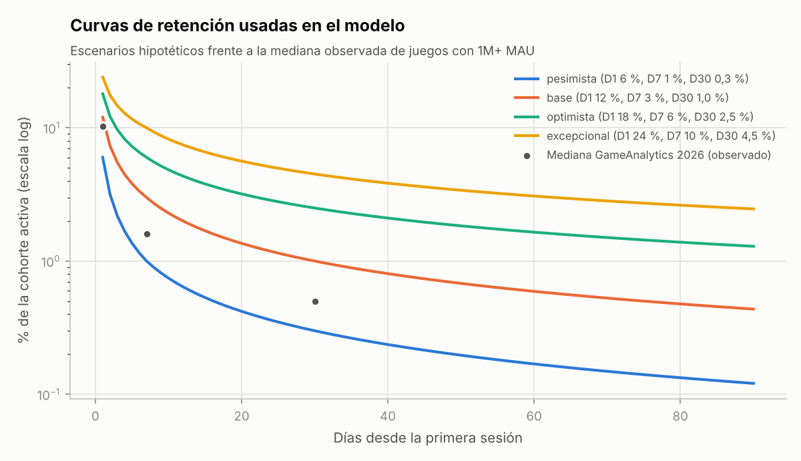
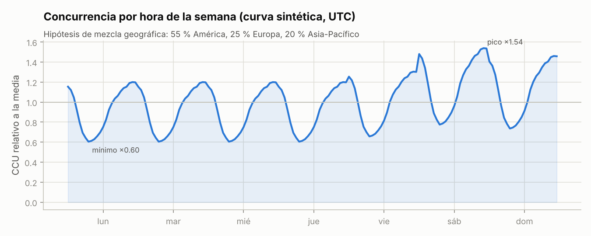
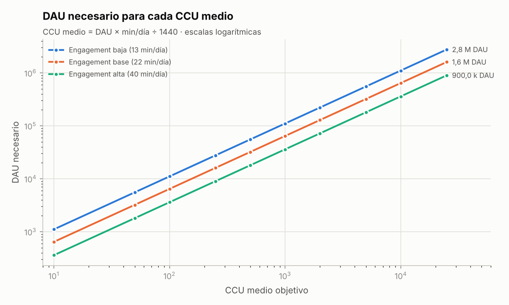
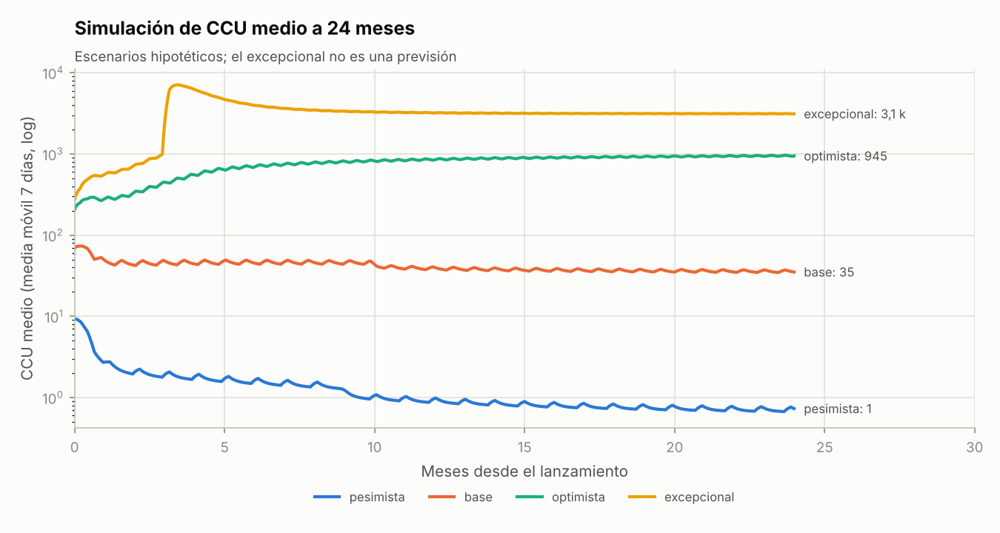
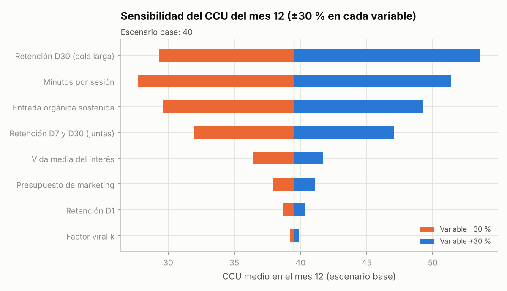
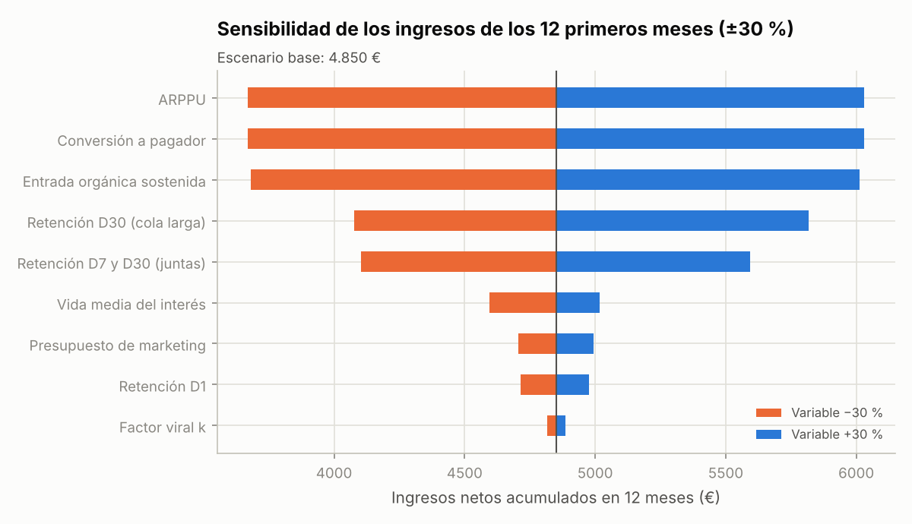

# Informe 4 — Retención, CCU y comportamiento de los jugadores

> **Fecha de referencia:** 22-10-2026.
> **Etiquetas:** [OBS] observado · [EST] estimación · [HIP] hipótesis. **Todos los escenarios de crecimiento son simulaciones hipotéticas, no previsiones.**
> **Modelo:** [modelos/modelo.py](modelos/modelo.py) (funciones `curva_retencion`, `tabla_ccu`, `simular`, `sensibilidad`). **Resultados:** [modelos/salidas/](modelos/salidas/). **Versión editable:** hoja `Simulador_cohortes` de [modelo_financiero.xlsx](modelo_financiero.xlsx).

---

## Resumen ejecutivo

1. **Benchmarks reales** [OBS]. En juegos de Roblox con más de 1 M de MAU (GameAnalytics 2026), la mediana es:
   - **D1 10,3 % · D7 1,6 % · D30 0,5 %**;
   - sesión de 9,8 min;
   - 22,4 min de juego al día por jugador.

   El 1 % superior llega a D1 22,2 % y D7 9,1 %.
2. **Nuestros objetivos** [HIP]: D1 ≥ 12 %, D7 ≥ 3 %, D30 ≥ 1 % para el escenario base, y D1 18 % / D7 6 % / D30 2,5 % como meta ambiciosa. Son objetivos propios, **no promedios observados**.
3. **La cifra clave es «días activos por jugador nuevo»** (suma de la curva de retención en 365 días): 1,6 (pesimista), **2,8 (base)**, 5,7 (optimista), 9,6 (excepcional).
   - Para sostener **100 CCU medios** hacen falta ~6.400 DAU.
   - Con retención base, eso exige **~2.300 jugadores nuevos al día**; con retención optimista, ~1.100.
4. **CCU medio, de pico y mínimo:**
   - con una mezcla geográfica supuesta, el pico semanal es ≈ **1,54 ×** la media y el mínimo ≈ **0,60 ×** [HIP, curva sintética];
   - un juego de 100 CCU medios verá ~154 en el pico del sábado y ~60 de madrugada.
5. **Simulación a 24 meses (CCU medio del mes 12):**
   - pesimista ≈ **1**;
   - base ≈ **40**;
   - optimista ≈ **850**;
   - excepcional ≈ **3.200** (con un pico diario medio de ~7.100 y una hora punta de ~11.000).
6. **Sensibilidad:** el CCU depende sobre todo de la **retención a 30 días (cola larga)**, de los **minutos por sesión** y de la **entrada orgánica**. El marketing pagado mueve poco el resultado si la retención no acompaña.
   - Pasar de actualizaciones cada 6 semanas a cada 2 aumenta el CCU del mes 12 en ~11 %.
   - No actualizar nunca lo reduce en ~30 %.

---

## 1. Metodología

| Pieza | Método |
|---|---|
| Benchmarks | GameAnalytics 2026 (más de 500 juegos de Roblox con 1 M+ MAU, ago-2025 a jul-2026) ([informe](https://www.gameanalytics.com/reports/2026-roblox-report); [resumen](https://gamedevreports.substack.com/p/gameanalytics-key-roblox-and-roblox)); bandas de «experiencias similares» del panel de Roblox ([DevForum](https://devforum.roblox.com/t/analytics-similar-experience-benchmarks-broader-access/2210285)) |
| Curvas de retención | Interpolación log-log entre las anclas D1, D7 y D30; más allá de D30, cola con la pendiente 7→30. Se comprueba que la curva pasa exactamente por las anclas (autocomprobación en el código) |
| DAU desde cohortes | DAU(t) = Σ nuevos(c) × R(t − c) (convolución diaria) |
| CCU | **CCU medio = DAU × sesiones/día × min/sesión ÷ 1.440** |
| Pico y mínimo | Curva semanal sintética por hora: perfil local típico de Roblox (más actividad por la tarde y la noche) ponderado por regiones (Norteamérica 40 %, Latinoamérica 15 %, Europa 25 %, Sudeste asiático 12 %, Oceanía 8 %) y por día (fin de semana +12-18 %) [HIP] |
| Crecimiento | Simulación diaria a 730 días con entrada orgánica (lanzamiento, decaimiento del interés, picos por actualización, amplificación algorítmica), viralidad (k × DAU), tráfico pagado (presupuesto ÷ coste por partida) y saturación (25 M de jugadores alcanzables) [HIP] |

---

## 2. Retención (4.1)

### 2.1 Definiciones operativas

| Métrica | Definición que usaremos |
|---|---|
| D1 / D7 / D30 | % de jugadores nuevos de un día que vuelven exactamente 1, 7 o 30 días después (definición clásica del panel de Roblox) |
| Duración de sesión | Minutos de entrada a salida |
| Sesiones por jugador y día | Sesiones / DAU |
| Jugadores nuevos y recurrentes | Primera sesión en el juego frente al resto |
| Abandono | Jugador que no vuelve en 14 días |
| Frecuencia de retorno | Días jugados en D2-7 y D8-28 (**señales directas de RFY desde junio de 2026**, [DevForum](https://devforum.roblox.com/t/recommended-for-you-algorithm-improvements-that-better-value-long-term-retention/4684575)) |
| Cohortes | Agrupación por semana de primera sesión **y por fuente** (Home/RFY, búsqueda, anuncios, enlaces), porque RFY solo valora a los usuarios orgánicos de Home |

### 2.2 Benchmarks disponibles

| Fuente | D1 | D7 | D30 | Sesión | Notas |
|---|---|---|---|---|---|
| GameAnalytics 2026, **mediana** (1 M+ MAU) | 10,3 % | 1,6 % | 0,5 % | 9,8 min (P75: 12; P90: 14,7) | [OBS] Sesgo de supervivencia: son juegos exitosos |
| GameAnalytics 2026, **1 % superior** | 22,2 % | 9,1 % | n. d. | — | [OBS] |
| Panel de Roblox, ejemplo de banda D1 de «experiencias similares» (≈ 2023) | P50: 12,4 % · P90: 24,1 % | — | — | — | [OBS] Ejemplo ilustrativo de un anuncio antiguo |
| Juego indie de carreras (Block Car Racing) | n. d. | n. d. | n. d. | Solo 25 % sigue a los 5 min; 56 % abandona la carrera | [OBS] Autodeclarado ([DevForum](https://devforum.roblox.com/t/25-of-new-users-are-still-playing-after-5-minutes/4244172)) |
| Juegos de coches en Rolimons (tiempo medio de juego) | — | — | — | 13-16 min | [OBS] |
| Reglas generales que circulan («D1 del 20 % = bueno») | 20 %+ | — | — | — | GameAnalytics las considera **infladas** por muestras pequeñas de juegos ya exitosos |

### 2.3 Objetivos del proyecto (propios) frente a observados

| Métrica | Mediana observada | **Objetivo base** | **Objetivo ambicioso** | Umbral de alarma |
|---|---|---|---|---|
| D1 | 10,3 % | **12 %** | 18 % | < 6 % |
| D7 | 1,6 % | **3 %** | 6 % | < 1 % |
| D30 | 0,5 % | **1 %** | 2,5 % | < 0,3 % |
| Sesión media | 9,8 min | **14 min** | 17-20 min | < 7 min |
| Sesiones / DAU / día | n. d. | 1,6 | 1,8-2,0 | < 1,2 |
| Rebote en la primera partida (< 60 s) | n. d. | **≤ 25 %** | ≤ 15 % | > 35 % |
| % de sesiones con algún compañero de crew | n. d. | 25 % | 40 % | < 15 % |
| % de eventos completados | n. d. | 75 % | 85 % | < 60 % |

**¿Por qué superar la mediana es razonable pero no está garantizado?** El género tiene sesiones algo más largas que la media (§5.1 del [Informe 1](01_analisis_mercado.md)) y el diseño ataca las causas conocidas de abandono. Pero la mediana de GameAnalytics es de **juegos ya exitosos**: un juego nuevo suele empezar **por debajo**.

### 2.4 Días activos por jugador nuevo (el multiplicador que manda)

| Escenario de retención | D1 | D7 | D30 | D90 (extrapolado) | **Días activos en 365 días** |
|---|---|---|---|---|---|
| Pesimista | 6 % | 1,0 % | 0,30 % | 0,12 % | **1,56** |
| Base | 12 % | 3,0 % | 1,00 % | 0,44 % | **2,78** |
| Optimista | 18 % | 6,0 % | 2,50 % | 1,29 % | **5,69** |
| Excepcional | 24 % | 10,0 % | 4,50 % | 2,46 % | **9,65** |

**Lectura:** cada jugador nuevo aporta, de media, 2,8 días de juego en el escenario base. **Más de la mitad de ese valor llega después del día 7**, de ahí que el modelo sea tan sensible a D7-D30. En la realidad, D1, D7 y D30 están **correlacionadas** (un juego mejor retiene en todos los horizontes): el D1 actúa como **puerta de entrada** aunque su efecto aislado en el modelo parezca pequeño.

### 2.5 Evolución por cohortes (cómo la mediremos)

1. Cohortes **semanales por fuente de adquisición**: Home/RFY, búsqueda, anuncios, enlaces o amigos.
2. **Matriz de retención** (cohorte × día) en el panel de Roblox, más eventos propios (§6).
3. **Retención por comportamiento:** jugó en crew o no; completó 3 eventos o no; compró la primera mejora o no. Sirve para encontrar «momentos mágicos» **correlacionados** con la retención, que después hay que confirmar con pruebas A/B antes de afirmar causalidad.

---

## 3. Diseño de la primera sesión (4.2)

**Principio:** el algoritmo mide el rebote en la **primera partida** (< 60 s y 61-180 s). Los primeros 3 minutos deciden la distribución orgánica.

| Momento | Qué ocurre | Objetivo medible |
|---|---|---|
| **0-30 s** | Carga mínima (radio de *streaming* pequeño). El jugador **aparece ya dentro de un coche clase D** en una avenida con neón; semáforo «3-2-1» contra 3 bots fáciles. Indicaciones de control adaptadas al dispositivo (2 iconos, sin texto largo) | ≥ 90 % llega a la salida de la primera carrera |
| **30 s-1 min** | **Primera carrera** (*sprint* de 50-60 s): aviso del nitro en el momento justo; final **ajustado y ganable** (los bots se calibran para que el principiante gane por poco si no choca) | ≥ 80 % termina la carrera; rebote < 60 s ≤ 25 % |
| **1-3 min** | **Primera recompensa:** pantalla corta con créditos, REP y una **repetición de 3 s del mejor momento**. **Primera elección de identidad:** escoger el coche propio entre 3 de clase D y un color | ≥ 75 % elige coche |
| **3-5 min** | **Segundo evento:** autopista entre el tráfico (*near-miss*) o huida corta (primer contacto con la policía, Heat 1). **Primera mejora:** «Motor nivel 1» con los créditos ganados (≈ 80 % del saldo) y la diferencia se nota al instante | ≥ 60 % compra la primera mejora |
| **5-10 min** | **Revelación del *hub*:** balizas de eventos. **Primera interacción social:** invitación a una **carrera de crew** (con jugadores del servidor o bots). Si ganan juntos: bonificación de crew. Aparecen las **misiones diarias** (3) | ≥ 40 % juega un evento de crew; ≥ 50 % ve las misiones |
| **10-30 min** | Se desbloquean Circuito y Zona de derrape (REP 3). **Primer desbloqueo cosmético** (llantas). Primer puesto en la tabla de amigos de un contrarreloj. Opción de unirse o crear una crew | Sesión media ≥ 14 min; ≥ 30 % completa 5 eventos |
| **30-60 min** | La barra de progreso muestra «te faltan X créditos para el Kaizen RS» (clase C, ~1,6 h). Se completan 1-2 misiones diarias. **Primera razón para volver:** recompensa diaria siguiente visible, evento de crew programado («mañana a las 20:00»), carrera relámpago de fin de semana | ≥ 20 % llega a 30 min en la primera sesión |
| **Al salir** | Resumen: «Mañana: misión nueva + 5.000 créditos de bonus de racha». Si el jugador aceptó las notificaciones de la experiencia: aviso de evento de crew | D1 ≥ 12 % |

**Lo que debe suceder antes de que el jugador abandone (embudo mínimo):**

1. Ganar una carrera.
2. Sentir el nitro.
3. Elegir **su** coche.
4. Comprar **una** mejora y notarla.
5. Ver el *hub* lleno de eventos.
6. Jugar **con alguien** (aunque sea un desconocido o un bot de crew).
7. Ver **qué le espera mañana**.

Se instrumenta como embudo de incorporación (§6).

---

## 4. Sistemas de retención (4.3)

**Clasificación ética:**

- **Diversión genuina:** el jugador vuelve porque quiere.
- **Presión:** el jugador vuelve por miedo a perder algo.

Diseñamos para la primera y limitamos la segunda.

| Sistema | Mecanismo | Impacto hipotético D1 / D7 / D30 [HIP] | Coste | Tipo | Regla de diseño |
|---|---|---|---|---|---|
| Inicio de sesión diario | Recompensa por entrar | Bajo / medio / bajo | Bajo | **Presión** | Racha con **margen de 1 día**; la recompensa nunca bloquea contenido |
| Recompensas por tiempo jugado | Regalos cada X min | Medio / bajo / bajo | Bajo | Presión (fomenta AFK) | **Solo con actividad real**: requiere participar en eventos, no estar conectado |
| Misiones diarias (3) | Objetivos variados («2 derrapes de 5 s») | Medio / alto / medio | Bajo | Genuina si son variadas | Completables en ≤ 20 min; diseñadas para enseñar contenido |
| Misiones semanales (5) | Objetivos mayores, uno de crew | Bajo / alto / alto | Bajo | Genuina | Al menos una de crew (co-juego) |
| Pase de temporada | Niveles por XP y recompensas | Bajo / alto / **alto** | Medio | Mixta | Recompensas gratis valiosas; **sin temporizadores falsos**; los objetos vuelven en temporadas posteriores |
| Reputación (REP) | Niveles que desbloquean eventos y distritos | Alto / alto / medio | Bajo | Genuina | Ritmo inicial rápido (REP 3 en 15 min) |
| Colecciones y maestría | Libro de coches, maestría por coche | Bajo / medio / **alto** | Medio | Genuina | Recompensas cosméticas exclusivas por coche |
| Eventos temporales | Fin de semana relámpago, eventos de temporada | Bajo / alto / alto | Medio | Mixta | Anunciados con antelación; repetibles |
| Carreras rotativas | Evento destacado diario y semanal con bonificación | Medio / alto / medio | Bajo | Genuina | Usa rutas existentes (contenido barato) |
| Clasificaciones | Semanales por evento: amigos y global | Bajo / medio / medio | Bajo | Genuina (en los mejores) | **La tabla de amigos va por defecto**: motiva a todos |
| Desafíos entre amigos | Fantasma de «bate mi tiempo» con enlace | Medio / alto / alto | Medio | Genuina | Enlace compartible (atribución de *Audience Expansion*) |
| Torneos | Campeonatos de crew | — / medio / alto | Alto | Genuina | Solo con masa crítica [F5] |
| Desbloqueos | Clases, distritos, eventos | Alto / alto / medio | Bajo | Genuina | Cada sesión desbloquea algo en las primeras 5 horas |
| Recompensas de progresión | Hitos de REP con regalos | Medio / medio / medio | Bajo | Genuina | Visibles en una barra de progreso |
| Personalización | Identidad del coche | Medio / alto / **alto** | Medio | Genuina | Lo mejor se consigue jugando; el pago amplía opciones |
| Objetivos a largo plazo | Primer clase S (~50 h), crew legendaria | Bajo / medio / **alto** | Bajo | Genuina | Siempre visible «el siguiente gran objetivo» |
| Notificaciones de la experiencia | Avisos opcionales a quien los acepta | Bajo / medio / medio | Bajo | Mixta | Máximo 1 al día y solo por cosas reales (crew, evento) |

**Qué no haremos:**

- temporizadores falsos;
- castigos por no entrar (perder el progreso);
- recompensas por estar AFK;
- cajas aleatorias de pago;
- «ofertas de último minuto» engañosas.

Además de éticas, estas prácticas tienen **riesgo reputacional** (reacción a la caja de Driving Empire en 2023) y **riesgo de cumplimiento** en una plataforma con público menor de edad.

---

## 5. Modelización del CCU (4.4)

### 5.1 Fórmula y alcance

**CCU medio = DAU × sesiones por usuario y día × minutos por sesión ÷ 1.440**

- La fórmula da la **concurrencia media diaria**, no el pico.
- El **pico** depende de cómo se concentra el juego en las mismas horas.
- Con una audiencia muy concentrada en una zona horaria (p. ej., solo Norteamérica), la relación pico/media sube a 1,8-2,2 [HIP]. Con audiencia global se aplana.

**Curva sintética usada** [HIP]:

- pico semanal (sábado por la tarde-noche en América) ≈ **1,54 ×** la media;
- pico de un día laborable ≈ 1,20 ×;
- mínimo ≈ **0,60 ×**.

### 5.2 Perfiles de *engagement*

| Perfil | Sesiones / día | Min / sesión | Min / día | DAU por CCU medio |
|---|---|---|---|---|
| Bajo | 1,3 | 10 | 13 | 110,8 |
| **Base** | 1,6 | 14 | **22,4** (= mediana de GameAnalytics) | **64,3** |
| Alto | 2,0 | 20 | 40 | 36,0 |

### 5.3 ¿Qué hace falta para cada nivel de CCU?

DAU según el perfil de *engagement*. Jugadores nuevos al día necesarios en estado estacionario (DAU base / días activos) según la retención.

| CCU medio | Pico semanal | Mínimo | DAU (eng. bajo) | **DAU (eng. base)** | DAU (eng. alto) | Nuevos/día (ret. pesimista) | **Nuevos/día (ret. base)** | Nuevos/día (ret. optimista) | Nuevos/día (ret. excepcional) | Coste/mes si todos fueran pagados (0,03 $ por partida) |
|---|---|---|---|---|---|---|---|---|---|---|
| 10 | 15 | 6 | 1.108 | **643** | 360 | 413 | **231** | 113 | 67 | 211 $ |
| 50 | 77 | 30 | 5.538 | **3.214** | 1.800 | 2.064 | **1.156** | 565 | 333 | 1.054 $ |
| 100 | 154 | 60 | 11.077 | **6.429** | 3.600 | 4.128 | **2.312** | 1.131 | 666 | 2.109 $ |
| 250 | 385 | 151 | 27.692 | **16.071** | 9.000 | 10.320 | **5.781** | 2.826 | 1.666 | 5.272 $ |
| 500 | 769 | 302 | 55.385 | **32.143** | 18.000 | 20.640 | **11.561** | 5.653 | 3.332 | 10.544 $ |
| 1.000 | 1.538 | 604 | 110.769 | **64.286** | 36.000 | 41.279 | **23.122** | 11.305 | 6.664 | 21.087 $ |
| 2.000 | 3.077 | 1.209 | 221.538 | **128.571** | 72.000 | 82.559 | **46.244** | 22.610 | 13.328 | 42.175 $ |
| 5.000 | 7.692 | 3.021 | 553.846 | **321.429** | 180.000 | 206.396 | **115.610** | 56.525 | 33.320 | 105.437 $ |
| 10.000 | 15.384 | 6.043 | 1.107.692 | **642.857** | 360.000 | 412.793 | **231.221** | 113.050 | 66.640 | 210.873 $ |
| 25.000 | 38.461 | 15.107 | 2.769.231 | **1.607.143** | 900.000 | 1.031.982 | **578.052** | 282.625 | 166.599 | 527.183 $ |

**Lecturas clave:**

1. **100 CCU medios ≈ 6.400 DAU ≈ 2.300 nuevos al día** con retención base. Es un listón alto para un juego nuevo: unos 70.000 jugadores nuevos al mes.
2. **Duplicar la retención (base → optimista) reduce a la mitad la captación necesaria.** La retención es la palanca más barata.
3. **Comprar toda la captación** con anuncios al coste por partida base (0,03 $) cuesta más de lo que el juego ingresa en cualquier nivel con monetización baja o media (ver [07](07_proyecciones_financieras.md)). La adquisición pagada sirve para **arrancar y medir**, no para sostener.
4. **No asumimos que estos niveles sean probables.** La probabilidad se discute en [11](11_riesgos_viabilidad.md). Como contexto [OBS]: en junio de 2026, de ~8,5 M de experiencias rastreadas, ~19.000 tenían al menos un jugador en un momento dado, ~1.370 tenían 1.000 o más, y 112 tenían 10.000 o más ([RoWatcher](https://rowatcher.com/news/how-many-games-are-on-roblox-in-2026)).

---

## 6. Simulación del crecimiento (4.5)

### 6.1 Supuestos por escenario [HIP]

| Parámetro | Pesimista | Base | Optimista | Excepcional (aparte) |
|---|---|---|---|---|
| Retención (D1 / D7 / D30) | 6 / 1 / 0,3 % | 12 / 3 / 1 % | 18 / 6 / 2,5 % | 24 / 10 / 4,5 % |
| *Engagement* (sesiones × min) | 1,4 × 11 | 1,6 × 14 | 1,8 × 17 | 1,8 × 19 |
| Monetización | Baja | Media | Alta | Media (la viralidad atrae a jugadores que gastan poco) |
| Entrada orgánica sostenida (nuevos/día) | 140 | 1.100 | 3.000 | 3.500 |
| Pico de lanzamiento (nuevos/día extra, decae en ~10 días) | 600 | 2.500 | 5.000 | 6.000 |
| Amplificación algorítmica por buenas señales | — | — | ×2,2 a partir del día 45 (rampa de 90 días) | ×2,0 a partir del día 45 |
| Ruptura viral | — | — | — | Día 90: +160.000 nuevos/día que decaen con una constante de 20 días |
| Vida media del interés sin novedades / suelo con LiveOps | 150 d / 30 % | 240 d / 45 % | 300 d / 55 % | 300 d / 60 % |
| Actualizaciones (cada / pico de entrada) | 30 d / +40 % | 21 d / +60 % | 14 d / +80 % | 14 d / +80 % |
| Viralidad k (nuevos/día por DAU) | 0,004 | 0,010 | 0,020 | 0,030 |
| Marketing (lanzamiento / mensual) | 50 € / 0 € | 250 € / 100 € | 500 € / 250 € | 500 € / 500 € |
| Caída de popularidad (*shock*) | −30 % desde el día 270 | −25 % desde el día 300 | — | — |
| Saturación (audiencia alcanzable) | 25 M | 25 M | 25 M | 25 M |

**Cómo leer «entrada orgánica»:** jugadores nuevos al día que llegan sin pagar (Home/RFY, búsqueda, amigos). Es la **variable más incierta** y la que mejor resume si el algoritmo «compra» el juego. Por eso el plan de validación (Informe 10) mide primero las señales que la determinan (rebote y retención) con tráfico pagado barato.

### 6.2 Resultados a 3, 6, 12 y 24 meses

| Escenario | Mes | Nuevos/día | DAU medio | **CCU medio** | CCU pico semanal (est.) | Ingresos €/mes | Beneficio €/mes | Caja acumulada € |
|---|---|---|---|---|---|---|---|---|
| Pesimista | 3 | 123 | 183 | **2** | 3 | 11 | −239 | −3.058 |
| Pesimista | 6 | 96 | 151 | **1,6** | 2 | 9 | −241 | −3.780 |
| Pesimista | 12 | 47 | 86 | **0,9** | 1 | 5 | −245 | −5.241 |
| Pesimista | 24 | 35 | 66 | **0,7** | 1 | 4 | −246 | −8.189 |
| Base | 3 | 1.341 | 2.952 | **46** | 71 | 410 | 58 | −2.280 |
| Base | 6 | 1.156 | 2.967 | **46** | 71 | 412 | 60 | −2.124 |
| Base | 12 | 793 | 2.542 | **40** | 61 | 342 | −7 | −1.922 |
| Base | 24 | 628 | 2.294 | **36** | 55 | 308 | −40 | −2.250 |
| Optimista | 3 | 5.830 | 18.477 | **393** | 604 | 5.424 | 4.377 | 7.633 |
| Optimista | 6 | 8.137 | 32.228 | **685** | 1.054 | 9.461 | 8.010 | 28.151 |
| Optimista | 12 | 7.026 | 40.053 | **851** | 1.309 | 11.379 | 9.175 | 80.650 |
| Optimista | 24 | 5.671 | 44.768 | **951** | 1.464 | 12.718 | 10.314 | 201.125 |
| *Excepcional* | 3 | 18.089 | 48.157 | *1.144* | *1.760* | *6.688* | *5.259* | *7.105* |
| *Excepcional* | 6 | 14.707 | 178.197 | *4.232* | *6.511* | *24.746* | *20.275* | *83.265* |
| *Excepcional* | 12 | 9.038 | 135.748 | *3.224* | *4.960* | *18.243* | *14.763* | *178.285* |
| *Excepcional* | 24 | 7.108 | 131.823 | *3.131* | *4.817* | *17.716* | *14.315* | *353.704* |

*Ingresos netos para el estudio (después de la cuota de Roblox y de DevEx), en euros al tipo del BCE del 20-10-2026. Costes de caja según [07](07_proyecciones_financieras.md). Sin coste de oportunidad ni impuestos. La caja acumulada incluye 2.310 € de inversión previa.*

- **Escenario excepcional:** máximo de CCU medio diario ≈ **7.125** (día 101), con una hora punta estimada de ≈ **11.000**.
- **Optimista:** el máximo diario es de ≈ 976 al final del periodo.

**Interpretación:**

- **Pesimista:** el juego no capta la atención del algoritmo y se apaga. Las reglas GO/NO-GO deben detectarlo en el **mes 2-3**, no en el 24 (Informe 12).
- **Base:** un juego competente sin tracción algorítmica fuerte se estabiliza en **35-45 CCU**. Cubre aproximadamente los costes de caja, **no** el tiempo de los socios.
- **Optimista:** buenas señales y amplificación dan **~850-950 CCU** al año, ~11-13 k€ de ingresos netos al mes.
- **Excepcional:** una ruptura viral (como WRONG WAY, que pasó de 0 a 14 k de pico en días) puede llevar a miles de CCU. **No es una previsión** y no debe usarse para planificar gastos.

### 6.3 Sensibilidad (±30 % en cada variable, escenario base)

| Variable | CCU mes 12 (−30 %) | CCU mes 12 (+30 %) | Ingresos 12 m (−30 %) | Ingresos 12 m (+30 %) |
|---|---|---|---|---|
| Retención D30 (cola larga) | 29,3 | **53,6** | 4.077 € | 5.817 € |
| Minutos por sesión | 27,7 | 51,4 | 4.850 € | 4.850 € |
| Entrada orgánica sostenida | 29,6 | 49,3 | 3.681 € | **6.013 €** |
| Retención D7 y D30 (juntas) | 31,9 | 47,1 | 4.103 € | 5.593 € |
| Vida media del interés | 36,4 | 41,7 | 4.594 € | 5.016 € |
| Presupuesto de marketing | 37,9 | 41,1 | 4.706 € | 4.994 € |
| Retención D1 (aislada) | 38,7 | 40,3 | 4.714 € | 4.977 € |
| Factor viral k | 39,2 | 39,9 | 4.815 € | 4.885 € |
| Conversión a pagador | 39,5 | 39,5 | 3.670 € | **6.030 €** |
| ARPPU | 39,5 | 39,5 | 3.670 € | **6.030 €** |

*Base: 39,5 CCU en el mes 12 y 4.850 € de ingresos netos acumulados en 12 meses.*

**Notas:**

1. Los **minutos por sesión** mueven el CCU, pero **no los ingresos** del modelo, porque la monetización se modela por DAU. En la realidad, más tiempo probablemente implica más gasto, así que el efecto sobre los ingresos está infravalorado.
2. La D1 **aislada** parece poco influyente porque el modelo varía cada ancla por separado. En la práctica, D1, D7 y D30 se mueven juntas.

### 6.4 Efecto de las palancas (escenario base, 12 meses)

| Palanca | Valor | CCU mes 6 | CCU mes 12 | Ingresos netos 12 m | Gasto de marketing 12 m |
|---|---|---|---|---|---|
| Marketing mensual | 0 € | 41,5 | 34,1 | 4.371 € | 0 € |
| | 50 € | 43,8 | 36,8 | 4.610 € | 600 € |
| | 100 € (base) | 46,2 | 39,5 | 4.850 € | 1.200 € |
| | 250 € | 53,1 | 47,6 | 5.569 € | 3.000 € |
| | 500 € | 64,7 | 61,0 | 6.766 € | 6.000 € |
| | 1.000 € | 88,0 | 87,8 | 9.162 € | 12.000 € |
| Días entre actualizaciones | 14 | 48,6 | 41,2 | 5.085 € | — |
| | 21 (base) | 46,2 | 39,5 | 4.850 € | — |
| | 42 | 43,6 | 37,1 | 4.562 € | — |
| | Sin actualizaciones | 36,2 | **27,9** | 3.859 € | — |

**Conclusiones de las palancas:**

- Con un coste por partida de 0,03 $ y retención base, **cada euro de publicidad devuelve ~0,4 €** de ingresos en 12 meses.
- La publicidad solo se paga sola si el coste por partida baja hacia 0,01 $ (Roblox afirma que puede quedar por debajo, [DevForum](https://devforum.roblox.com/t/ads-for-creators-rdc-recap-and-what%E2%80%99s-next/3929106)) **y** la retención es al menos base. Detalle en la tabla de LTV de [07](07_proyecciones_financieras.md).
- Las **actualizaciones frecuentes** son la palanca de LiveOps con mejor relación coste/efecto.
- **No actualizar** recorta ~30 % del CCU en un año.

### 6.5 Saturación y caídas de popularidad

- **Saturación:** con 25 M de jugadores alcanzables [HIP], solo el escenario excepcional se acerca al techo (~9,5 M de nuevos en 24 meses). En el resto, el límite es la atención del algoritmo, no el tamaño del mercado.
- **Caídas:** los escenarios pesimista y base incluyen un *shock* del −25 % al −30 % (cambio de algoritmo, competidor). Este tipo de evento ya ha ocurrido: el cambio de RFY afectó a la monetización de cohortes jóvenes en el T2 2026 ([carta T2 2026](https://s27.q4cdn.com/984876518/files/doc_financials/2026/q2/Roblox-Q2-2026-Earnings-Shareholder-Letter.pdf)).

---

## 7. Instrumentación necesaria

| Evento / funnel | Herramienta | Uso |
|---|---|---|
| Embudo de incorporación (10 pasos de §3) | `AnalyticsService:LogOnboardingFunnelStepEvent` ([docs](https://create.roblox.com/docs/production/analytics/event-types)) | Detectar dónde se rompe la primera sesión |
| Embudo de la primera compra | `LogFunnelStepEvent` (máximo 10 embudos por experiencia) | Conversión |
| Fuentes y sumideros de créditos | `LogEconomyEvent` | Salud de la economía |
| Eventos propios: `race_start/finish/quit`, `respawn`, `police_bust/escape`, `crew_join`, `crew_event_finish` | `LogCustomEvent` + 3 campos personalizados | Retención por comportamiento |
| Retención por cohorte y fuente | Panel de Roblox (Analytics → Retention / Acquisition) | Objetivos de §2.3 |

---

## 8. Conclusiones

1. El objetivo realista para un juego bien hecho es **superar la mediana de GameAnalytics** (D1 12 %, D7 3 %, D30 1 %). Llegar al escenario optimista exige retención de cuartil superior.
2. El CCU es, en esencia, **entrada orgánica × días activos × minutos**. Las tres palancas son de diseño, no de presupuesto.
3. El escenario base **no** hace viable el proyecto en términos de tiempo invertido. La tesis de inversión depende de alcanzar señales del **cuartil superior** y de que el algoritmo amplifique el juego.

## 9. Recomendaciones accionables

1. Instrumentar el embudo de §3 **antes** de la primera prueba con usuarios.
2. Medir la retención **por fuente**: los usuarios de anuncios no cuentan para RFY y pueden retener distinto.
3. Fijar los umbrales de alarma de §2.3 como criterios de rediseño (Informe 12).
4. Priorizar la cadencia de actualizaciones (cada 2-3 semanas) sobre el gasto en marketing.

## 10. Incertidumbres y limitaciones

- La **entrada orgánica** es una hipótesis sin dato público. La transparencia de Roblox sobre impresiones y PTR solo está disponible **dentro** del panel del creador, después de publicar.
- Las curvas de retención son **interpolaciones**. La cola más allá de D30 es una extrapolación.
- La curva horaria es **sintética**: el reparto geográfico real se conocerá con el panel de Roblox.
- El modelo no incluye **reactivaciones** (jugadores que vuelven tras mucho tiempo), lo que hace los escenarios algo conservadores. Tampoco incluye efectos de red no lineales (más jugadores → mejores eventos).
