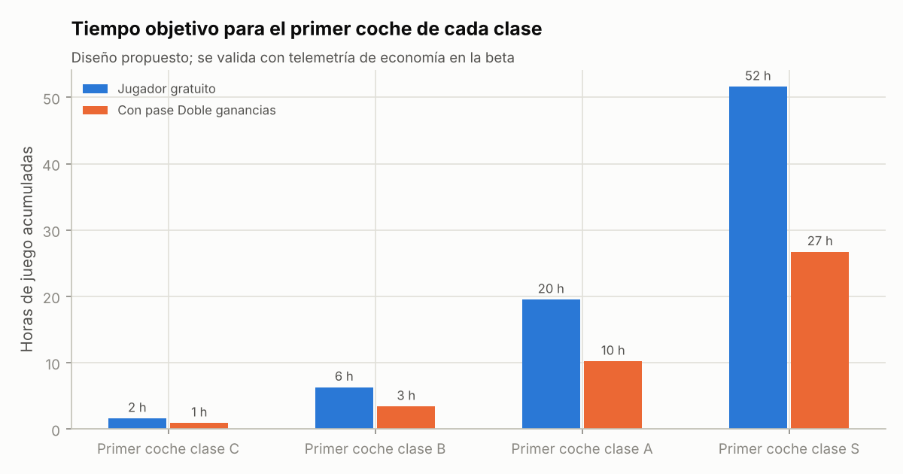

# Informe 5 (5.1-5.3) — Monetización y economía del juego

> **Fecha de referencia:** 22-10-2026.
> **Etiquetas:** [OBS] observado · [EST] estimación · [HIP] hipótesis.
> Las proyecciones de ingresos están en [07_proyecciones_financieras.md](07_proyecciones_financieras.md). La tabla de progresión se calcula en `tabla_economia()` de [modelos/modelo.py](modelos/modelo.py) y es editable en la hoja `Economia_juego` de [modelo_financiero.xlsx](modelo_financiero.xlsx).

---

## Resumen ejecutivo

- **Condiciones de Roblox a octubre de 2026** [OBS]:
  - el creador recibe el **70 %** de los Robux gastados en pases y productos;
  - DevEx paga **0,0038 $/R$** (desde el 5-9-2025) y **0,0054 $/R$** por el gasto de jugadores de EE. UU. de 18+ verificados en juegos elegibles (desde el 8-6-2026);
  - en términos de dinero del jugador, el creador recibe ≈ **26,6 %** (≈ **37,8 %** con la tasa 18+).
- **Fuentes adicionales:**
  - **Creator Rewards:** 5 R$ por usuario cualificado y día, y 35 % del gasto de usuarios nuevos o recuperados en sus primeros 60 días;
  - incentivos de **Roblox Plus**;
  - **vídeo recompensado**;
  - **precios regionales** (+4-10 % de gasto según Roblox).
- **Estrategia:** monetización **cosmética, de comodidad y de temporada**, sin cajas de pago y **sin ventaja comprable en competición** (clases de rendimiento).
- **Lanzamiento:** **4 pases + 7 productos + servidores privados**. El **pase de temporada** llega en la T1.
- **Economía:** una moneda blanda (**créditos**) y progreso no gastable (**REP**, XP de crew, maestría). Tiempos objetivo para un jugador gratuito:
  - primer coche clase C en **~1,6 h**;
  - B en **~6 h**;
  - A en **~20 h**;
  - S en **~52 h**.

  Con el pase «Doble Ganancias»: 0,9 / 3,4 / 10 / 27 h.
- **Sin comercio entre jugadores** (evita duplicaciones, estafas y mercado negro).

---

## 5.1 Investigación de monetización

### 5.1.1 Mecanismos disponibles en Roblox (condiciones vigentes)

| Mecanismo | Condiciones [OBS] | Fuente |
|---|---|---|
| **Pases** (compra única) | El creador recibe el 70 % de los Robux | [Earning on Roblox](https://create.roblox.com/docs/production/earning-on-roblox) |
| **Productos para desarrolladores** (consumibles) | 70 %; procesamiento con `ProcessReceipt` | Ídem |
| **Precios regionales** | Voluntarios por artículo. Roblox ajusta el precio por país según poder adquisitivo. Ya disponible para productos. Roblox declaró +4-10 % de gasto total y ~+50 % de compras de pases en las regiones con descuento | [Docs](https://create.roblox.com/docs/production/monetization/regional-pricing); [DevForum](https://devforum.roblox.com/t/introducing-regional-pricing-for-developer-products/3971235); [GamesBeat](https://gamesbeat.com/?p=318220) |
| **Servidores privados** | Gratis o con cuota mensual en Robux fijada por el creador. Desde el 24-9-2026, los suscriptores de Roblox Plus tienen **un único** servidor privado gratuito por juego | [Docs](https://create.roblox.com/docs/production/monetization/private-servers); [PlayNews](https://www.playnews.gg/en/guides/roblox-plus-free-private-servers-limited-to-one-per-game-starting-september-24-2026) |
| **Suscripciones de experiencia** | El jugador paga en moneda real y el creador cobra en Robux. La documentación de la tasa 18+ enumera las «suscripciones» como ingreso elegible. **Disponibilidad y requisitos para cuentas nuevas no verificados** en esta sesión | [Doc. 18+](https://create.roblox.com/docs/production/monetization/18-plus-devex-rate); [80.lv](https://80.lv/articles/roblox-is-launching-subscriptions-for-eligible-creators/) |
| **Roblox Plus** (4,99 $/mes desde el 30-4-2026) | Roblox cubre el descuento del 10-20 % al suscriptor: **el creador cobra lo mismo**. Hasta **100 R$ por suscriptor** con ≥ 60 min en servidores privados de pago en 30 días. Hasta **750 R$ por suscriptor nuevo** captado mediante la API de suscripción dentro del juego | [DevForum](https://devforum.roblox.com/t/introducing-roblox-plus/4567894/1); [Tubefilter](https://tubefilter.com/2026/04/13/roblox-plus-creator-payouts) |
| **Creator Rewards: participación diaria** | **5 R$** por usuario cualificado y día. Cualificado = *Active Spender* (≥ 9,99 $ de compras cualificadas en 60 días y no nuevo ni reactivado) que juega ≥ 10 min en la experiencia, siempre que esta sea una de las **3 primeras** que juega ese día | [Docs](https://create.roblox.com/docs/creator-rewards) |
| **Creator Rewards: *Audience Expansion*** | **35 %** de los primeros 100 $ de compras cualificadas de usuarios **nuevos o inactivos ≥ 60 días** traídos mediante enlace para compartir, enlace directo o búsqueda por nombre, en sus primeros 60 días. Requiere ≥ 100 DAU de media durante 60 días, ID verificado y cuenta DevEx. Retención de 60 días antes del abono | [Docs](https://create.roblox.com/docs/creator-rewards); [DevForum](https://devforum.roblox.com/t/introducing-creator-rewards-earn-more-by-growing-the-community/3777628) |
| **Vídeo recompensado** | Ganancia = EPM × impresiones; solo usuarios de 13+. **Roblox no publica el EPM**. Las cifras de terceros (6-12 $ eCPM; 5-15 % de los ingresos) **no están verificadas** | [DevForum](https://devforum.roblox.com/t/more-creators-can-now-use-rewarded-video-ads/3838678); [carta T1 2026](https://www.sec.gov/Archives/edgar/data/0001315098/000162828026028882/ex991-q12026earningsshar.htm) |
| **DevEx** | 0,0038 $/R$ estándar. 0,0054 $/R$ para el gasto elegible de 18+ verificados en EE. UU., solo en juegos con avatar R15 o humanoide propio el 100 % del tiempo (un R6 en cualquier momento invalida). Mínimo de 30.000 Earned Robux por retirada; 13+ | [Ayuda DevEx](https://en.help.roblox.com/hc/en-us/articles/13061189551124-Developer-Exchange-Help-and-Information-Page); [Términos](https://en.help.roblox.com/hc/en-us/articles/115005718246-Developer-Exchange-Terms-of-Use); [Doc. 18+](https://create.roblox.com/docs/production/monetization/18-plus-devex-rate) |

**De Robux gastados a dinero ingresado (no confundirlos):**

```
1.000 R$ gastados por jugadores (en un pase o producto)
  → 700 Earned Robux para el estudio (70 %)
  → 700 × 0,0038 $ = 2,66 $ (tasa estándar)  |  700 × 0,0054 $ = 3,78 $ (18+ EE. UU. elegible)
  → ÷ 1,1215 USD/EUR (BCE, 20-10-2026) = 2,37 € | 3,37 €
```

**Precio implícito del Robux:** Roblox afirma que con la tasa 18+ la parte efectiva del creador pasa del 26,6 % al 37,8 % del gasto ([carta T1 2026](https://s27.q4cdn.com/984876518/files/doc_financials/2026/q1/Q1-2026-Earnings-Shareholder-Letter.pdf)). Las cuentas cuadran con un precio medio de **~0,0100 $ por Robux** pagado por el jugador (0,7 × 0,0038 / 0,266) [EST]. Así, **1 R$ de gasto del jugador ≈ 1 céntimo de dólar**, y el estudio recibe ~0,27 céntimos.

### 5.1.2 Qué venden los juegos de conducción (resumen de [02](02_competidores.md))

| Producto | Ejemplo | Precio | Lección |
|---|---|---|---|
| Pase con coche + multiplicador de dinero | Driving Empire «[PORSCHE UPD]» | 500 R$ | Vende bien acelerar, pero roza el *pay-to-win* |
| Caja aleatoria con coches exclusivos | Driving Empire (2023) | 649 R$ | **Rechazo y retirada**: evitar |
| Pase de temporada | Car Dealership Tycoon | 399 / 599 / 1.599 R$ | Formato aceptado por la comunidad |
| Cosmético barato | Car Dealership Tycoon (colores especiales) | 80 R$ | Puerta de entrada al primer pago |
| Pases de vehículo o capacidad | A Dusty Trip | 75-600 R$ (sin verificar) | Escalera de precios amplia |
| Licencias de marca | Driving Empire, Greenville, CDID | — | Las marcas como **contenido**, no como venta directa |

**Limitación:** no se auditaron las tiendas completas (la red bloquea roblox.com). Es una tarea de la Fase 0.

### 5.1.3 Evaluación de mecanismos para Nitro Crews

| Mecanismo | Encaje | Prioridad | Riesgo para la experiencia gratuita | Comentario |
|---|---|---|---|---|
| Pases cosméticos | Muy alto | P1 | Bajo | Núcleo de la propuesta justa |
| Pases de comodidad (garaje) | Alto | P1 | Bajo | — |
| Pase de progresión («Doble Ganancias») | Alto | P1 | **Medio** | Acelera la colección, **no** el resultado en carrera (clases) |
| Paquetes de créditos | Alto | P1 | Medio | Valor escalado por nivel de REP para que sigan siendo útiles |
| Pack de inicio (única vez) | Muy alto | P1 | Bajo | Mejor convertidor al primer pago en la industria [HIP] |
| Pase de temporada | Muy alto | P2 (T1) | Bajo-medio | Retención D7-D30 + ingreso recurrente |
| Garajes *premium* | Medio | P1 (dentro del pase de garaje) | Bajo | — |
| Servidores privados | Medio | P1 | Bajo | Incentivo de Roblox Plus |
| Suscripción propia («Nitro Club») | Medio | P3 | Bajo | Solo si está disponible para nuestra cuenta y hay demanda |
| Vídeo recompensado | Medio | P2 | Medio (intrusivo si se abusa) | Opcional, solo 13+, máximo 3 al día |
| API de Roblox Plus (750 R$ por suscriptor) | Medio | P3 | Medio (ofertas a menores) | Ofrecerlo **una vez**, sin insistir |
| Precios regionales | Alto | **P1** | Nulo | Activar en todos los artículos |
| Cajas o botín de pago | — | **[NO]** | Muy alto | Reputación y cumplimiento |
| Venta de rendimiento por encima de la clase | — | **[NO]** | Muy alto | Rompe el pilar de justicia |
| Licencias de marca | — | F5 | — | Cuando haya escala |

---

## 5.2 Catálogo comercial

**Niveles de precio:** accesible (≤ 149 R$, ≈ ≤ 1,5 $), intermedio (199-499 R$), *premium* (≥ 799 R$).
**Prioridad:** P1 = lanzamiento (MVP) · P2 = beta o T1 · P3 = T2 o posterior.

### 5.2.1 Pases (compra única)

| Nombre | Tipo | Precio | Público | Valor percibido | Momento de presentación | Recompensa | Frecuencia | Riesgo | Prioridad |
|---|---|---|---|---|---|---|---|---|---|
| **Garaje Ampliado** | Comodidad | 149 R$ | Coleccionistas | Alto, una vez lleno | Al intentar comprar con el garaje lleno | +15 plazas permanentes | Única | Bajo | **P1** |
| **Doble Ganancias** | Progresión | 449 R$ | Jugadores impacientes y adultos | Muy alto | Tras 45-60 min, en el primer «no me llega» | ×2 créditos de **eventos** (no de misiones ni de temporada) | Única | **Medio** | **P1** |
| **Pack Neón** | Cosmético | 199 R$ | 10-17 años, estilo | Alto (se ve en el mundo) | En el taller, al ver el neón básico | Neones animados (8 patrones) + colores extra | Única | Bajo | **P1** |
| **Sonidos de Escape** | Cosmético | 149 R$ | Aficionados al motor | Medio-alto | En el taller (vista previa sonora) | 6 sonidos de escape y petardeos | Única | Bajo | **P1** |
| **Club VIP** | Estatus + comodidad | 399 R$ | Jugadores comprometidos | Medio | Tras 5 sesiones | Zona VIP en La Plaza, placa dorada, 1 cambio diario de misión, *livery* mensual exclusiva | Única | Bajo | P2 |
| **Crew Plus** | Social | 199 R$ | Líderes de crew | Medio | Al crear una crew | Crew de 30 en lugar de 20, estandarte animado, colores de crew | Única | Bajo | P2 |
| **Editor Pro de vinilos** | Cosmético | 249 R$ | Creativos | Alto (cuando exista el editor) | En el editor | Más capas y ranuras de diseños | Única | Bajo | P3 |
| **Élite Policial** | Cosmético | 249 R$ | Jugadores de policía | Medio | Con la policía jugadora | Coches y luces de policía cosméticos | Única | Bajo | P3 (F5) |

### 5.2.2 Productos para desarrolladores (consumibles)

| Nombre | Tipo | Precio | Público | Valor percibido | Momento | Recompensa | Frecuencia | Riesgo | Prioridad |
|---|---|---|---|---|---|---|---|---|---|
| **Pack de Inicio** | Oferta única | 99 R$ | Nuevos (primeros 7 días) | **Muy alto** | Tras la 3.ª carrera (y una vez más el día 2) | Variante cosmética exclusiva del coche D elegido + 25.000 créditos + neón básico | Una por cuenta | Bajo | **P1** |
| Créditos XS | Moneda | 49 R$ | Todos | Medio | «Te faltan X créditos» | 6.000 × multiplicador de nivel | Recurrente | Medio | **P1** |
| Créditos S | Moneda | 149 R$ | Todos | Medio | Ídem | 20.000 × mult. | Recurrente | Medio | **P1** |
| Créditos M | Moneda | 399 R$ | Comprometidos | Medio-alto | Ídem | 60.000 × mult. | Recurrente | Medio | **P1** |
| Créditos L | Moneda | 999 R$ | Grandes gastadores | Alto | Ídem | 160.000 × mult. | Ocasional | Medio | **P1** |
| Créditos XL | Moneda | 2.499 R$ | Grandes gastadores | Alto | Ídem | 450.000 × mult. | Rara | Medio | **P1** |
| **Paquete Medianoche** | Cosmético | 249 R$ | Estilo | Alto | Escaparate de La Plaza (rotativo) | Llantas + kit + *livery* temáticos | Ocasional | Bajo | **P1** |
| **Pase de Temporada** | Temporada | 399 R$ | Comprometidos | Muy alto | Inicio de temporada y a mitad | Pista *premium* (50 niveles) | Cada 6-8 semanas | Bajo-medio | P2 (T1) |
| **Pase de Temporada+** | Temporada | 799 R$ | Grandes gastadores | Alto | Ídem | *Premium* + 10 niveles | Cada temporada | Medio | P2 (T1) |
| **Variante de coche de temporada** | Cosmético | 499 R$ | Coleccionistas | Alto | Lanzamiento de temporada | Kit y *livery* exclusivos del coche protagonista (el **coche base se consigue gratis**) | Por temporada | Bajo | P2 (T1) |
| **Emblema de crew animado** | Social | 149 R$ | Crews | Medio | Panel de crew | Emblema animado | Ocasional | Bajo | P2 |
| **Regalar** (cualquier pase o paquete a un amigo) | Social | Precio del artículo | Amigos | Alto | Perfil del amigo | El artículo para el amigo | Ocasional | Bajo | P2 |
| **Cambio de misión diaria** | Comodidad | 25 R$ | Comprometidos | Bajo | Panel de misiones | Cambiar una misión | Frecuente | Bajo | P3 |

**Multiplicador de nivel de los paquetes [HIP]:**

- ×1 en REP 1-9, ×1,5 en REP 10-19 y ×2 en REP 20+.
- Se muestra de forma transparente.
- **Por qué:** los ingresos por hora crecen con la clase; sin el multiplicador, los paquetes dejarían de tener sentido para los veteranos.

### 5.2.3 Otros ingresos

| Nombre | Tipo | Precio | Prioridad | Notas |
|---|---|---|---|---|
| **Servidor privado de crew** | Suscripción de Roblox | 99 R$/mes | **P1** | + incentivo de Roblox Plus (hasta 100 R$ por suscriptor con ≥ 60 min en 30 días) |
| **Vídeo recompensado** «×2 en el último evento» | Anuncio | — | P2 | Máximo 3 al día; solo 13+; nunca obligatorio |
| **Club Nitro** (suscripción propia, ≈ 4,99 $) | Suscripción | Moneda real | P3 | 3.000 créditos diarios por entrar, *livery* mensual, +5 plazas; sin ventaja competitiva |
| **Creator Rewards** | Recompensa de plataforma | — | Automático | Se potencia con enlaces para compartir (fantasmas de amigos) |

### 5.2.4 Reglas de monetización (contrato con el jugador)

1. **Nada de lo que se paga gana carreras.** El rendimiento se limita por clase; las mejoras se consiguen jugando.
2. **Sin azar de pago.** Ni cajas, ni ruletas, ni «sobres».
3. **Sin temporizadores falsos ni urgencia artificial.** Los objetos de temporada vuelven en 2-3 temporadas.
4. **Precios claros** en Robux y en el equivalente aproximado en créditos.
5. **Ofertas contextuales, no invasivas:** como máximo 1 ventana emergente por sesión. Nunca durante una carrera.
6. **Precios regionales** activados en todos los artículos.
7. **Menores:** sin presión social para pagar (nada de «tu crew necesita que compres»).

### 5.2.5 Mezcla de ingresos esperada al año del lanzamiento [HIP]

| Fuente | % de Earned Robux (hipótesis) |
|---|---|
| Pases (Doble Ganancias, Garaje, Neón, Sonidos, VIP) | 35 % |
| Paquetes de créditos + Pack de Inicio | 25 % |
| Pase de temporada (+ variantes) | 20 % |
| Paquetes cosméticos | 8 % |
| Creator Rewards (participación diaria + *Audience Expansion*) | 8-10 % |
| Servidores privados + Roblox Plus | 2 % |
| Vídeo recompensado | 0-5 % (sin dato oficial) |

---

## 5.3 Economía del juego

### 5.3.1 Monedas y progresos

| Moneda o progreso | Gastable | Cómo se obtiene | Para qué |
|---|---|---|---|
| **Créditos** | Sí | Eventos, misiones, temporada, venta de coches, paquetes | Coches, mejoras, cosméticos de créditos, plazas, inscripciones |
| **REP** (nivel del jugador 1-50) | No | Eventos y misiones | Desbloquear eventos, distritos y clases |
| **XP de temporada** | No | Jugar (todas las actividades) | Niveles del pase |
| **Maestría de coche** (0-10) | No | Usar ese coche | Cosméticos exclusivos del modelo |
| **REP de crew** [T1] | No | Eventos de crew | Niveles, emblemas, toma de distritos |

**Sin moneda *premium* intermedia:** se paga en Robux directamente. Es más transparente y simplifica el cumplimiento.

### 5.3.2 Fuentes de créditos

| Fuente | Valor de diseño (créditos) |
|---|---|
| Evento (media por clase del coche) | D 2.500 · C 4.500 · B 8.000 · A 14.000 · S 22.000 |
| Multiplicador por posición | 1.º ×1,5 · medio ×1,0 · último ×0,6 (nunca 0) |
| Bonificación de crew | +10 % por correr con compañeros |
| Heat (Huida) | Hasta ×1,5 si se escapa con Heat 3 |
| *Near-miss* / derrape | Hasta +30 % según la puntuación |
| Primera vez en una ruta | ×2 |
| Misiones diarias | 3 × 3.000-6.000 (escaladas por clase) |
| Misiones semanales | 5 × 15.000-40.000 |
| Temporada (pista gratuita) | ~250.000 por temporada + cosméticos + 1 coche C |
| Venta de coche | 50 % del precio de compra |

**Ritmo:** ~12 eventos por hora (3 min de evento + 2 min de transición) → **ingresos/hora de diseño** de ≈ 32 k (D), 58 k (C), 100 k (B) y 170 k (A).

### 5.3.3 Sumideros

| Sumidero | Valor de diseño |
|---|---|
| Coches | D 15-30 k · C 60-90 k · B 180-300 k · A 0,8-1,3 M · S 3,5-5 M |
| Mejoras de rendimiento | 15-30 % del precio del coche hasta el tope de su clase |
| Cosméticos de créditos | Pinturas 2-10 k · llantas 5-25 k · kits 10-60 k (escalados por clase) · neón básico 8 k |
| Plazas de garaje | 5 por REP; extra con el pase |
| Crear una crew [T1] | 50.000 |
| Inscripción en eventos «Subterráneo» | 5-20 % del bote; el ganador se lleva ~1,8× su inscripción |
| Conversión de clase [T2] | 30-50 % del precio de la clase destino |

### 5.3.4 Tiempo para conseguir coches (jugador medio activo)

| Hito | Precio medio | Horas (gratis) | Horas acumuladas (gratis) | Horas acumuladas (Doble Ganancias) |
|---|---|---|---|---|
| Primer coche C | 70.000 | 1,6 | **1,6** | 0,9 |
| Primer coche B | 230.000 | 4,6 | **6,3** | 3,4 |
| Primer coche A | 1.000.000 | 13,2 | **19,5** | 10,2 |
| Primer coche S (T1) | 4.000.000 | 32,1 | **51,6** | 26,7 |
| Garaje completo del MVP (12 coches + mejoras) | ~3,6 M | — | **~45** | ~25 |



**Supuestos del cálculo:**

- ingresos/hora jugando en la clase anterior;
- misiones ≈ 8.000 créditos/h equivalentes;
- 15-30 % del dinero se gasta en mejoras por el camino;
- bono inicial de 15.000.

**Criterios:**

- primer «gran» coche (C) **en la primera o segunda sesión**;
- A en ~2-3 semanas de juego moderado (~1 h/día);
- S como **aspiración de un mes o más**.

El jugador de pago va **~2× más rápido en colección**, pero **no gana más carreras**: la brecha máxima admitida entre pagadores y no pagadores en tiempo de colección es de ×2 (KPI).

### 5.3.5 Progresión gratuita frente a *premium*

| | Gratuito | Pagador (Doble Ganancias + temporada) |
|---|---|---|
| Rendimiento en carrera | Igual (clases) | Igual |
| Velocidad de colección | ×1 | ~×1,7-2 |
| Cosméticos | Amplios (todos los básicos + temporada gratuita + maestría) | + exclusivos y variantes |
| Acceso a eventos | Total | Total |

### 5.3.6 Control de la inflación

1. **Sin comercio** entre jugadores ni mercado: los precios son fijos y no se especula.
2. **Rendimientos decrecientes por repetición:** repetir la misma ruta más de 3 veces por hora reduce el premio un 25 % por repetición extra (se reinicia cada hora). Fomenta la variedad y frena las granjas.
3. **Sumideros que escalan con la clase** (mejoras, cosméticos e inscripciones proporcionales).
4. **Códigos promocionales** solo cosméticos o pequeños (≤ 5.000 créditos), a diferencia de los 30-75 k de algunos competidores.
5. **Servidores privados:** premios al 50 % si hay menos de 3 jugadores humanos (contra las granjas con cuentas secundarias).
6. **Panel de economía** (eventos `LogEconomyEvent`): relación de sumideros sobre fuentes, saldo mediano por nivel de REP y distribución del tiempo hasta cada clase.

### 5.3.7 Prevención de *exploits*

| Riesgo | Contramedida |
|---|---|
| Duplicación de datos (condiciones de carrera al guardar) | Sesiones con bloqueo (ProfileStore o equivalente), escrituras atómicas, versión de esquema |
| Compras duplicadas o perdidas | `ProcessReceipt` **idempotente**: guardar el `PurchaseId`, conceder antes de devolver `PurchaseGranted` |
| Recompensas falsificadas por el cliente | **El servidor calcula siempre** los premios; el cliente nunca envía cantidades |
| Hacks de velocidad y teletransporte | Server Authority en eventos competitivos o validación de puntos de control (orden, tiempo mínimo por tramo según la clase), detección de teletransporte |
| Granjas AFK | Sin premios sin participación real; detección de entradas repetitivas |
| Abuso de RemoteEvents | Límite de frecuencia por jugador y validación de tipos y rangos |
| Colusión en crews (dejarse ganar) | Topes de premio por crew y por evento y hora |
| Reembolsos y *chargebacks* | Roblox gestiona los pagos; registrar compras para auditoría |

### 5.3.8 KPI de monetización y economía (beta)

| KPI | Objetivo base | Alarma |
|---|---|---|
| Conversión diaria a pagador | 2,5 % | < 1 % |
| ARPPU diario | 60 R$ | < 30 R$ |
| ARPDAU | 1,5 R$ | < 0,5 R$ |
| % de compradores del Pack de Inicio (sobre nuevos) | 3-5 % | < 1 % |
| Sumideros / fuentes (7 días) | 0,85-1,0 | < 0,6 (inflación) |
| Brecha de colección pagador / no pagador | ≤ 2× | > 3× |
| Valoración de «me gusta» | ≥ 90 % | < 85 % |

---

## Conclusiones

1. El dinero del jugador llega al estudio a un **26,6 %** (37,8 % en el gasto 18+ de EE. UU. elegible). Monetizar bien en Roblox exige **volumen de DAU**, no precios altos.
2. La propuesta justa (cosmética, comodidad, temporada) es **compatible con ingresos medios** (ver [07](07_proyecciones_financieras.md)) y **protege la retención**, que es lo que el algoritmo premia.
3. La economía está calibrada para **premiar pronto** (C en 1,6 h) y **sostener la aspiración** (S en ~52 h), sin comercio para no tener que gestionar fraude.

## Recomendaciones accionables

1. Lanzar con **Pack de Inicio, Doble Ganancias, Garaje Ampliado, Pack Neón, Sonidos, paquetes de créditos y Paquete Medianoche**, más servidores privados, todo con **precios regionales activados**.
2. Preparar el **pase de temporada** para la T1 (4-6 semanas después del lanzamiento).
3. Implementar `ProcessReceipt` idempotente y el panel de economía **antes** de la beta.
4. Auditar las tiendas de 5 competidores (Fase 0) y ajustar precios ±20 %.

## Incertidumbres y limitaciones

- La disponibilidad de **suscripciones de experiencia** para nuestra cuenta y el **EPM del vídeo recompensado** no están verificados.
- La mezcla de ingresos y los KPI objetivo son **hipótesis**; los primeros 30 días de beta los recalibran.
- Las condiciones de Roblox (cuotas, DevEx, incentivos) **cambian con frecuencia**: revisarlas cada trimestre.
- Los precios de los competidores son parciales, porque no se pudo acceder a sus tiendas.
