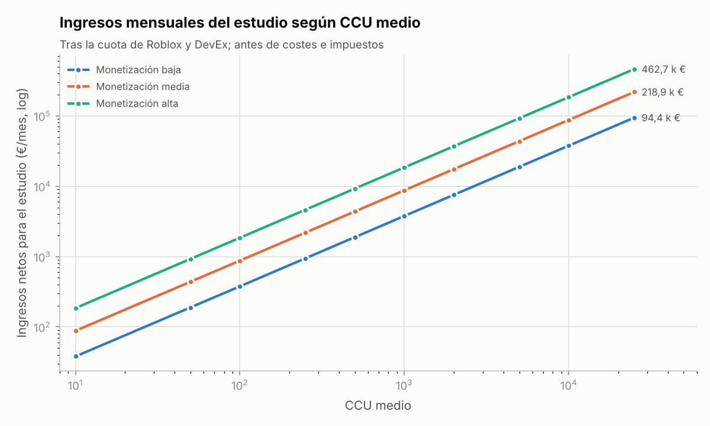
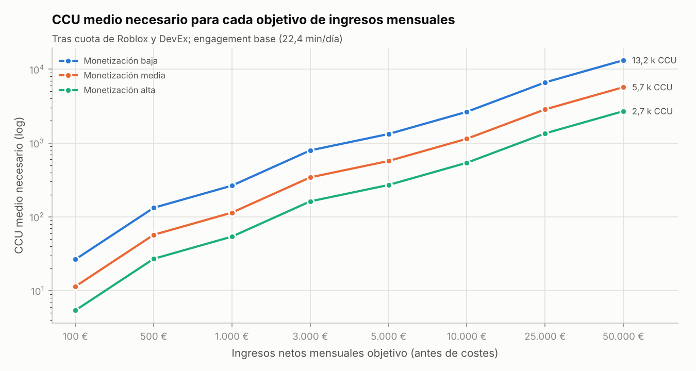
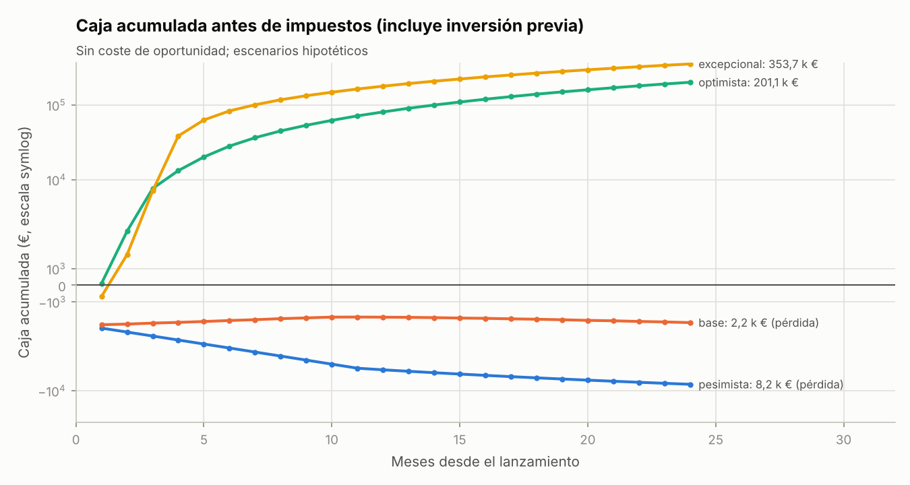

# Informe 5 (5.4-5.5) — Proyecciones financieras y rentabilidad

> **Fecha de referencia:** 22-10-2026 · **Tipo de cambio:** 1 EUR = 1,1215 USD (referencia del BCE del 20-10-2026, [BCE](https://www.ecb.europa.eu/stats/policy_and_exchange_rates/euro_reference_exchange_rates/html/eurofxref-graph-usd.en.html)). El 21-10-2026 fue 1,1234; en 2026 osciló aproximadamente entre 1,116 y 1,17.
> **Etiquetas:** [OBS] observado · [EST] estimación · [HIP] hipótesis. **Ninguna cifra es una previsión garantizada.**
> **Modelo:** [modelos/modelo.py](modelos/modelo.py) → [modelos/salidas/finanzas_por_ccu.csv](modelos/salidas/finanzas_por_ccu.csv), [objetivos_ingresos.csv](modelos/salidas/objetivos_ingresos.csv), [punto_equilibrio.csv](modelos/salidas/punto_equilibrio.csv), [ltv_y_cpp.csv](modelos/salidas/ltv_y_cpp.csv) y [simulacion_mensual.csv](modelos/salidas/simulacion_mensual.csv). **Hoja de cálculo editable con fórmulas:** [modelo_financiero.xlsx](modelo_financiero.xlsx).

---

## Resumen ejecutivo

- **Cuánto deja cada jugador concurrente.** Con *engagement* base (22,4 min/día), cada **CCU medio** aporta al estudio, después de la cuota de Roblox y de DevEx y antes de costes:

  | Monetización | € por CCU medio y mes |
  |---|---|
  | Baja | **3,8** |
  | Media | **8,8** |
  | Alta | **18,5** |

  Como referencia, la plataforma reparte ≈ 8,6 $ de DevEx por CCU medio y mes, contando a todos los creadores [EST].
- **Umbrales de rentabilidad** (monetización media):

  | Objetivo | CCU medio necesario |
  |---|---|
  | Cubrir los costes de caja (≈ 300 €/mes) | **~34** |
  | Cubrir además el coste de oportunidad de 100 h/mes a 15 €/h | **~206** |
  | 1.000 €/mes de ingresos | **~114** |
  | 10.000 €/mes | **~1.140** |
  | 50.000 €/mes | **~5.700** |

- **Inversión hasta el lanzamiento:** ≈ **2.300-3.600 € de caja** (según la duración) y ≈ **1.600 horas** de los dos socios. Esas horas equivalen a ≈ 24.000 € de coste de oportunidad a 15 €/h.
- **Escenarios a 24 meses** (caja acumulada antes de impuestos, sin coste de oportunidad):

  | Escenario | Caja a 24 meses | Comentario |
  |---|---|---|
  | Pesimista | **−8.200 €** | Si no se cancela a tiempo |
  | Base | **−2.250 €** | Cubre los costes corrientes, pero no recupera la inversión |
  | Optimista | **+201.000 €** | ≈ 100.000 € por socio antes de impuestos |
  | *Excepcional* | *+354.000 €* | — |

- **Conclusión financiera:** el proyecto **solo compensa el tiempo invertido si alcanza señales de cuartil superior**. Las decisiones de inversión deben esperar a medir esas señales (Informe 12).

---

## 1. Metodología y fórmulas

```
DAU                  = CCU medio × 1.440 / (sesiones/día × min/sesión)      [64,3 DAU por CCU con eng. base]
R$ brutos/día        = DAU × conversión × ARPPU                              (= DAU × ARPDAU)
Earned R$/día        = R$ brutos × 70 %  +  DAU × % cualificados CR × 5 R$  (Creator Rewards)
USD/día              = Earned de compras × [(1 − s18) × 0,0038 + s18 × 0,0054]  +  Earned CR × 0,0038
EUR/mes              = USD/día × 30,4 / 1,1215
Costes/mes           = 120 (IA) + 100 (contenido) + 30 (otros) + marketing por tramo + reinversión (10 % > 3 k€; 15 % > 10 k€)
Beneficio operativo  = EUR/mes − costes (antes de impuestos)
Por socio            = beneficio / 2
```

### 1.1 Condiciones de Roblox usadas [OBS]

- **Cuota del creador:** 70 % en pases y productos ([docs](https://create.roblox.com/docs/production/earning-on-roblox)).
- **DevEx estándar:** 0,0038 $/Earned R$. **Tasa 18+ de EE. UU.:** 0,0054 $/R$ en juegos elegibles ([ayuda DevEx](https://en.help.roblox.com/hc/en-us/articles/13061189551124-Developer-Exchange-Help-and-Information-Page); [doc. 18+](https://create.roblox.com/docs/production/monetization/18-plus-devex-rate)).
- **Mínimo de retirada:** 30.000 Earned R$ (≈ 114 $) ([términos](https://en.help.roblox.com/hc/en-us/articles/115005718246-Developer-Exchange-Terms-of-Use)).
- **Creator Rewards:** 5 R$ por usuario cualificado y día ([docs](https://create.roblox.com/docs/creator-rewards)).

**No confundir:** los Robux **gastados** por los jugadores no son los Robux **ganados** por el estudio, y no todos los Earned Robux se cambian al mismo tipo:

- la tasa 18+ solo aplica a compras elegibles de jugadores de EE. UU. de 18+ verificados;
- los Earned Robux procedentes de Creator Rewards se cambian a la tasa estándar en el modelo.

### 1.2 Escenarios de monetización [HIP]

| Escenario | Conversión diaria | ARPPU (R$ brutos/pagador/día) | ARPDAU (R$ brutos) | % cualificados para Creator Rewards | % de Earned de compras a la tasa 18+ | **€ por CCU medio y mes** | **$ por CCU medio y mes** |
|---|---|---|---|---|---|---|---|
| Baja | 1,5 % | 40 | 0,60 | 3 % | 0 % | **3,77** | 4,23 |
| **Media** | 2,5 % | 60 | 1,50 | 5 % | 5 % | **8,75** | 9,82 |
| Alta | 3,8 % | 90 | 3,42 | 6 % | 10 % | **18,51** | 20,76 |

**Anclas de cordura:**

- **GameAnalytics 2026** ([informe](https://www.gameanalytics.com/reports/2026-roblox-report); [resumen](https://gamedevreports.substack.com/p/gameanalytics-key-roblox-and-roblox)): ARPPU mediano de 0,70 $ (≈ 70 R$ a ~0,01 $/R$); la cifra de cabecera es que «solo el 3,80 % de los jugadores paga». El escenario **alto** se parece a esos valores de cabecera de juegos con 1 M+ MAU.
- **Plataforma:** ≈ 8,6 $ de DevEx por CCU medio y mes ([01](01_analisis_mercado.md) §2.2). El escenario **medio** (9,8 $) es comparable.
- **Estimación de terceros para Greenville:** ≈ 5,4 $ por CCU y mes ([RoWatcher](https://rowatcher.com/games/371263894), fiabilidad moderada). Se sitúa entre los escenarios bajo y medio.

---

## 2. Ingresos por nivel de CCU (tres escenarios por nivel)

Valores redondeados; *engagement* base. Costes según §4. «Con coste de oportunidad» resta 1.500 €/mes (100 h × 15 €/h).

| CCU medio | Monet. | DAU | Pagadores/día | R$ brutos/día | Earned R$/mes | USD/día | USD/mes | **EUR/mes** | EUR/año | Costes €/mes | **Beneficio €/mes** | Por socio €/mes | Con coste de oport. €/mes |
|---|---|---|---|---|---|---|---|---|---|---|---|---|---|
| 10 | baja | 643 | 9,6 | 386 | 11.139 | 1,39 | 42 | **38** | 453 | 300 | −262 | −131 | −1.762 |
| 10 | media | 643 | 16,1 | 964 | 25.406 | 3,23 | 98 | **88** | 1.051 | 300 | −212 | −106 | −1.712 |
| 10 | alta | 643 | 24,4 | 2.199 | 52.648 | 6,83 | 208 | **185** | 2.221 | 300 | −115 | −57 | −1.615 |
| 50 | baja | 3.214 | 48,2 | 1.929 | 55.697 | 6,96 | 212 | **189** | 2.265 | 300 | −111 | −56 | −1.611 |
| 50 | media | 3.214 | 80,4 | 4.821 | 127.029 | 16,15 | 491 | **438** | 5.253 | 300 | 138 | 69 | −1.362 |
| 50 | alta | 3.214 | 122,1 | 10.993 | 263.242 | 34,14 | 1.038 | **925** | 11.104 | 300 | 625 | 313 | −875 |
| 100 | baja | 6.429 | 96,4 | 3.857 | 111.394 | 13,92 | 423 | **377** | 4.529 | 400 | −23 | −11 | −1.523 |
| 100 | media | 6.429 | 160,7 | 9.643 | 254.057 | 32,30 | 982 | **875** | 10.506 | 400 | 475 | 238 | −1.025 |
| 100 | alta | 6.429 | 244,3 | 21.986 | 526.485 | 68,27 | 2.075 | **1.851** | 22.208 | 400 | 1.451 | 725 | −49 |
| 250 | baja | 16.071 | 241,1 | 9.643 | 278.486 | 34,81 | 1.058 | **944** | 11.323 | 400 | 544 | 272 | −956 |
| 250 | media | 16.071 | 401,8 | 24.107 | 635.143 | 80,74 | 2.455 | **2.189** | 26.264 | 400 | 1.789 | 894 | 289 |
| 250 | alta | 16.071 | 610,7 | 54.964 | 1.316.211 | 170,68 | 5.189 | **4.627** | 55.519 | 863 | 3.764 | 1.882 | 2.264 |
| 500 | baja | 32.143 | 482,1 | 19.286 | 556.971 | 69,62 | 2.116 | **1.887** | 22.646 | 400 | 1.487 | 744 | −13 |
| 500 | media | 32.143 | 803,6 | 48.214 | 1.270.286 | 161,49 | 4.909 | **4.377** | 52.528 | 838 | 3.540 | 1.770 | 2.040 |
| 500 | alta | 32.143 | 1.221,4 | 109.929 | 2.632.423 | 341,36 | 10.377 | **9.253** | 111.039 | 1.325 | 7.928 | 3.964 | 6.428 |
| 1.000 | baja | 64.286 | 964,3 | 38.571 | 1.113.943 | 139,24 | 4.233 | **3.774** | 45.293 | 1.127 | 2.647 | 1.323 | 1.147 |
| 1.000 | media | 64.286 | 1.607,1 | 96.429 | 2.540.571 | 322,97 | 9.818 | **8.755** | 105.056 | 1.625 | 7.129 | 3.565 | 5.629 |
| 1.000 | alta | 64.286 | 2.442,9 | 219.857 | 5.264.846 | 682,73 | 20.755 | **18.506** | 222.077 | 3.526 | 14.980 | 7.490 | 13.480 |
| 2.000 | baja | 128.571 | 1.928,6 | 77.143 | 2.227.886 | 278,49 | 8.466 | **7.549** | 90.585 | 1.505 | 6.044 | 3.022 | 4.544 |
| 2.000 | media | 128.571 | 3.214,3 | 192.857 | 5.081.143 | 645,94 | 19.637 | **17.509** | 210.111 | 3.376 | 14.133 | 7.066 | 12.633 |
| 2.000 | alta | 128.571 | 4.885,7 | 439.714 | 10.529.691 | 1.365,46 | 41.510 | **37.013** | 444.155 | 6.302 | 30.711 | 15.355 | 29.211 |
| 5.000 | baja | 321.429 | 4.821,4 | 192.857 | 5.569.714 | 696,21 | 21.165 | **18.872** | 226.464 | 4.581 | 14.291 | 7.146 | 12.791 |
| 5.000 | media | 321.429 | 8.035,7 | 482.143 | 12.702.857 | 1.614,86 | 49.092 | **43.773** | 525.279 | 8.316 | 35.457 | 17.729 | 33.957 |
| 5.000 | alta | 321.429 | 12.214,3 | 1.099.286 | 26.324.229 | 3.413,65 | 103.775 | **92.532** | 1.110.387 | 15.630 | 76.902 | 38.451 | 75.402 |
| 10.000 | baja | 642.857 | 9.642,9 | 385.714 | 11.139.429 | 1.392,43 | 42.330 | **37.744** | 452.927 | 7.412 | 30.332 | 15.166 | 28.832 |
| 10.000 | media | 642.857 | 16.071,4 | 964.286 | 25.405.714 | 3.229,71 | 98.183 | **87.546** | 1.050.557 | 14.882 | 72.664 | 36.332 | 71.164 |
| 10.000 | alta | 642.857 | 24.428,6 | 2.198.571 | 52.648.457 | 6.827,30 | 207.550 | **185.064** | 2.220.774 | 29.510 | 155.555 | 77.777 | 154.055 |
| 25.000 | baja | 1.607.143 | 24.107,1 | 964.286 | 27.848.571 | 3.481,07 | 105.825 | **94.360** | 1.132.318 | 15.904 | 78.456 | 39.228 | 76.956 |
| 25.000 | media | 1.607.143 | 40.178,6 | 2.410.714 | 63.514.286 | 8.074,29 | 245.458 | **218.866** | 2.626.393 | 34.580 | 184.286 | 92.143 | 182.786 |
| 25.000 | alta | 1.607.143 | 61.071,4 | 5.496.429 | 131.621.143 | 17.068,24 | 518.875 | **462.661** | 5.551.935 | 71.149 | 391.512 | 195.756 | 390.012 |



**Notas:**

1. Por encima de ~5.000 CCU los costes reales crecerían más que en este modelo (equipo, moderación, comunidad, soporte). Las cifras altas son **cotas superiores**.
2. «Beneficio» es **antes de impuestos**: ver §7.

---

## 3. Objetivos de ingresos mensuales (100 € a 50.000 €)

Ingresos netos del estudio (antes de costes). Jugadores nuevos/día necesarios en estado estacionario con retención base (2,78 días activos) y optimista (5,69).

| Objetivo €/mes | Monet. | **CCU medio** | DAU | Pagadores/día | R$ brutos/mes | Nuevos/día (ret. base) | Nuevos/día (ret. opt.) |
|---|---|---|---|---|---|---|---|
| 100 | baja / **media** / alta | 26,5 / **11,4** / 5,4 | 1.703 / **734** / 347 | 25,5 / **18,4** / 13,2 | 31.066 / **33.484** / 36.115 | 613 / **264** / 125 | 300 / **129** / 61 |
| 500 | baja / **media** / alta | 132,5 / **57,1** / 27,0 | 8.516 / **3.672** / 1.737 | 127,7 / **91,8** / 66,0 | 155.332 / **167.421** / 180.576 | 3.063 / **1.321** / 625 | 1.498 / **646** / 305 |
| 1.000 | baja / **media** / alta | 264,9 / **114,2** / 54,0 | 17.032 / **7.343** / 3.474 | 255,5 / **183,6** / 132,0 | 310.665 / **334.843** / 361.153 | 6.126 / **2.641** / 1.249 | 2.995 / **1.291** / 611 |
| 3.000 | baja / **media** / alta | 794,8 / **342,7** / 162,1 | 51.096 / **22.029** / 10.421 | 766,4 / **550,7** / 396,0 | 931.994 / **1.004.528** / 1.083.459 | 18.378 / **7.923** / 3.748 | 8.986 / **3.874** / 1.833 |
| 5.000 | baja / **media** / alta | 1.324,7 / **571,1** / 270,2 | 85.160 / **36.715** / 17.368 | 1.277,4 / **917,9** / 660,0 | 1.553.324 / **1.674.214** / 1.805.764 | 30.630 / **13.206** / 6.247 | 14.976 / **6.457** / 3.054 |
| 10.000 | baja / **media** / alta | 2.649,4 / **1.142,3** / 540,4 | 170.321 / **73.430** / 34.737 | 2.554,8 / **1.835,8** / 1.320,0 | 3.106.648 / **3.348.428** / 3.611.529 | 61.260 / **26.411** / 12.494 | 29.952 / **12.913** / 6.109 |
| 25.000 | baja / **media** / alta | 6.623,6 / **2.855,6** / 1.350,9 | 425.802 / **183.576** / 86.842 | 6.387,0 / **4.589,4** / 3.300,0 | 7.766.620 / **8.371.069** / 9.028.821 | 153.151 / **66.028** / 31.235 | 74.880 / **32.283** / 15.272 |
| 50.000 | baja / **media** / alta | 13.247,2 / **5.711,3** / 2.701,8 | 851.603 / **367.152** / 173.685 | 12.774,0 / **9.178,8** / 6.600,0 | 15.533.241 / **16.742.138** / 18.057.643 | 306.302 / **132.056** / 62.470 | 149.759 / **64.566** / 30.543 |



### 3.1 Potencial de cada nivel de ingresos

| Objetivo | Hipótesis necesarias (monetización media) | Lectura [EST] |
|---|---|---|
| **100 €** | ~11 CCU; ~260 nuevos/día | Alcanzable en el escenario base. **No cubre** los costes de caja (~300 €) |
| **500 €** | ~57 CCU; ~1.300 nuevos/día con retención base | Algo por encima del escenario base (≈ 40 CCU). Cubre la caja |
| **1.000 €** | ~114 CCU; ~2.600 nuevos/día (o ~1.300 con retención optimista) | Requiere retención por encima de la base o tracción algorítmica moderada |
| **3.000 €** | ~343 CCU | Zona del escenario optimista temprano (mes 3: ~390 CCU) |
| **5.000 €** | ~571 CCU | Escenario optimista (mes 6) |
| **10.000 €** | ~1.140 CCU (o ~540 con monetización alta) | Escenario optimista con monetización alta, o top ~1.400 de la plataforma por concurrencia |
| **25.000 €** | ~2.860 CCU | Fuera del escenario optimista; requiere una ruptura (escenario excepcional) |
| **50.000 €** | ~5.700 CCU (o ~2.700 con monetización alta) | Solo con éxito excepcional sostenido; estaría por encima de Midnight Chasers y cerca de Car Driving Indonesia hoy |

**Contexto de tasas base** [OBS, junio de 2026, [RoWatcher](https://rowatcher.com/news/how-many-games-are-on-roblox-in-2026)]: ~1.370 experiencias con ≥ 1.000 CCU y 112 con ≥ 10.000, de ~8,5 M rastreadas. Mediana de un creador en DevEx: ~1.500 $ en 12 meses (más de 42.000 creadores en el programa) ([Roblox Newsroom](https://about.roblox.com/newsroom/2026/09/global-impact-of-creation-on-roblox)).

---

## 4. Costes

### 4.1 Hasta el lanzamiento (MVP + lanzamiento)

| Partida | Caja (base) | Rango | Notas |
|---|---|---|---|
| Herramientas de IA (Claude Code / Codex), 2 socios × 8 meses (dedicación mixta) | 960 € | 320-3.500 € | [HIP] según el plan contratado; **verificar precios vigentes**. A tiempo parcial (~14 meses): ≈ 1.700 € |
| Modelos 3D de 12 coches (encargo o licencia comercial + adaptación) | incluido abajo | 600-1.500 € | [HIP] |
| Audio (paquetes de motor, efectos), iconos, miniatura e icono del juego | incluido abajo | 150-500 € | [HIP] |
| **Subtotal de arte y sonido** | **1.200 €** | 800-2.000 € | — |
| Anuncios de prueba (validación de retención) | 150 € | 50-300 € | Ads Manager |
| Marketing de lanzamiento | 250 € | 0-1.000 € | Ver [08](08_popularidad_y_marketing.md) |
| Estudio de nombre y marca (búsqueda de anterioridades; registro opcional) | 0 € | 0-1.000 € | Registro opcional en EUIPO/OEPM; **verificar tasas** |
| **Total de caja hasta el lanzamiento** | **≈ 2.560 €** | **≈ 1.500-5.000 €** | El modelo usa 2.310 € + 250 € de marketing de lanzamiento. A tiempo parcial: ≈ 3.300-3.600 € |
| **Horas** (ambos socios) | **≈ 1.600 h** | 1.300-1.950 h | Detalle en [10](10_roadmap_desarrollo.md) |
| **Coste de oportunidad** (15 €/h) | **≈ 24.000 €** | 19.500-29.000 € (con 25 €/h: ≈ 40.000 €) | No es caja; es el valor del tiempo |

### 4.2 Mensuales tras el lanzamiento

| Partida | Base | Notas |
|---|---|---|
| Herramientas de IA | 120 € | — |
| Contenido (arte y sonido por encargo) | 100 € | En meses de temporada nueva, 150-300 € |
| Otros (software, servicios) | 30 € | — |
| Marketing | 50-150 € (< 1.000 CCU); 500 € (1.000-5.000); 1.500 € (≥ 5.000) | Escalado [HIP] |
| Reinversión (freelancers, moderación, comunidad) | 10 % de ingresos > 3.000 €/mes; 15 % > 10.000 €/mes | [HIP] |
| Infraestructura | **0 €** | Roblox aloja los servidores. DataStores gratis dentro de los límites; *Extended Services* de pago solo si se superan (p. ej., 0,12 $/GB-mes de almacenamiento adicional) ([DevForum](https://devforum.roblox.com/t/announcing-roblox-extended-services/3621439)) |
| **Horas de mantenimiento y LiveOps** | 100 h/mes (ambos) | Coste de oportunidad: 1.500 €/mes |

**Coste por temporada (6-8 semanas):** ≈ 150-200 h + 300-600 € de arte (coche protagonista, kits, llantas). Está **incluido** en las horas mensuales y en los picos de contenido.

---

## 5. Punto de equilibrio y periodo de recuperación

### 5.1 Umbral mínimo de jugadores para cubrir costes

| Monetización | € por CCU medio y mes | Costes de caja (300 €/mes) → **CCU de equilibrio** | + coste de oportunidad (1.500 €/mes) → **CCU de equilibrio** | DAU equivalente (caja / con oport.) |
|---|---|---|---|---|
| Baja | 3,77 | **79,5** | **476,9** | 5.100 / 30.700 |
| **Media** | 8,75 | **34,3** | **205,6** | 2.200 / 13.200 |
| Alta | 18,51 | **16,2** | **97,3** | 1.000 / 6.300 |

### 5.2 Escenarios a 24 meses (simulación del Informe 4)

| Escenario | CCU mes 12 | Ingresos €/mes (mes 12) | Beneficio €/mes (mes 12) | Ingresos acumulados 24 m | **Caja acumulada 24 m** | Recuperación de la caja invertida | Recuperación con coste de oportunidad (24.000 € + 1.500 €/mes) |
|---|---|---|---|---|---|---|---|
| Pesimista | 0,9 | 5 € | −245 € | 171 € | **−8.189 €** | Nunca | Nunca |
| Base | 39,5 | 342 € | −7 € | 8.712 € | **−2.250 €** | No en 24 meses | Nunca |
| Optimista | 851 | 11.379 € | 9.175 € | 251.249 € | **+201.125 €** | **Mes 1-2** | ≈ **mes 7** |
| *Excepcional* | 3.224 | 18.243 € | 14.763 € | 439.495 € | **+353.704 €** | *Mes 2* | *≈ mes 4* |



**Beneficio por socio (50 %), antes de impuestos:**

| Escenario | Mes 12 | Acumulado 24 m |
|---|---|---|
| Optimista | ≈ **4.600 €/mes** | ≈ 100.500 € |
| Base | ≈ 0 €/mes | Pérdida de ≈ 1.100 € |
| Pesimista (si no se corta) | Pérdida | Pérdida de ≈ 4.100 € |

---

## 6. Adquisición pagada: valor de vida (LTV) frente a coste por partida

LTV = días activos en 365 días × USD netos para el estudio por DAU y día. Es el **coste por partida máximo rentable**.

| Retención | Monetización | Días activos | **LTV (USD)** | Retorno con CPP 0,01 $ | Retorno con CPP 0,03 $ |
|---|---|---|---|---|---|
| Pesimista | media | 1,56 | 0,0078 | 0,78× | 0,26× |
| **Base** | **media** | 2,78 | **0,0140** | **1,40×** | **0,47×** |
| Base | alta | 2,78 | 0,0295 | 2,95× | 0,98× |
| Optimista | media | 5,69 | 0,0286 | 2,86× | 0,95× |
| Optimista | alta | 5,69 | 0,0604 | 6,04× | 2,01× |
| Excepcional | media | 9,65 | 0,0485 | 4,85× | 1,62× |

**Lectura:**

- Roblox afirma que el coste por partida puede bajar de **0,01 $** ([DevForum, RDC](https://devforum.roblox.com/t/ads-for-creators-rdc-recap-and-what%E2%80%99s-next/3929106)); desarrolladores en el foro reportan 0,007-0,011 $. **Si eso se confirma**, la publicidad interna es rentable con retención base y monetización media. A 0,03 $ solo lo es con retención optimista y monetización alta.
- El primer gasto en anuncios es, por tanto, **un experimento para medir el coste real por partida y la retención de esos usuarios**. Precaución: los usuarios de anuncios pueden retener peor que los orgánicos, y **no cuentan** en las señales de *ranking* de RFY ([Discovery](https://create.roblox.com/docs/discovery)).

---

## 7. Impuestos y aspectos legales (categoría separada; requiere asesoramiento)

**No es asesoramiento fiscal.** Puntos que un asesor en España debe revisar **antes del primer cobro de DevEx**:

1. **Quién cobra:** DevEx paga a una cuenta de Roblox verificada. Con dos socios, decidir si cobra una persona (y reparte), una **sociedad civil** o una **SL**. Esto afecta a la tributación y a la responsabilidad.
2. **Tributación de la renta:** los cobros de DevEx son rendimientos de la actividad para residentes en España (IRPF o Impuesto de Sociedades si hay SL).
3. **Alta como autónomo:** si la actividad es habitual, puede requerir alta en el RETA. La cuota depende de los rendimientos; **verificar la tabla de 2026**.
4. **Formularios de EE. UU.:** onboarding de Tipalti con W-8BEN (o W-8BEN-E si es sociedad) para aplicar el convenio España-EE. UU.
5. **IVA:** la naturaleza del servicio prestado a una empresa estadounidense (Roblox) puede dar lugar a una operación no sujeta o con inversión del sujeto pasivo. Confirmarlo con el asesor.
6. **Desfase de caja:** entre la venta y el cobro hay retenciones (p. ej., 60 días en *Audience Expansion*), el mínimo de 30.000 R$ y los plazos de pago de DevEx. Hay que **planificar 1-2 meses de desfase** [EST].
7. **Pacto de socios:** reparto (50/50), propiedad intelectual del juego y del código, qué pasa si uno abandona, gastos y reinversión. **Firmarlo antes de empezar el MVP.**

---

## 8. Guía del modelo financiero editable ([modelo_financiero.xlsx](modelo_financiero.xlsx))

| Hoja | Qué contiene | Qué editar |
|---|---|---|
| `Supuestos` | Constantes de Roblox, tipo de cambio, *engagement*, monetización, costes, coste por partida. Derivados: DAU por CCU, ARPDAU, USD por DAU y día, € por CCU y mes, costes fijos | **Celdas amarillas** |
| `CCU_a_ingresos` | Tabla de CCU → ingresos → beneficio → por socio, **con fórmulas** | Los niveles de CCU (columna A) |
| `Objetivos_ingresos` | Objetivo € → CCU, DAU, pagadores y nuevos/día, **con fórmulas** | Objetivos y días de vida |
| `Simulador_cohortes` | Simulador mensual a 24 meses: nuevos/día por mes × núcleo de retención K(a) → DAU, CCU, ingresos, costes, beneficio y caja acumulada, **con fórmulas** | Nuevos/día por mes; elegir el núcleo K (pesimista, base, optimista, excepcional); inversión previa |
| `Escenarios_24m` | Resultados (valores) de la simulación diaria de Python | — |
| `Matriz_conceptos` | Matriz de decisión ponderada con `SUMPRODUCT` | Pesos y notas |
| `Economia_juego` | Precios por clase → horas para conseguirlos | Precios, ingresos por hora, % en mejoras |
| `Competidores` | Instantáneas de competidores | — |

**Verificación:** recalculado con LibreOffice el 22-10-2026, **sin errores de fórmula**. Coincide con Python, p. ej.:

- 100 CCU con monetización media dan 875,5 €/mes en ambos;
- el DAU del mes 3 del simulador mensual sale ≈ 2.961 (frente a 2.952 en la simulación diaria).

---

## Conclusiones

1. **Economía unitaria:** ≈ 9 € al mes por CCU medio con monetización media. Hacen falta cientos de CCU para ingresos «interesantes» y más de 1.000 para que cada socio gane un sueldo.
2. **Equilibrio de caja: ~34 CCU. Equilibrio con el tiempo pagado a 15 €/h: ~206 CCU.** Es la cifra que define el éxito mínimo.
3. Solo el escenario **optimista** (señales de cuartil superior + amplificación) hace del proyecto una buena inversión. El base es una afición que se autofinancia.

## Recomendaciones accionables

1. Fijar como **hito de viabilidad** sostener **≥ 200 CCU medios durante 30 días** antes del mes 6 tras el lanzamiento.
2. No comprometer gastos fijos por encima de ~300 €/mes hasta superar 100 CCU medios.
3. Medir el **coste por partida real** y la retención de los usuarios de anuncios en la Fase 1. Si el CPP es ≤ 0,012 $ con retención base, escalar la publicidad con control del retorno.
4. Firmar el **pacto de socios** y consultar al **asesor fiscal** antes del primer cobro.

## Incertidumbres y limitaciones

- Monetización y *engagement* son **hipótesis** calibradas con benchmarks agregados, no con datos propios.
- El escenario medio depende del 70 % de cuota y de la tasa DevEx vigentes: un cambio de Roblox altera todo el modelo.
- El tipo de cambio EUR/USD varió ~±3 % en 2026: impacto directo en los euros.
- Los costes de herramientas y arte son estimaciones a verificar con precios reales.
- El modelo no incluye **impuestos**, **reembolsos** ni el coste de **equipo adicional** a gran escala.
