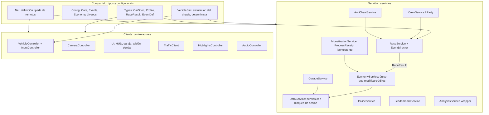

# Informe 7 — Viabilidad técnica y arquitectura

> **Fecha de referencia:** 22-10-2026.
> **Etiquetas:** [OBS] documentado · [EST] estimación · [HIP] hipótesis.
> **Herramientas del equipo:** Roblox Studio, Luau, GitHub, Codex y Claude Code.

---

## Resumen ejecutivo

- **El juego es técnicamente viable para dos personas** si se respetan tres decisiones:
  1. **chasis arcade propio con suspensión por rayos** (en lugar de A-Chassis);
  2. **mapa compacto con *StreamingEnabled*** y presupuestos de memoria pensados para móvil;
  3. **economía y premios siempre en el servidor**.
- **La decisión técnica más importante:** cómo sincronizar coches en carrera. Hay dos opciones viables que se prueban en la Fase 0-1:
  - **(A) física en el cliente** (propiedad de red del conductor) **+ validación en el servidor**;
  - **(B) *Server Authority*** (predicción en el cliente y *rollback*), disponible para todos los creadores desde julio de 2026. Bloquea trampas de velocidad, a cambio de más carga de servidor y de escribir la simulación en un módulo compartido.
- **Lo que es demasiado caro para dos personas:** deformación realista, simulación de neumáticos completa, mapa gigante, más de 100 coches, editor de vinilos por capas (hasta la T3), mercado de intercambio, emparejamiento clasificatorio global con poco CCU, tráfico físico denso y policía jugadora antes de tener masa crítica.
- **Arquitectura modular** con dos dominios: **A = conducción y carreras**; **B = meta, datos e interfaz**. Contratos compartidos y tipados, sincronización por archivos con Rojo e integración continua (lint, formato, tipos y pruebas) para trabajar en paralelo sin conflictos.

---

## 1. Metodología

Para cada área: dificultad (1 = trivial, 5 = muy difícil para dos personas), riesgo, enfoque recomendado y referencia. Las fuentes son la documentación de Roblox, los anuncios del DevForum y hilos técnicos del DevForum, leídos a través de extractos de buscador. **Las APIs concretas deben verificarse en la documentación vigente antes de implementarlas.** Código generado con IA sin verificar contra la documentación = riesgo.

---

## 2. Evaluación por área

| Área | Dificultad | Riesgo | Enfoque recomendado | Referencias |
|---|---|---|---|---|
| **Física de vehículos** | 4 | Alto (la sensación es el producto) | Chasis propio de cuerpo rígido con 4 rayos de suspensión, curva de agarre lateral y asistencias. Ajuste por datos (atributos y configuración) | [Plantilla de carreras](https://devforum.roblox.com/t/new-studio-racing-template/2805745) (referencia de patrón) |
| **Predicción del cliente** | 3 (opción A) / 4 (opción B) | Medio | A: el cliente simula su propio coche (latencia cero para el conductor). B: `RunService:BindToSimulation()` en un módulo compartido cliente/servidor, con estado en atributos | [Server Authority](https://create.roblox.com/docs/projects/server-authority) |
| **Autoridad del servidor** | 3-4 | Medio | Premios, economía, resultados y puntos de control: **siempre en el servidor**. Física: según la opción A o B | [DevForum, disponibilidad general](https://devforum.roblox.com/t/full-release-ship-fair-and-competitive-games-with-server-authority/4727993) |
| **Replicación** | 3 | Medio | Coches de otros jugadores: replicación física de Roblox + interpolación. Estado de carrera: eventos remotos tipados a baja frecuencia (posiciones de carrera 4-10 Hz) | — |
| **Propiedad de red** | 3 | Medio | El conductor es propietario de su coche (A). `SetNetworkOwner` solo desde el servidor, al sentarse. **No** girar las ruedas desde el servidor (causa de retraso documentada en el foro) | [DevForum: retraso de dirección](https://devforum.roblox.com/t/vehicle-steering-lag/431156); [propiedad de red](https://devforum.roblox.com/t/how-would-i-go-about-implementing-network-ownership-for-this-vehicle-script/1063560) |
| **Latencia** | 3 | Medio | Orden de llegada calculado en el servidor con marcas de tiempo de puntos de control validadas (ventana de tolerancia). Fantasma al salir para evitar choques por desincronización | [DevForum: *jitter*](https://devforum.roblox.com/t/cars-jittering-when-driving-at-high-speed/4068444) |
| **Seguridad** | 3 | Alto | No confiar nunca en el cliente: validar tipos y rangos de todos los remotos, limitar su frecuencia, calcular premios en el servidor | — |
| **Persistencia de datos** | 3 | **Muy alto** (pérdida de datos) | Perfiles con **bloqueo de sesión** (librería tipo ProfileStore; **verificar la licencia**), esquema versionado, migraciones con pruebas. Límite: 4 MB por clave | [Límites de DataStore](https://create.roblox.com/docs/cloud-services/data-stores/error-codes-and-limits) |
| **Sistemas de carreras** | 3 | Medio | Máquina de estados por evento (inscripción → cuenta atrás → en curso → resultados), puntos de control ordenados, reaparición y bots de relleno | — |
| **Emparejamiento** | 2 (dentro del servidor) / 4 (global) | Alto si es global | MVP: **dentro del servidor** (eventos de 2-8 con bots). Global (MemoryStore + teletransporte) solo con CCU suficiente | — |
| **IA de tráfico** | 3 | Medio | Tráfico **en el cliente** sobre rutas predefinidas, con **semilla determinista** por servidor y franja de tiempo (todos ven aproximadamente lo mismo), CFrame animado sin física. *Near-miss* detectado en el cliente y validado de forma laxa en el servidor | [HIP] patrón propuesto |
| **IA policial** | 4 | Alto | Patrullas en el servidor (pocas: máximo 3 por jugador perseguido), navegación por un **grafo de carreteras** con dirección hacia un objetivo, captura por barra (velocidad baja cerca de la patrulla), huida por pérdida de línea de visión + tiempo | [HIP] |
| **Optimización del mapa** | 3 | Alto en móvil | Kit modular de carreteras, mallas con niveles de detalle, texturas compartidas, colisiones simplificadas (cajas para edificios), luces emisivas en lugar de luces reales | [Rendimiento](https://create.roblox.com/docs/performance-optimization/design) |
| ***StreamingEnabled*** | 3 | Medio | Activado. Radio objetivo ajustado al distrito. Coches como modelos atómicos. Piezas críticas de la carrera (puntos de control) persistentes en el cliente que corre. **Precarga de la ruta** al aceptar un evento | Ídem |
| **Rendimiento móvil** | 4 | **Alto** | Dispositivo base de pruebas (Android de gama baja, 3-4 GB de RAM). Objetivo ≥ 30 FPS. Calidad de tráfico y efectos por nivel de dispositivo. Microperfilador en cada hito | Roblox advierte de cierres por falta de memoria en gama baja ([docs](https://create.roblox.com/docs/performance-optimization/design)) |
| **Interfaz** | 3 | Medio | Una librería declarativa (React-Lua o Fusion; elegir la que el equipo domine). Componentes reutilizables y escalado móvil | — |
| **Personalización de vehículos** | 3 | Medio | Datos (qué pieza en qué ranura) separados de la representación visual (módulo `CarAppearance`). Piezas como `MeshPart` intercambiables por ranura. Pinturas con `SurfaceAppearance` y colores | — |
| **Guardado de garajes** | 2 | Alto (pérdida) | El garaje es parte del perfil: coche = ID de modelo + mejoras + ajustes + apariencia, de ~1-2 KB por coche [EST]. 50 coches caben con holgura en 4 MB | — |
| **Telemetría y analíticas** | 2 | Bajo | `AnalyticsService`: embudos (máximo 10), economía, eventos propios y 3 campos personalizados. Gratis | [Tipos de evento](https://create.roblox.com/docs/production/analytics/event-types) |
| **Herramientas de pruebas** | 3 | Medio | Pruebas unitarias de lógica pura fuera de Roblox (Lune), pruebas de integración en Studio, *bots* de carrera para pruebas de carga, listas de comprobación de jugabilidad | [HIP] |
| **Prevención de trampas** | 3-4 | Alto | Opción B (*Server Authority*) o validación de puntos de control (orden y tiempo mínimo por tramo según la velocidad máxima de la clase + tolerancia), detección de teletransporte, premios en el servidor, limitación de remotos | — |
| **Escalabilidad** | 2 | Bajo | Roblox escala servidores automáticamente. Servidores de 20-24 jugadores. Datos globales (clasificaciones semanales) con `OrderedDataStore` por semana. Eventos globales con `MessagingService` | — |

---

## 3. Chasis: propio frente a adaptar una solución existente

| Opción | Sensación arcade | Móvil | Compatible con *Server Authority* | Licencia | Esfuerzo hasta «se siente bien» | Veredicto |
|---|---|---|---|---|---|---|
| **A-Chassis** (comunitario) | Media (orientado a realismo) | Media | Baja (diseñado del lado del cliente) | **No aclarada** en el extracto del repositorio ([GitHub](https://github.com/lisphm/A-Chassis)) | Medio (mucha configuración) | **Descartar** salvo que se verifique la licencia y encaje la sensación |
| **Coche de la plantilla oficial de carreras** de Roblox | Media-alta (arcade sencillo, código limpio y comentado, pensado para extenderse; la IA puede usar su módulo controlador) | Alta | Media | Plantilla oficial (uso en Roblox previsto; **confirmar términos**) | Bajo | **Base de referencia** en la Fase 0 |
| **Chasis propio por rayos** | **Total** | Alta (lo diseñamos para ello) | **Alta** (simulación determinista en un módulo compartido) | Propia | Medio-alto (60-120 h hasta una sensación de calidad) [EST] | **Recomendado para producción** |
| **Kits comerciales** (BuiltByBit, Payhip…) | Variable | Variable | Desconocida | Por vendedor (**verificar**) | Bajo-medio | Solo como referencia o modelos, nunca como núcleo sin auditar |

**Recomendación:** en la Fase 0, prueba de 1-2 semanas: plantilla oficial como línea base frente a chasis propio, comparados por el mismo panel de 10 probadores. El chasis propio gana si:

1. la sensación se valora igual o mejor;
2. funciona a ≥ 30 FPS en el dispositivo base;
3. su simulación cabe en un módulo compartido (requisito de la opción B).

---

## 4. Sincronización de carreras: opción A frente a opción B

| Criterio | A: física en el cliente + validación | B: *Server Authority* |
|---|---|---|
| Respuesta para el conductor | Inmediata | Inmediata (predicción) con correcciones por *rollback* |
| Lo que ven los rivales | Interpolación (retraso de ~100-200 ms [EST]) | Coherente con el servidor |
| Trampas de velocidad | Requiere validación propia | **Bloqueadas por la plataforma** ([Newsroom](https://about.roblox.com/newsroom/2026/07/creating-responsive-cheat-resistant-games-roblox-server-authority)) |
| Choques coche contra coche | Inconsistentes (cada cliente manda en su coche) | Más coherentes |
| Coste de servidor | Bajo | **Mayor** (cliente y servidor trabajan más, según Roblox) |
| Complejidad de código | Media | Alta: simulación compartida, estado en atributos (un desajuste provoca *rollback* completo) |
| Precisión física | — | Una fuente secundaria cita la recomendación de Roblox de física fija a 240 Hz para simulaciones exigentes como carreras ([GitHub](https://github.com/Jazenn/Roblox_KFC_Racer/issues/7)). **Verificar en la documentación** |
| Madurez | Patrón clásico | Disponibilidad general reciente (julio de 2026): pocos juegos de carreras de referencia |

**Decisión propuesta:**

- **mundo libre** (fuera de eventos): opción A, sin colisiones con no compañeros;
- **eventos competitivos**: opción B si el prototipo de la Fase 1 cumple sensación, FPS y coste; si no, opción A con validación de puntos de control y fantasma inicial.

Se decide en el hito de la semana 8-10 (Informe 10).

---

## 5. Funcionalidades demasiado difíciles o caras para dos desarrolladores

| Funcionalidad | Por qué | Alternativa |
|---|---|---|
| Deformación realista por daño | Mallas deformables y su replicación | Daño visual (chispas, humo, calcomanías) |
| Modelo de neumático completo (al estilo Pacejka) | Ajuste interminable y CPU en móvil | Curva de agarre simplificada + asistencias |
| Mapa gigante y detallado | Coste de arte, memoria y *streaming* | 4 distritos compactos, ampliación por temporadas |
| Más de 100 coches | Arte y equilibrado | 12-15 coches + personalización profunda |
| Editor de vinilos por capas | UI compleja, datos y moderación de diseños | Calcomanías en ranuras fijas (MVP) → editor en la T3 |
| Mercado o intercambio entre jugadores | Fraude, duplicaciones, moderación | Sin intercambio |
| Emparejamiento clasificatorio global con poco CCU | Colas vacías | Eventos dentro del servidor + contrarreloj asíncrono |
| Tráfico con física real y denso | CPU y red | Tráfico cinemático en el cliente |
| Policía jugadora (jugador contra jugador asimétrico) | Equilibrio y masa crítica | Policía IA en el MVP; jugadora en la F5 |
| Sistema de repeticiones completo (toda la carrera, todos los coches) | Memoria y red | Repetición local de los últimos 5-10 s (búfer de CFrames a ~20 Hz) |
| Voz, *streaming* integrado | Fuera de alcance | Plataforma (Roblox Party y voz) |
| Licencias de marcas | Negociación y requisitos | Marcas ficticias |

---

## 6. Arquitectura modular



### 6.1 Propiedad por dominio (desarrollo en paralelo)

| Módulo | Dueño | Contrato con el otro dominio |
|---|---|---|
| `VehicleSim`, `VehicleController`, `InputController`, `CameraController` | **A** | Lee `CarSpec` (estadísticas tras mejoras) y aplica `CarAppearance` (de B) |
| `RaceService`, `EventDirector`, rutas de eventos | **A** | Emite `RaceResult` → `EconomyService` (B) calcula los premios |
| `PoliceService`, `TrafficClient`, `HighlightsController` | **A** | — |
| `DataService`, `EconomyService`, `GarageService` | **B** | Expone `GetCarSpec(player, carId)` |
| `CarAppearance` (aplicar piezas visuales), taller | **B** | Lo usa A al generar el coche |
| `MonetizationService`, `ShopUI`, precios regionales | **B** | — |
| `CrewService`, *party*, invitaciones | **B** | Proporciona composición de crews a `RaceService` (A) |
| `LeaderboardService`, `AnalyticsService` (envoltorio) | **B** | A llama a `Analytics.Log(...)` con eventos tipados |
| UI (HUD de carrera) | **A** (HUD) / **B** (resto de menús) | Componentes comunes en una carpeta compartida de UI |
| Mapa (distritos) | **Ambos** + autónomos | Mapa en un *place* separado de Team Create (ver §7.3) |

**Regla anticonflictos:**

- cada carpeta tiene un dueño (`CODEOWNERS`);
- los cambios en `Shared/Types` y `Shared/Net` requieren la revisión del otro socio;
- los cambios de esquema de datos van con una migración y su prueba.

### 6.2 Estructura del repositorio

```text
nitro-crews/
├─ rokit.toml                # cadena de herramientas fijada (rojo, wally, stylua, selene, luau-lsp, lune)
├─ default.project.json      # mapeo de Rojo a DataModel
├─ wally.toml                # dependencias (UI, señales, perfiles…) con licencia verificada
├─ selene.toml / stylua.toml
├─ .github/workflows/ci.yml  # lint + formato + tipos + pruebas en cada PR
├─ .github/CODEOWNERS
├─ CLAUDE.md / AGENTS.md     # convenciones para Claude Code y Codex
├─ src/
│  ├─ shared/                # Types, Config (Cars, Events, Economy), Net, VehicleSim, Util
│  ├─ server/                # Services/*
│  └─ client/                # Controllers/*, UI/*
├─ tests/                    # pruebas Lune (lógica pura: economía, PI, premios, migraciones)
├─ places/                   # notas sobre places (el mapa vive en Roblox; exportaciones .rbxm opcionales con Git LFS)
└─ docs/                     # GDD vivo, decisiones de arquitectura (ADR), checklists de QA
```

### 6.3 Modelo de datos del perfil (esquema versionado)

```lua
-- Esquema v1 (ilustrativo; ~5-60 KB por jugador)
type Profile = {
    schemaVersion: number,
    credits: number,
    rep: { level: number, xp: number },
    garage: { [string]: OwnedCar },        -- clave = id único de instancia
    selectedCarId: string?,
    cosmetics: { [string]: boolean },      -- desbloqueos globales
    missions: { daily: {MissionState}, weekly: {MissionState}, lastReset: number },
    season: { id: string, xp: number, premium: boolean, claimed: {number} },
    crew: { crewId: string? },
    purchases: { [string]: boolean },      -- PurchaseId procesados (idempotencia), con rotación
    settings: { assists: AssistSettings, controls: ControlSettings },
    stats: { racesFinished: number, escapes: number },
}
type OwnedCar = { modelId: string, upgrades: {[string]: number}, tune: {grip: number, gearing: number},
                  appearance: {[string]: string}, mastery: number }
```

---

## 7. Flujo de trabajo con Git, Codex y Claude Code

### 7.1 Herramientas

| Herramienta | Uso | Nota |
|---|---|---|
| **Rojo** | Sincronizar el código del sistema de archivos a Studio; **el disco es la fuente de verdad** del código | Estándar de la comunidad |
| **Script Sync** (integrado en Studio) | Alternativa más simple: sincroniza scripts y carpetas con el disco (solo Script, LocalScript, ModuleScript y Folder; en beta según una fuente) | [Guía](https://www.rocode.app/guides/claude-code-roblox-studio) |
| **Servidor MCP de Studio** (integrado) | Claude Code o Codex pueden leer el DataModel, ejecutar scripts, editar instancias y lanzar pruebas de juego | [Docs de IA](https://create.roblox.com/docs/ai/accelerated-workflows) |
| **Wally** | Gestor de paquetes Luau | Verificar la licencia de cada paquete |
| **StyLua / Selene / luau-lsp** | Formato, lint y comprobación de tipos (`--!strict` en módulos compartidos) | En la integración continua |
| **Lune** | Ejecutar Luau fuera de Roblox: pruebas unitarias de la lógica pura | Economía, PI, premios, migraciones |
| **GitHub Actions** | Integración continua en cada PR | Bloquea la fusión si algo falla |
| **Team Create** | Construcción colaborativa del **mapa** | Separado del código |

### 7.2 Ramas y revisiones

- **Desarrollo sobre la rama principal**, con ramas cortas (1-3 días) por funcionalidad. PR obligatoria con revisión del otro socio en las carpetas compartidas.
- **Versionado semántico** del juego (p. ej., `0.4.2`) y etiqueta en Git en cada publicación.
- **Dos *places*:** «Dev» (pruebas) y «Producción». Publicación a producción solo desde una etiqueta. Registro de cambios para los jugadores.

### 7.3 Mapa y recursos

- El mapa se construye en un *place* de Team Create y se reutiliza con **Paquetes** de Roblox (actualización centralizada de piezas).
- El código **no** se edita en Team Create cuando se usa Rojo: el código se edita en el disco.
- Exportaciones periódicas `.rbxm` del mapa a Git LFS (opcional), como copia de seguridad.

### 7.4 Uso de IA: qué sí y qué no

| Tarea | IA (Codex / Claude Code) | Humano |
|---|---|---|
| Código repetitivo (servicios, remotos tipados, UI) | ✅ Genera; el humano revisa | Revisión y prueba de juego |
| Pruebas unitarias de economía y datos | ✅ | Define los casos límite |
| Migraciones de datos | ⚠️ Solo con pruebas y revisión doble | **Siempre** |
| Ajuste de la sensación de conducción | ⚠️ Puede proponer cambios de parámetros | **Decide jugando** |
| Diseño de niveles y mapa | ❌ | Humano (y autónomos) |
| Arte, modelos de coche, música | ❌ (riesgo de propiedad intelectual) | Encargos con licencia |
| Diagnóstico de rendimiento | ✅ (leer el microperfilador vía MCP) | Prueba en dispositivo real |

**Riesgos de la IA:**

- **APIs inventadas o desactualizadas:** exigir referencias a la documentación en las PR generadas.
- **Código que «funciona» en Studio pero falla en red:** probar siempre con 2+ clientes en el modo de prueba local.
- **Velocidad engañosa:** la IA acelera la *escritura* de código, no la integración, el ajuste, las pruebas ni la publicación (ver estimaciones del Informe 10).

### 7.5 Integración continua mínima

```yaml
# .github/workflows/ci.yml (esquema)
on: [pull_request]
jobs:
  checks:
    runs-on: ubuntu-latest
    steps:
      - uses: actions/checkout@v4
      - name: Toolchain (rokit)        # instala rojo, stylua, selene, luau-lsp, lune fijados en rokit.toml
        run: ...
      - run: stylua --check src tests
      - run: selene src
      - run: luau-lsp analyze --definitions=globalTypes.d.luau src   # comprobación de tipos
      - run: lune run tests            # pruebas de lógica pura
      - run: rojo build -o build.rbxl  # el proyecto compila
```

---

## 8. Presupuestos de rendimiento (objetivos internos [HIP])

| Recurso | Objetivo |
|---|---|
| FPS en el dispositivo móvil base | ≥ 30 sostenidos en carrera con 8 coches + tráfico |
| FPS en PC de gama media | 60 |
| Jugadores por servidor | 20-24 |
| Coches simultáneos en un evento | ≤ 8 |
| Tráfico visible (móvil / PC) | 12 / 30 vehículos |
| Patrullas por jugador perseguido | ≤ 3 |
| Tiempo hasta la primera carrera (móvil, 4G) | ≤ 20-30 s |
| Tamaño del perfil | ≤ 100 KB |
| Remotos por jugador | Límite de frecuencia por tipo (p. ej., 10/s para entrada de carrera) |

---

## 9. Seguridad y antitrampas (lista de comprobación del MVP)

1. Servidor como única fuente de créditos, REP, inventario y resultados.
2. Validación de puntos de control: orden, tiempo mínimo por tramo (distancia / velocidad máxima de la clase × 1,15), sin teletransportes.
3. Detección de velocidad imposible (opción A) o *Server Authority* (opción B).
4. `ProcessReceipt` idempotente con registro de `PurchaseId`.
5. Límite de frecuencia y validación de argumentos en todos los remotos.
6. Filtrado de texto de jugador (matrículas, nombres de crew).
7. Registro de anomalías (eventos de analítica) y revisión semanal.

---

## Conclusiones

1. No hay ningún bloqueo técnico para el MVP. Los riesgos están en la **sensación de conducción**, el **rendimiento móvil** y la **sincronización en carrera**, y los tres se prueban en las primeras 8-10 semanas.
2. *Server Authority* es una oportunidad nueva (julio de 2026) para un juego de carreras justo, pero añade complejidad y coste de servidor: hay que **prototipar antes de comprometerse**.
3. La división **A (conducción y carreras) / B (meta, datos e interfaz)** con contratos tipados minimiza los conflictos de Git y permite trabajar en paralelo desde la semana 1.

## Recomendaciones accionables

1. Semana 1: repositorio con Rojo, Rokit, integración continua, `CODEOWNERS`, `CLAUDE.md` y `AGENTS.md`, y tipos compartidos.
2. Semanas 1-3: prueba del chasis (plantilla oficial frente a chasis propio) con el dispositivo base y 10 probadores.
3. Semanas 4-8: prototipo de carrera con 2-4 clientes en ambas opciones (A y B), con métricas de sensación, FPS y CPU del servidor.
4. Antes de la beta: pruebas de migración de datos y de compras duplicadas; prueba de carga con *bots*.

## Incertidumbres y limitaciones

- Nombres exactos de las APIs y de sus límites: **verificar en la documentación vigente**. Este informe se basa en extractos.
- El coste real de servidor de *Server Authority* en un juego de carreras no está publicado.
- La licencia de librerías comunitarias (perfiles, UI) debe comprobarse una a una.
- Las estimaciones de horas por área están en el Informe 10 y son rangos, no compromisos.
