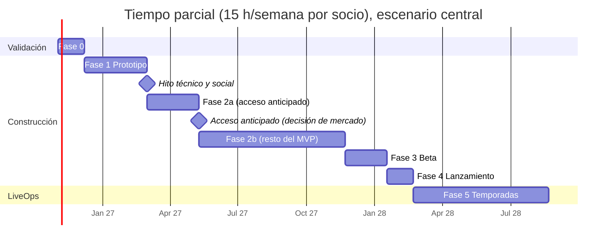
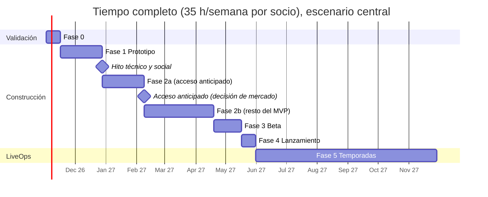

# Informe 8 — Plan de desarrollo para dos socios

> **Fecha de referencia:** 22-10-2026.
> **Etiquetas:** [EST] estimación · [HIP] hipótesis. Las horas son **rangos de estimación ascendente** (por funcionalidad). **Ya incluyen** la ganancia de productividad de la IA en la *escritura* de código (estimada en un 25-40 % de esa parte), **no** en diseño, ajuste de sensación, arte, pruebas, depuración en red ni publicación.

---

## Resumen ejecutivo

- **Roles:**
  - **Socio A — Conducción y carreras:** chasis, cámara, eventos, policía, tráfico y repeticiones.
  - **Socio B — Meta, datos e interfaz:** perfiles, economía, garaje, personalización, crews, monetización, analítica e interfaz.
  - **Compartido:** mapa (con autónomos), QA y comunidad.
- **Esfuerzo hasta el lanzamiento 1.0:** **≈ 1.300-1.950 h** entre los dos (punto medio ~1.600 h): ~640-950 h el socio A y ~670-990 h el socio B.
- **Calendario hasta el 1.0** (incluye un 15 % de colchón):

  | Dedicación de cada socio | Hasta el lanzamiento 1.0 | Hasta el acceso anticipado |
  |---|---|---|
  | **Tiempo parcial** (15 h/semana) | **≈ 12-17 meses** | ≈ 5-7 meses |
  | **Mixta** (25 h/semana) | ≈ 7-10 meses | ≈ 3-4 meses |
  | **Tiempo completo** (35 h/semana) | **≈ 5-7,5 meses** | ≈ 2,5-3,5 meses |

- **Recomendación clave:** **no esperar al 1.0 para medir.** Publicar un **acceso anticipado** (*vertical slice*: 3 eventos, 6 coches, 2 distritos, crews de sesión, guardado) y comprar 3.000-10.000 partidas con anuncios para **medir el rebote, D1 y D7 antes de invertir el 60 % restante del esfuerzo**.
- **Caja hasta el lanzamiento:** ≈ 2.500-3.600 € según la duración (herramientas, arte, anuncios de prueba y lanzamiento).

---

## 1. Metodología de estimación

1. **Desglose por funcionalidad** y por socio, en rangos de horas (optimista-pesimista).
2. **Duración** = horas del socio más cargado ÷ horas semanales + **15 % de colchón** (coordinación, imprevistos, enfermedad).
3. **Advertencia:** la IA genera código rápido, pero **integrar, probar en red y móvil, ajustar la sensación y depurar** no se acelera en la misma proporción. Las estimaciones lo reflejan.
4. **Coste de caja** por fase (herramientas, arte, anuncios). El **coste de oportunidad** (15 €/h por defecto) está en [07](07_proyecciones_financieras.md).

---

## 2. Fases

### Fase 0 — Investigación y validación

| Campo | Detalle |
|---|---|
| **Objetivos** | Confirmar el mercado, encontrar una **sensación de conducción divertida** y comprobar la demanda |
| **Funcionalidades / tareas** | Auditar tiendas y primeras sesiones de 5 competidores (A + B). Repositorio con Rojo, Rokit, integración continua, `CODEOWNERS`, `CLAUDE.md` / `AGENTS.md` (B). **Prueba de chasis:** plantilla oficial frente a chasis propio + cámara (A). Test de diversión con 10-15 jugadores (A + B). Nombre y comprobaciones de marca, Discord, 6-9 clips de prueba en TikTok/Shorts (B). Pacto de socios |
| **Dependencias** | Ninguna |
| **Responsable** | A: chasis y cámara · B: repositorio, demanda, marca |
| **Paralelismo** | Total (sin dependencias cruzadas) |
| **Horas** | A 42-63 · B 32-48 · **Total 74-111 h** |
| **Plazo** | Parcial: 4-5 semanas · Completo: ~2 semanas |
| **Coste de caja** | ~120-240 € (herramientas) |
| **Riesgos** | La sensación no convence → iterar 1-2 semanas más o adoptar la plantilla oficial como base |
| **Criterios de finalización** | ≥ 8 de 12 probadores valoran la conducción con ≥ 4/5; ≥ 60 % pide «una más»; ≥ 30 FPS en el dispositivo base; chasis elegido; nombre provisional comprobado; pacto de socios firmado |

### Fase 1 — Prototipo

| Campo | Detalle |
|---|---|
| **Objetivos** | Bucle jugable: conducir → carrera → resultado. Validar la **hipótesis social** (carrera de crew) y la **opción de sincronización** (A/B) |
| **Funcionalidades** | Controlador de vehículo v1 con asistencias (A, 50-70 h). Sensación de velocidad y cámaras (A, 15-25). Primera carrera: puntos de control, tiempos, resultados, bots básicos (A, 30-40). Prototipo de sincronización A/B (A, 20-30). Carrera de crew con bots (A 10-15, B 10-15). Controles táctiles y de mando (B, 15-20). Mapa *greybox*: *hub*, centro y anillo (A 10-15, B 25-35). Perfil y guardado mínimos + UI básica (B, 30-40). Embudo de analítica (B, 8-12). Prueba cerrada (A 5, B 10) |
| **Dependencias** | Chasis de la Fase 0 |
| **Responsable** | A: conducción, carrera, sincronización · B: datos, UI, controles táctiles, mapa *greybox*, analítica |
| **Paralelismo** | Alto (contratos `CarSpec` y `RaceResult` definidos el día 1) |
| **Horas** | A 140-200 · B 98-132 · **Total 238-332 h** |
| **Plazo** | Parcial: 10-15 semanas · Completo: 4,5-6,5 semanas |
| **Coste de caja** | ~250-360 € (herramientas) + 100 € (arte provisional) + **100-150 € de anuncios** si se adelanta una alfa pública |
| **Riesgos** | Sincronización en carrera insatisfactoria; FPS bajos en móvil; la carrera de crew no engancha |
| **Criterios de finalización** | Carrera de 2-8 jugadores sin errores críticos; rebote en la prueba < 30 %; ≥ 70 % termina su primera carrera; opción A/B decidida; datos de crew frente a solitario recogidos |

### Hitos de decisión

1. **Hito técnico y social: fin de la Fase 1** (semana ~8 a tiempo completo; ~4 meses a tiempo parcial). Se decide:
   - la opción de sincronización A/B ([09](09_arquitectura_tecnica.md) §4);
   - si se mantiene C6 o se pivota a C2 + C1 ([03](03_conceptos_y_seleccion.md) §4).
2. **Hito de mercado: acceso anticipado** (semana ~14 a tiempo completo; ~6 meses a tiempo parcial). Se publica tras la **Fase 2a**, el subconjunto de la Fase 2 descrito a continuación.

**Acceso anticipado:**

- **Contenido** (subconjunto de la Fase 2):
  - 3 eventos (*sprint*, circuito, autopista);
  - 6 coches (3 D + 3 C);
  - *hub* + centro + anillo;
  - garaje con pintura y llantas;
  - crews de sesión;
  - economía simple;
  - Pack de Inicio + paquetes de créditos.
- **Medición:** 50-150 € de anuncios (≈ 3.000-10.000 partidas).
- **Decisión GO/NO-GO** con los umbrales de [12](12_recomendacion_final.md).

### Fase 2 — MVP

| Campo | Detalle |
|---|---|
| **Objetivos** | Juego completo para el lanzamiento 1.0 (contenido cerrado del [GDD §3.9](04_game_design_document.md)) |
| **Funcionalidades (A)** | Chasis v2 y 12 coches configurados (50-80). 5 tipos de evento y ~20 rutas (60-90). Policía IA con Heat 1-3 (50-80). Tráfico determinista y *near-miss* (35-55). Repetición de momentos (20-30). Validación y antitrampas de carrera / *Server Authority* (25-40). HUD de carrera (20-30). Mapa final (40-60). Audio (15-25). QA (20-30) |
| **Funcionalidades (B)** | Datos robustos con migraciones y pruebas (30-45). Economía y misiones (35-50). Garaje y concesionario (40-60). Personalización inicial + `CarAppearance` (60-90). Progresión REP, clases e índice de rendimiento (25-35). Crews de sesión, pings y emotes (40-60). Monetización: 4 pases, 7 productos, `ProcessReceipt`, precios regionales (25-35). Clasificaciones semanales (15-25). UI/UX y localización ES/EN/PT-BR (60-90). Analítica completa (10-15). Mapa final (40-60). QA (20-30) |
| **Dependencias** | Decisión A/B (Fase 1); modelos de coche de los autónomos (encargar en la Fase 1) |
| **Responsable** | Según la lista anterior |
| **Paralelismo** | Alto. Puntos de integración semanales (viernes: build + prueba de juego) |
| **Horas** | A 335-510 · B 400-595 · **Total 735-1.105 h** |
| **Plazo** | Parcial: 31-46 semanas · Completo: 13-20 semanas |
| **Coste de caja** | Herramientas (~120 €/mes) + **arte y sonido 800-1.500 €** (12 coches, iconos, audio) |
| **Riesgos** | Desbordamiento de alcance (el riesgo n.º 1 de los equipos pequeños); retrasos de los autónomos; deuda técnica en datos |
| **Criterios de finalización** | Todo el contenido del [GDD §3.9](04_game_design_document.md) funcional; 0 errores críticos conocidos; pruebas de datos y compras superadas; ≥ 30 FPS en el dispositivo base con 8 coches + tráfico; las 22 quejas de [02 §5.2](02_competidores.md) revisadas |

### Fase 3 — Beta

| Campo | Detalle |
|---|---|
| **Objetivos** | Calidad, equilibrio y datos fiables antes del lanzamiento |
| **Funcionalidades** | Equilibrado de economía, coches y eventos (A 20-30, B 20-30). Paneles de analítica (B 10-15). Optimización móvil (A 30-45, B 10-15). Corrección de errores (A 30-45, B 30-45). Beta abierta con Discord y encuestas (A 10, B 15) |
| **Dependencias** | MVP completo |
| **Responsable** | Ambos |
| **Paralelismo** | Medio (el equilibrado necesita decisiones conjuntas) |
| **Horas** | A 90-130 · B 85-120 · **Total 175-250 h** |
| **Plazo** | Parcial: 7-10 semanas · Completo: 3-4 semanas |
| **Coste de caja** | Herramientas + 50-100 € de anuncios (cohortes de medición) |
| **Riesgos** | Retención por debajo del umbral → iterar o rediseñar antes del lanzamiento |
| **Criterios de finalización** | D1 ≥ 12 %, sesión ≥ 12 min y rebote < 60 s ≤ 25 % en cohortes de beta (n ≥ 3.000); tasa de cierres de cliente baja y estable; economía dentro de los KPI de [06 §5.3.8](06_monetizacion.md) |

### Fase 4 — Lanzamiento

| Campo | Detalle |
|---|---|
| **Objetivos** | Publicar el 1.0 con el máximo impulso inicial y monitorización |
| **Funcionalidades** | Página del juego, miniaturas (3 variantes), icono, tráiler (B 15-25 + encargo). Marketing: clips, creadores, anuncios (A 10-15, B 15-25). Ajuste de monetización (B 5-10). Monitorización y correcciones urgentes (A 20-30, B 20-30) |
| **Dependencias** | Beta superada |
| **Responsable** | B lidera el marketing; A lidera la estabilidad |
| **Horas** | A 30-45 · B 55-90 · **Total 85-135 h** |
| **Plazo** | Parcial: 4-6 semanas · Completo: 2-3 semanas |
| **Coste de caja** | Marketing de lanzamiento 250-1.000 € (Informe 6) + herramientas |
| **Riesgos** | Errores en el pico de tráfico; miniatura con PTR baja |
| **Criterios de finalización** | Publicado; 7 días sin incidentes críticos; primera lectura de PTR y retención por fuente |

### Fase 5 — Escalado (LiveOps continuo)

| Campo | Detalle |
|---|---|
| **Objetivos** | Retención a largo plazo y crecimiento: temporadas, contenido y social |
| **Funcionalidades** | **T1** (4-6 semanas tras el lanzamiento): pase de temporada, coche S *Nova*, crews permanentes, duelos de montaña, quedadas. **T2:** distrito Costa, eliminación, toma de distritos, códigos de *livery*. **T3:** lluvia, editor de vinilos. **T4:** aeródromo, arrancadas. **F5+:** policía jugadora, campeonatos, licencias |
| **Dependencias** | Datos de la beta y del lanzamiento |
| **Responsable** | A: contenido de conducción y eventos · B: meta, temporada, tienda, crews |
| **Horas** | ≈ 100 h/mes entre los dos (≈ 150-200 h por temporada) |
| **Plazo** | Temporadas de 6-8 semanas; actualización menor cada 2-3 semanas |
| **Coste de caja** | 250-500 €/mes + reinversión según ingresos (Informe 5) |
| **Riesgos** | Agotamiento del equipo; cadencia irregular → caída de CCU (−30 % sin actualizaciones en el modelo) |
| **Criterios de continuidad** | Umbrales GO/NO-GO de 90 y 180 días ([12](12_recomendacion_final.md)) |

---

## 3. Resumen de horas

| Fase | Socio A | Socio B | Total |
|---|---|---|---|
| 0 Validación | 42-63 | 32-48 | 74-111 |
| 1 Prototipo | 140-200 | 98-132 | 238-332 |
| 2 MVP | 335-510 | 400-595 | 735-1.105 |
| 3 Beta | 90-130 | 85-120 | 175-250 |
| 4 Lanzamiento | 30-45 | 55-90 | 85-135 |
| **Total hasta el 1.0** | **637-948** | **670-985** | **1.307-1.933** |
| 5 Escalado | ~50/mes | ~50/mes | ~100/mes |

**Plan recortado (si el tiempo aprieta):**

- policía IA y repeticiones pasan a la T1;
- 8 coches en lugar de 12;
- 4 eventos en lugar de 5;
- personalización sin kits.

Ahorro ≈ 200-300 h → total ≈ 1.050-1.650 h.

---

## 4. Calendarios

### 4.1 Tiempo parcial (15 h/semana cada socio) — lanzamiento 1.0 en ≈ 12-17 meses

*Fechas orientativas, con inicio el 2-11-2026:*

- *hito técnico ≈ finales de febrero de 2027;*
- *acceso anticipado ≈ mayo de 2027;*
- *1.0 ≈ febrero de 2028.*

**Riesgo alto de abandono** por la duración: ver [11](11_riesgos_viabilidad.md).

### 4.2 Tiempo completo (35 h/semana cada socio) — 1.0 en ≈ 5-7,5 meses

*Inicio el 2-11-2026 → hito técnico ≈ finales de diciembre de 2026 → acceso anticipado ≈ febrero de 2027 → 1.0 ≈ junio de 2027.*

### 4.3 Comparativa de dedicación

| Dedicación por socio | Hasta el acceso anticipado | Hasta el 1.0 | Coste de oportunidad hasta el 1.0 (15 €/h, ~1.600 h) | Caja hasta el 1.0 |
|---|---|---|---|---|
| 15 h/semana | 5-7 meses | 12-17 meses | ≈ 24.000 € | ≈ 3.300-3.600 € |
| 25 h/semana | 3-4 meses | 7-10 meses | ≈ 24.000 € | ≈ 2.800-3.100 € |
| 35 h/semana | 2,5-3,5 meses | 5-7,5 meses | ≈ 24.000 € | ≈ 2.400-2.700 € |

*El coste de oportunidad total es el mismo (son las mismas horas). Cambia la **velocidad de aprendizaje**: a tiempo completo se valida el mercado ~3 meses antes.*

---

## 5. Cadencia de trabajo

| Ritual | Frecuencia | Contenido |
|---|---|---|
| Planificación | Lunes (30 min) | Tablero de GitHub Projects: 3-5 tareas por socio y semana |
| Integración + prueba de juego | Viernes (60-90 min) | Build en el *place* de desarrollo, prueba con 2+ clientes y 1 móvil |
| Prueba con externos | Quincenal desde la Fase 1 | 3-5 jugadores; observar sin ayudar; anotar rebotes |
| Revisión de métricas | Semanal desde el acceso anticipado | Retención por fuente, embudo, economía |
| Retrospectiva | Mensual | Qué recortar, qué acelerar |
| Registro de decisiones (ADR) | Por decisión | `docs/adr/NNN-titulo.md` |

---

## 6. Conclusiones

1. El juego es **construible** por dos personas, pero a tiempo parcial el 1.0 tarda **más de un año**: el riesgo dominante pasa a ser el abandono.
2. El **acceso anticipado** convierte una apuesta de ~1.600 h en una de **~650-950 h** antes de la primera decisión basada en datos reales.
3. La división A/B permite paralelizar casi todo. Los cuellos de botella son el **chasis** (Fase 0-1) y los **modelos de coche** (dependencia externa).

## 7. Recomendaciones accionables

1. Decidir **ahora** la dedicación de cada socio y fijar la fecha objetivo del acceso anticipado.
2. Encargar los modelos de coche **en la Fase 1**, no en la 2.
3. Congelar el alcance del MVP (GDD §3.9): toda idea nueva va a la lista de la T1 o posterior.
4. Ensayar el plan recortado si a mitad de la Fase 2 se acumula más de un 25 % de retraso.

## 8. Incertidumbres y limitaciones

- Las horas son estimaciones de juicio con rangos amplios. La experiencia previa de los socios en Roblox y Luau puede moverlas ±30 %.
- No se incluyen horas de comunidad y moderación posteriores al lanzamiento, que crecen con el CCU.
- Las fechas suponen continuidad; vacaciones y exámenes alargan el calendario a tiempo parcial.
